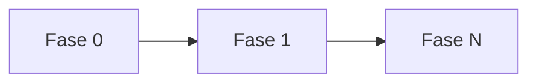

# TDD-<NNN>: <Título del sistema o módulo>

| Campo | Valor |
|---|---|
| **Estado** | Borrador |
| **Versión** | 0.1 |
| **Fecha** | <AAAA-MM-DD> |
| **Autor** | <nombre> |
| **PRD de origen** | <ruta del PRD, ej.: docs/prd/PRD-001-...md> |
| **Alcance** | <todo el PRD / fase (ej.: MVP v1.0) / módulo> |
| **Prompt de origen** | "<prompt inicial del usuario>" |
| **Fuentes** | <archivos consultados y fechas de las clarificaciones> |

---

## 1. Resumen técnico

<3–5 frases: qué se construye, estilo arquitectónico, stack principal y los drivers que más pesaron en el diseño. Referenciar DT.>

## 2. Alcance técnico

### 2.1 Requisitos cubiertos
<Lista o rango de RF/RNF/RN del PRD cubiertos por este TDD.>

### 2.2 Fuera del alcance técnico
- <Lo que este diseño deliberadamente no cubre, y en qué fase/documento se tratará.>

### 2.3 Restricciones
| ID | Restricción | Origen |
|---|---|---|
| RT-01 | | <PRD / equipo / institución / legal> |

## 3. Drivers arquitectónicos

| RNF / RN | Atributo de calidad | Escenario medible | Táctica / decisión |
|---|---|---|---|
| RNF-01 | | | DT-NN |

## 4. Resumen de decisiones técnicas

> Vista rápida del registro centralizado (sección 20). El detalle, las alternativas y la justificación están solo allí.

| ID | Categoría | Decisión | Estado |
|---|---|---|---|
| DT-01 | | | Aceptada |

## 5. Visión general de la arquitectura

### 5.1 Estilo arquitectónico
<Estilo y patrón interno elegidos y cómo se aplican. Referenciar DT.>

### 5.2 Diagrama de contexto (C4 – nivel 1)
```mermaid
flowchart LR
  %% Actores, sistema y sistemas externos
```

### 5.3 Diagrama de contenedores (C4 – nivel 2)
```mermaid
flowchart LR
  %% Frontends, API, base de datos, workers, servicios externos
```

## 6. Stack tecnológico

| Capa | Tecnología | Versión | Uso | DT |
|---|---|---|---|---|
| Backend | | | | |
| Frontend | | | | |
| Base de datos | | | | |
| Pruebas | | | | |
| Infraestructura | | | | |

## 7. Estructura del proyecto

### 7.1 Repositorio
```text
<árbol de directorios de primer y segundo nivel>
```

### 7.2 Organización interna
<Responsabilidad de cada proyecto/carpeta/capa y reglas de dependencia entre ellas.>

## 8. Componentes y módulos

### 8.1 <Nombre del módulo> (`CMP-01`)
- **Responsabilidad:** 
- **Requisitos atendidos:** RF-NN, RN-NN
- **Interfaces expuestas:** <endpoints, servicios, eventos>
- **Dependencias:** <otros módulos, servicios externos>
- **Reglas de negocio implementadas:** <cómo y dónde se aplican>

## 9. Modelo de datos

### 9.1 Diagrama entidad-relación
```mermaid
erDiagram
```

### 9.2 Tablas

#### `<nombre_tabla>`
| Columna | Tipo | Nulo | Clave / restricción | Descripción |
|---|---|---|---|---|
| id | | No | PK | |

**Índices:** <lista>  
**Reglas de borrado / auditoría:** <cascada, soft delete, campos de auditoría>

### 9.3 Estrategia de migraciones y datos iniciales
<Herramienta, convención de nombres, seeds. Referenciar DT.>

## 10. Diseño de la API

### 10.1 Convenciones
- **Estilo y versionado:** 
- **Autenticación:** 
- **Formato de errores:** 
- **Paginación, filtros y ordenación:** 
- **Formatos de fecha, moneda e identificadores:** 

### 10.2 Endpoints
| ID | Método | Ruta | Descripción | Perfiles autorizados | Requisitos |
|---|---|---|---|---|---|
| API-01 | GET | | | | RF-NN |

### 10.3 Contratos de ejemplo
<Request/response de los endpoints más relevantes.>

## 11. Flujos y secuencias

### 11.1 <Nombre del flujo crítico>
```mermaid
sequenceDiagram
```

## 12. Frontend

### 12.1 Aplicaciones y rutas
| Aplicación / área | Ruta | Pantalla | Perfiles | Requisitos |
|---|---|---|---|---|
| | | | | |

### 12.2 Gestión de estado, comunicación con la API y manejo de errores
### 12.3 Diseño visual, accesibilidad y responsividad
### 12.4 Internacionalización y formatos

## 13. Seguridad y privacidad

### 13.1 Autenticación
### 13.2 Autorización (matriz perfil × recurso)
| Recurso / acción | <Perfil 1> | <Perfil 2> | <Perfil 3> |
|---|---|---|---|
| | ✅ | ❌ | |

### 13.3 Protección de datos y cumplimiento legal
### 13.4 Auditoría
### 13.5 Gestión de secretos y protecciones web

## 14. Integraciones externas

| Integración | Proveedor | Propósito | Protocolo | Manejo de fallos | DT |
|---|---|---|---|---|---|
| | | | | | |

## 15. Procesos en segundo plano y tareas programadas

| ID | Tarea | Disparador / frecuencia | Descripción | Idempotencia / reintentos | Requisitos |
|---|---|---|---|---|---|
| JOB-01 | | | | | |

## 16. Observabilidad

- **Logs:** 
- **Métricas:** 
- **Trazas:** 
- **Errores y alertas:** 
- **Health checks:** 

## 17. Estrategia de pruebas

| Nivel | Herramientas | Qué cubre | Criterio / cobertura | DT |
|---|---|---|---|---|
| Unitarias | | | | |
| Integración | | | | |
| E2E | | | | |

<Cómo se verifican los criterios de aceptación (Gherkin) del PRD; datos de prueba; ejecución en CI.>

## 18. Infraestructura, despliegue y CI/CD

### 18.1 Entornos
| Entorno | Propósito | Hosting | Datos |
|---|---|---|---|
| Local | | | |

### 18.2 Diagrama de despliegue
```mermaid
flowchart TB
```

### 18.3 Pipeline de CI/CD
<Etapas, disparadores, gates de calidad.>

### 18.4 Backups y recuperación
<Frecuencia, retención, RPO/RTO, prueba de restauración.>

## 19. Rendimiento y escalabilidad

<Volúmenes esperados, tácticas para cumplir los RNF de desempeño y disponibilidad, límites conocidos.>

## 20. Registro de decisiones técnicas

> Fuente única de verdad de las decisiones técnicas del proyecto. Las demás secciones solo referencian estos IDs.

### DT-01: <Título de la decisión>
| Campo | Valor |
|---|---|
| **Categoría** | <ARQ / LNG / FRW / DAT / SEG / INT / ASY / LIB / QA / INF / OBS / CNV> |
| **Estado** | Aceptada · Propuesta · Sustituida por DT-NN |
| **Fecha** | <AAAA-MM-DD> |
| **Requisitos relacionados** | RNF-NN, RF-NN |
| **Fuente** | Clarificación con usuario (AAAA-MM-DD) · Decisión preexistente (<archivo>) |

**Contexto:** <problema o driver que obliga a decidir.>

**Opciones consideradas:**
1. **<Opción A>** — pros / contras.
2. **<Opción B>** — pros / contras.

**Decisión:** <opción elegida.>

**Justificación:** <por qué, en relación con los drivers y restricciones.>

**Consecuencias:** <positivas, negativas y lo que implica para otras decisiones.>

## 21. Matriz de trazabilidad

| Requisito | Componente(s) | Endpoint(s) / pantalla(s) | Tabla(s) | Prueba(s) |
|---|---|---|---|---|
| RF-01 | CMP-NN | API-NN | | |

## 22. Roadmap de implementación

> Orden de construcción derivado del plan de entregas del PRD y de las dependencias técnicas entre componentes. Sin fechas salvo que el usuario las haya informado.

### 22.1 Visión general

| Fase | Nombre | Fase del PRD | Requisitos | Versión / tag | Cambio OpenSpec sugerido |
|---|---|---|---|---|---|
| 0 | Fundación técnica | — | <RNF/RF transversales> | <v0.1.0> | <nombre-kebab> |
| 1 | <Nombre> | <MVP v1.0> | <RF-NN a RF-NN, HU-NN> | <v1.0.0> | <nombre-kebab> |
| N | Despliegue / entrega | — | <restricciones de infraestructura> | — | <nombre-kebab> |



### 22.2 Fase <N> — <Nombre> (`<tag>`)
- **Objetivo:** <resultado observable de la fase.>
- **Alcance:** <RF / RN / HU cubiertos.>
- **Entregables:** <componentes (CMP), endpoints (API), tablas, jobs (JOB), pantallas y archivos de infraestructura, con las DT aplicadas.>
- **Dependencias:** <fases o incrementos previos.>
- **Criterio de conclusión:** <pruebas y escenarios Gherkin que deben pasar; demostración esperada.>

<Si una fase es grande, dividirla en incrementos en una tabla: incremento, alcance, componentes/endpoints/tablas, pruebas que lo cierran.>

### 22.3 Reglas del roadmap
<Condiciones para cerrar un incremento (pruebas, trazabilidad), restricciones temporales (ej.: créditos de nube), qué queda fuera del roadmap.>

## 23. Riesgos técnicos y deuda técnica

| Riesgo / deuda | Probabilidad | Impacto | Mitigación / plan |
|---|---|---|---|
| | | | |

## 24. Supuestos

- [SUPUESTO] 

## 25. Preguntas abiertas

| # | Pregunta | DT afectada | Responsable | Estado |
|---|---|---|---|---|
| 1 | | | | Abierta |

## 26. Glosario técnico

| Término | Definición |
|---|---|
| | |
