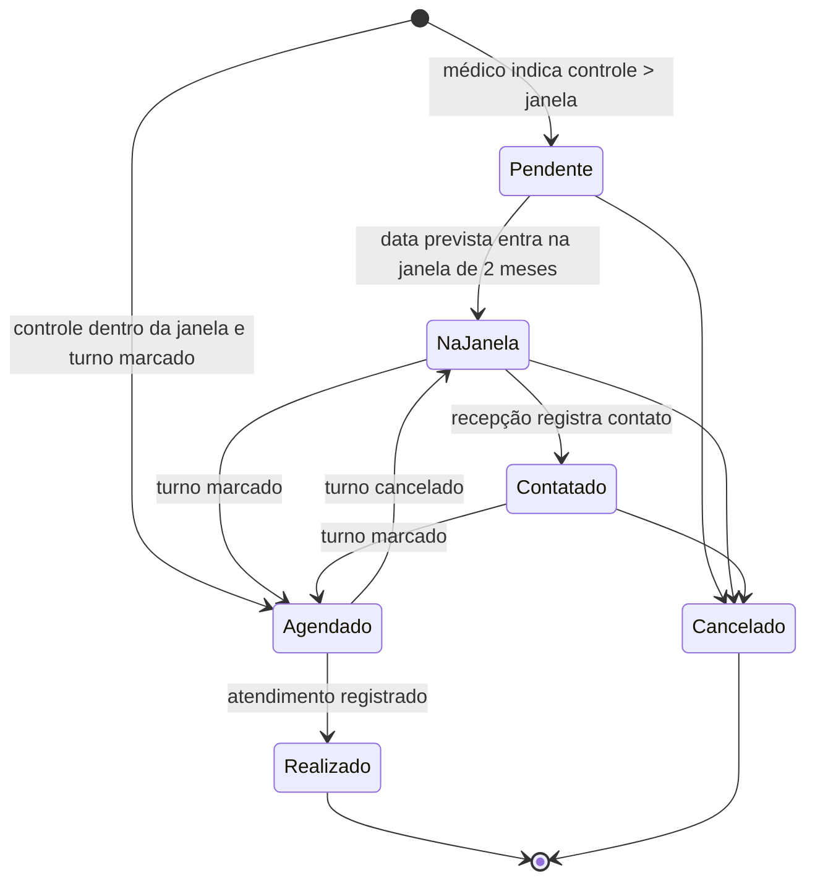

# PRD-001: Plataforma de Gestão de Clínica Médica

| Campo | Valor |
|---|---|
| **Status** | Aprovado (2026-11-18) |
| **Versão** | 1.2 |
| **Data** | 2026-11-18 (revisado em 2026-11-24 e 2026-11-25) |
| **Autor** | Leo Fzp (gerado com apoio da skill `generate-prd`) |
| **Prompt de origem** | "lea el archivo @docs/Entrevista.md y cree un PRD basado en ella." |
| **Fontes** | `docs/Entrevista.md` (entrevista com Patricia); `README.md`; clarificações com o usuário em 2026-11-18, 2026-11-24 e 2026-11-25 |

---

## 1. Resumo executivo

A clínica perde o acompanhamento de pacientes que precisam voltar para controle em mais de 2 meses, porque a agenda dos médicos só abre 2 meses à frente e o sistema atual não registra nem sinaliza esses retornos futuros. Este PRD especifica uma plataforma web que cobre cadastro de pacientes, prontuário (história clínica), agenda com reserva on-line pelo paciente, **acompanhamento de controles futuros**, cobrança com cálculo automático e relatórios financeiros. O MVP (v1) foca no acompanhamento de controles futuros, que é a principal dor do negócio. _Fonte: Entrevista §1, §3._

## 2. Contexto e problema

### 2.1 Situação atual
- A clínica usa um sistema pouco intuitivo para o usuário. _Fonte: Entrevista §1._
- Regra de negócio: a agenda de cada médico fica aberta no máximo **2 meses à frente**. Se o paciente precisa voltar dentro desse período, o turno é marcado na hora. _Fonte: Entrevista §1, §3._
- O cadastro do paciente inclui dados pessoais, de contato e de convênio (obra social), e cada paciente tem uma história clínica que qualquer médico da instituição pode consultar. _Fonte: Entrevista §2._
- A cobrança é feita por atendimento, por cartão (crédito/débito) ou dinheiro, com 10 % de desconto em dinheiro. O cálculo é manual. _Fonte: Entrevista §4._
- O fechamento de caixa é consolidado manualmente em planilhas. _Fonte: Entrevista §5._

### 2.2 Problema
1. **Perda de acompanhamento de pacientes** (principal): pacientes que precisam voltar em 3 meses ou mais não podem receber turno no ato da consulta, e não existe registro nem alerta de que eles devem ser contatados quando a data se aproximar. A equipe não sabe "a quem deveria estar ligando". _Fonte: Entrevista §1, §3._
2. **Sobrecarga da equipe** com marcações que o próprio paciente poderia fazer. _Fonte: Entrevista §3._
3. **Erros de cobrança** por cálculo manual de tarifas e descontos. _Fonte: Entrevista §4._
4. **Relatórios financeiros trabalhosos e sujeitos a erro**, feitos em planilhas a partir do fechamento de caixa. _Fonte: Entrevista §5._

### 2.3 Impacto
- Pacientes deixam de voltar para controle: há risco clínico para o paciente e perda de receita para a clínica. _Fonte: Entrevista §1 ("hemos perdido el seguimiento de muchos pacientes")._
- Tempo da equipe gasto em tarefas operacionais e na consolidação de planilhas. _Fonte: Entrevista §3, §5._
- Divergências financeiras entre o que foi cobrado e o que deveria ter sido cobrado. _Fonte: Entrevista §4._

## 3. Objetivos

| ID | Objetivo | Tipo |
|---|---|---|
| OBJ-01 | Garantir que todo paciente com controle futuro (> 2 meses) fique registrado e seja contatado quando a data entrar na janela da agenda | Negócio / usuário |
| OBJ-02 | Permitir que o paciente marque, cancele e reprograme seus turnos pela web, reduzindo a carga da equipe | Usuário |
| OBJ-03 | Eliminar erros no cálculo de cobranças com tarifas e descontos automáticos | Negócio |
| OBJ-04 | Gerar relatórios financeiros e operacionais sem consolidação manual em planilhas | Negócio |
| OBJ-05 | Oferecer uma experiência de uso mais intuitiva que a do sistema atual | Usuário |

### 3.1 Não objetivos
- Substituir o prontuário eletrônico por um sistema clínico completo (prescrição eletrônica, laudos, imagens).
- Processar pagamentos dentro do sistema (gateway de pagamento).
- Faturar para convênios (obras sociais) em v1.

## 4. Usuários e stakeholders

### 4.1 Personas
| Persona | Descrição | Necessidades principais | Frequência de uso |
|---|---|---|---|
| **Médico** | Profissional que atende os pacientes | Registrar e consultar a história clínica; indicar o próximo controle | Diária |
| **Funcionário de recepção** | Equipe que gerencia turnos, contatos e caixa | Ver quem está na janela de turno para avisar; marcar turnos; registrar cobranças; fechar o caixa | Diária |
| **Administrador / gestora** (ex.: Patricia) | Responsável pela clínica | Configurar tarifas e agendas; acompanhar faturamento e atendimentos | Diária / semanal |
| **Paciente** | Pessoa atendida (ou a ser atendida) pela clínica | Cadastrar-se e marcar, cancelar e reprogramar turnos sozinho pela web | Eventual |

### 4.2 Stakeholders
| Stakeholder | Interesse / responsabilidade |
|---|---|
| Direção da clínica | Retenção de pacientes, receita, controle financeiro |
| Corpo médico | Continuidade do tratamento e acesso à história clínica |
| Equipe de recepção | Menos trabalho manual e uma lista clara de pacientes para contatar |
| Pacientes | Acesso fácil a turnos e continuidade do cuidado |

## 5. Escopo

### 5.1 Dentro do escopo
- Cadastro de pacientes e de contatos de familiares.
- História clínica com registro do **próximo controle**.
- Agenda de médicos com janela de 2 meses.
- **Acompanhamento de controles futuros** com lista de trabalho para a recepção (v1).
- Portal do paciente com autocadastro, login e recuperação de senha, para marcar, cancelar e reprogramar turnos.
- Registro de cobranças com cálculo automático (tarifa por tipo de atendimento e desconto em dinheiro).
- Fechamento de caixa diário e relatórios financeiros e operacionais com exportação.
- Gestão de usuários e perfis de acesso.

### 5.2 Fora do escopo
- Migração de dados do sistema atual: a plataforma começa do zero. _Fonte: Clarificação com usuário._
- Faturamento para obras sociais/convênios em v1 (avaliar em v2). _Fonte: Clarificação com usuário._
- Pagamento on-line ou integração com gateway/maquininha de cartão. _Fonte: Clarificação com usuário._
- Avisos automáticos ao paciente em v1 (previstos para v2). _Fonte: Clarificação com usuário._
- Múltiplas unidades (sedes): a clínica opera em uma única unidade. _Fonte: Clarificação com usuário._
- Prescrição eletrônica, laudos e telemedicina.
- Visualização da história clínica ou dos próximos controles pelo paciente no portal.
- Adequação à LGPD (consentimento, política de privacidade, direitos do titular): não considerada neste projeto, por se tratar de um trabalho acadêmico (TCC). _Fonte: Clarificação com usuário (2026-11-25)._

## 6. Requisitos funcionais

| ID | Requisito | Prioridade (MoSCoW) | Fonte |
|---|---|---|---|
| **Pacientes e história clínica** | | | |
| RF-01 | O sistema deve permitir cadastrar e editar pacientes com: nome, sobrenome, sexo (Homem ou Mulher), data de nascimento, CPF (único), telefone, e-mail (único), telefone de contato de familiar, obra social, bairro e endereço (rua, número, casa/apartamento). | Must | Entrevista §2; Clarificação com usuário (2026-11-24) |
| RF-02 | O sistema deve impedir o cadastro ou a edição de um paciente com CPF ou e-mail já registrado para outro paciente, informando qual dado está duplicado. No autocadastro pelo portal, a mensagem é genérica e não revela o dado duplicado (RN-13, RN-16). | Must | Entrevista §2; Clarificação com usuário (2026-11-24) |
| RF-02a | O sistema deve calcular e exibir a idade atual do paciente a partir da data de nascimento, sem armazená-la, e não deve aceitar data de nascimento futura. | Must | Clarificação com usuário (2026-11-24) |
| RF-03 | O sistema deve permitir buscar pacientes por nome, sobrenome ou CPF. | Must | Entrevista §2 |
| RF-04 | O sistema deve permitir que o médico registre, a cada consulta, uma evolução na história clínica com: motivo, observações, medicamentos e indicações. | Must | Entrevista §2 |
| RF-05 | O sistema deve permitir que qualquer médico da instituição leia a história clínica completa do paciente em ordem cronológica. | Must | Entrevista §2 |
| RF-06 | O sistema deve restringir a leitura e a edição do conteúdo clínico ao perfil Médico. | Must | Clarificação com usuário |
| **Acompanhamento de controles futuros** | | | |
| RF-07 | O sistema deve permitir que o médico, ao registrar a consulta, indique o próximo controle como um prazo ("em N meses/semanas") ou uma data aproximada, e o sistema deve calcular a data prevista. | Must | Entrevista §1, §2; Clarificação com usuário |
| RF-08 | Se a data prevista do controle estiver dentro da janela de agenda aberta (≤ 2 meses), o sistema deve sugerir marcar o turno imediatamente. | Should | Entrevista §1 |
| RF-09 | O sistema deve manter cada controle futuro com um status: *Pendente* (fora da janela), *Na janela* (a contatar), *Contatado*, *Agendado*, *Realizado* ou *Cancelado*. | Must | Entrevista §1, §3 |
| RF-10 | O sistema deve mudar automaticamente um controle de *Pendente* para *Na janela* quando sua data prevista entrar nos 2 meses de agenda aberta. | Must | Entrevista §3; Clarificação com usuário |
| RF-11 | O sistema deve exibir à recepção uma lista de trabalho com os controles *Na janela* e *Contatado* sem turno, ordenada por data prevista e com os dados de contato do paciente (telefone, e-mail, contato de familiar). | Must | Entrevista §3 |
| RF-12 | O sistema deve permitir registrar cada tentativa de contato (data, funcionário, canal e resultado) em um controle. | Must | Entrevista §3 |
| RF-13 | O sistema deve vincular o controle ao turno quando ele for marcado (pela recepção ou pelo portal), mudando o status para *Agendado*; quando o paciente for atendido, o status deve mudar para *Realizado*. | Must | Entrevista §1, §3 |
| RF-14 | O sistema deve permitir consultar todos os controles futuros (inclusive os *Pendentes*), com filtros por médico, status e intervalo de datas. | Should | Entrevista §3 |
| RF-15 | O sistema deve destacar na lista os controles cuja data prevista já passou sem turno marcado. | Should | Entrevista §1 |
| **Agenda e turnos** | | | |
| RF-16 | O sistema deve permitir configurar a agenda de cada médico (dias, horários e duração do turno). | Must | Entrevista §3 |
| RF-17 | O sistema deve impedir marcar turnos com mais de 2 meses de antecedência. O limite deve ser um parâmetro configurável pelo administrador, com valor padrão de 2 meses. | Must | Entrevista §1, §3 |
| RF-18 | O sistema deve permitir que a recepção marque, cancele e reprograme turnos para qualquer paciente. | Must | Entrevista §3 |
| RF-19 | O sistema deve impedir dois turnos no mesmo horário para o mesmo médico. | Must | Entrevista §3 |
| RF-20 | O sistema deve associar a cada turno um tipo de atendimento (usado para calcular a tarifa). | Must | Entrevista §4; Clarificação com usuário |
| **Portal do paciente** | | | |
| RF-21 | O sistema deve permitir que o paciente crie uma conta no portal com e-mail e senha e acesse o portal com essas credenciais. Após a confirmação do e-mail, a conta deve ser vinculada ao cadastro de paciente que tem o mesmo e-mail; se não houver cadastro com esse e-mail, o paciente deve informar os dados do RF-01 e o sistema deve criar o cadastro (RN-14, RN-16). | Must | Entrevista §3; Clarificação com usuário (2026-11-25) |
| RF-22 | O sistema deve permitir que o paciente marque um turno escolhendo médico, data e horário livre dentro da janela de agenda aberta. | Must | Entrevista §3 |
| RF-23 | O sistema deve permitir que o paciente cancele ou reprograme seus turnos com uma antecedência mínima configurável pelo administrador (padrão: 24 h). | Must | Clarificação com usuário |
| RF-24 | O sistema deve permitir que o paciente recupere sua senha por meio de um link enviado ao e-mail da conta, válido por 1 hora e de uso único (RN-15). | Must | Entrevista §3; Clarificação com usuário (2026-11-25) |
| **Cobrança** | | | |
| RF-25 | O sistema deve permitir que o administrador mantenha uma tabela de tarifas por tipo de atendimento. | Must | Entrevista §4; Clarificação com usuário |
| RF-26 | O sistema deve calcular automaticamente o valor de cada atendimento a partir da tarifa do tipo de atendimento do turno. | Must | Entrevista §4 |
| RF-27 | O sistema deve aplicar automaticamente 10 % de desconto quando o meio de pagamento for dinheiro. O percentual deve ser configurável pelo administrador. | Must | Entrevista §4 |
| RF-28 | O sistema deve registrar cada cobrança com: paciente, atendimento, médico, tipo de atendimento, meio de pagamento (crédito, débito ou dinheiro), valor bruto, desconto, valor final, data/hora e funcionário. | Must | Entrevista §4, §5 |
| RF-29 | O sistema deve permitir estornar uma cobrança com justificativa, sem apagar o registro original. | Should | Entrevista §4 |
| **Relatórios e caixa** | | | |
| RF-30 | O sistema deve gerar o fechamento de caixa diário com totais por meio de pagamento e total de descontos aplicados. | Must | Entrevista §5; Clarificação com usuário |
| RF-31 | O sistema deve exibir o faturamento e o número de pacientes atendidos por dia. | Must | Entrevista §5 |
| RF-32 | O sistema deve exibir o faturamento e os atendimentos totalizados por semana e por mês. | Must | Entrevista §4; Clarificação com usuário |
| RF-33 | O sistema deve permitir filtrar e agrupar os relatórios por médico e por tipo de atendimento. | Should | Clarificação com usuário |
| RF-34 | O sistema deve permitir exportar os relatórios para CSV/Excel. | Should | Clarificação com usuário |
| RF-35 | O sistema deve exibir indicadores de acompanhamento: controles *Na janela*, *Contatados*, *Agendados* e vencidos sem turno. | Should | Entrevista §1, §3 |
| **Acesso e usuários** | | | |
| RF-36 | O sistema deve controlar o acesso por perfis: Administrador, Médico, Recepção e Paciente. | Must | Entrevista §2, §3; Clarificação com usuário |
| RF-37 | O sistema deve permitir que o administrador crie, edite e desative usuários internos. | Must | Clarificação com usuário |
| **Fase 2** | | | |
| RF-38 | O sistema deve enviar avisos automáticos ao paciente quando seu controle entrar na janela de agenda. O canal está `[POR DEFINIR]`. | Won't (v1) / Must (v2) | Clarificação com usuário |
| RF-39 | O sistema deve permitir registrar a cobertura de obra social e o faturamento ao convênio. | Won't (v1) | Clarificação com usuário |

## 7. Histórias de usuário e critérios de aceitação

### HU-01: Indicar o próximo controle na consulta
**Como** médico, **quero** registrar na história clínica quando o paciente deve voltar, **para** que a clínica não perca o acompanhamento mesmo que a agenda ainda não esteja aberta.

**Requisitos relacionados:** RF-04, RF-07, RF-08, RF-09

```gherkin
Cenário: Controle fora da janela de agenda
  Dado que estou registrando a consulta do paciente "Ana Souza" em 2026-11-18
  Quando indico "próximo controle em 6 meses"
  Então o sistema cria um controle com data prevista 2027-05-18 e status "Pendente"
  E o controle fica visível na história clínica do paciente

Cenário: Controle dentro da janela de agenda
  Dado que estou registrando uma consulta em 2026-11-18
  Quando indico "próximo controle em 1 mês"
  Então o sistema sugere marcar um turno em uma data próxima de 2026-12-18
```

### HU-02: Lista de pacientes para contatar
**Como** funcionário de recepção, **quero** ver os pacientes cujo controle já pode ser agendado, **para** saber a quem ligar e marcar o turno.

**Requisitos relacionados:** RF-10, RF-11, RF-12, RF-15

```gherkin
Cenário: Controle entra na janela
  Dado um controle "Pendente" com data prevista 2027-05-18 e janela de 2 meses
  Quando a data atual chega a 2027-03-18
  Então o controle passa a "Na janela" e aparece na lista de trabalho com o telefone, o e-mail e o contato de familiar do paciente

Cenário: Registrar tentativa de contato
  Dado um controle "Na janela" na lista
  Quando registro uma ligação com o resultado "não atendeu"
  Então a tentativa fica gravada com data, funcionário e resultado
  E o controle continua na lista

Cenário: Controle vencido
  Dado um controle sem turno cuja data prevista já passou
  Então o controle aparece destacado como vencido na lista
```

### HU-03: Fechar o ciclo do controle
**Como** funcionário de recepção, **quero** que o controle seja vinculado ao turno marcado, **para** que ele saia da lista de pendências.

**Requisitos relacionados:** RF-13, RF-18

```gherkin
Cenário: Turno marcado para um controle
  Dado um controle "Contatado" do paciente "Ana Souza"
  Quando marco um turno para ela com o médico responsável
  Então o controle passa a "Agendado" e sai da lista de trabalho
  Quando o atendimento é registrado
  Então o controle passa a "Realizado"
```

### HU-04: Consultar a história clínica de outro médico
**Como** médico, **quero** ler tudo o que foi feito com o paciente por outros profissionais, **para** entender o caso e dar continuidade ao tratamento.

**Requisitos relacionados:** RF-05, RF-06

```gherkin
Cenário: Médico lê a história clínica
  Dado que a paciente "Ana Souza" foi atendida pelo Dr. A
  Quando o Dr. B abre a história clínica dela
  Então ele vê todas as evoluções em ordem cronológica

Cenário: Recepção não acessa conteúdo clínico
  Dado que estou logado com o perfil Recepção
  Quando abro a ficha da paciente "Ana Souza"
  Então vejo os dados pessoais e a data do próximo controle
  Mas não vejo as evoluções clínicas
```

### HU-05: Cadastrar paciente
**Como** funcionário de recepção, **quero** cadastrar os dados pessoais e de contato do paciente, **para** poder identificá-lo e contatá-lo.

**Requisitos relacionados:** RF-01, RF-02, RF-02a, RF-03

```gherkin
Cenário: CPF duplicado
  Dado que já existe um paciente com CPF 123.456.789-00
  Quando tento cadastrar outro paciente com o mesmo CPF
  Então o sistema bloqueia o cadastro e mostra o paciente existente

Cenário: E-mail duplicado
  Dado que já existe um paciente com e-mail "ana@exemplo.com"
  Quando tento cadastrar outro paciente com o mesmo e-mail
  Então o sistema bloqueia o cadastro e indica que o e-mail já está em uso

Cenário: Telefone compartilhado por familiares
  Dado que já existe um paciente com telefone "(11) 98765-4321"
  Quando cadastro outro paciente da mesma família com o mesmo telefone
  Então o sistema permite o cadastro

Cenário: Idade calculada
  Dado que cadastro a paciente "Ana Souza" com data de nascimento 1990-05-10
  Quando abro a ficha dela em 2026-11-24
  Então o sistema exibe a idade de 36 anos
```

### HU-06: Marcar turno pela web
**Como** paciente, **quero** marcar meu turno pelo portal, **para** não depender de ligar para a clínica.

**Requisitos relacionados:** RF-13, RF-17, RF-19, RF-22

```gherkin
Cenário: Marcação dentro da janela
  Dado que estou logado no portal
  Quando escolho um médico, uma data dentro dos próximos 2 meses e um horário livre
  Então o turno é confirmado e o horário deixa de estar disponível

Cenário: Data fora da janela
  Dado que estou logado no portal
  Quando procuro horários com mais de 2 meses de antecedência
  Então o sistema não oferece horários disponíveis

Cenário: Marcação vinculada a um controle
  Dado que tenho um controle "Na janela" com o Dr. A
  Quando marco um turno com o Dr. A pelo portal
  Então o controle passa a "Agendado"
```

### HU-07: Cancelar ou reprogramar pela web
**Como** paciente, **quero** cancelar ou reprogramar meu turno, **para** liberar o horário quando não puder ir.

**Requisitos relacionados:** RF-23

```gherkin
Cenário: Cancelamento dentro do prazo
  Dado que a antecedência mínima configurada é de 24 h
  E que tenho um turno daqui a 3 dias
  Quando cancelo o turno
  Então o turno é cancelado e o horário fica livre

Cenário: Cancelamento fora do prazo
  Dado que a antecedência mínima configurada é de 24 h
  E que tenho um turno daqui a 10 horas
  Quando tento cancelar
  Então o sistema informa que preciso entrar em contato com a clínica
```

### HU-08: Cobrança automática
**Como** funcionário de recepção, **quero** que o sistema calcule o valor do atendimento, **para** evitar erros de cobrança.

**Requisitos relacionados:** RF-20, RF-25, RF-26, RF-27, RF-28

```gherkin
Cenário: Pagamento em dinheiro
  Dado que a tarifa de "Consulta" é R$ 200,00
  Quando registro a cobrança de uma "Consulta" paga em dinheiro
  Então o sistema calcula desconto de R$ 20,00 e valor final de R$ 180,00

Cenário: Pagamento com cartão
  Dado que a tarifa de "Consulta" é R$ 200,00
  Quando registro a cobrança paga com cartão de débito
  Então o valor final é R$ 200,00, sem desconto
```

### HU-09: Fechamento de caixa e relatórios
**Como** administradora, **quero** ver o faturamento e os atendimentos por dia, semana e mês, **para** acompanhar a clínica sem montar planilhas.

**Requisitos relacionados:** RF-30, RF-31, RF-32, RF-33, RF-34

```gherkin
Cenário: Fechamento de caixa diário
  Dado que hoje houve cobranças em dinheiro, crédito e débito
  Quando gero o fechamento de caixa do dia
  Então vejo o total por meio de pagamento, o total de descontos e o total geral

Cenário: Exportação
  Dado o relatório mensal filtrado por médico
  Quando clico em "Exportar"
  Então baixo um arquivo CSV/Excel com os mesmos dados exibidos
```

### HU-10: Configuração da clínica
**Como** administradora, **quero** configurar tarifas, agendas, usuários e parâmetros, **para** adaptar o sistema às regras da clínica.

**Requisitos relacionados:** RF-16, RF-17, RF-23, RF-25, RF-27, RF-36, RF-37

```gherkin
Cenário: Alterar tarifa
  Dado que a tarifa de "Controle" é R$ 150,00
  Quando altero para R$ 170,00
  Então novas cobranças usam R$ 170,00
  E as cobranças já registradas mantêm o valor original
```

### HU-11: Acessar o portal
**Como** paciente, **quero** criar minha conta, entrar no portal e recuperar minha senha quando a esquecer, **para** gerenciar meus turnos sem depender da clínica.

**Requisitos relacionados:** RF-21, RF-24

```gherkin
Cenário: Criar conta vinculada ao cadastro existente
  Dado que a recepção cadastrou a paciente "Ana Souza" com o e-mail "ana@exemplo.com"
  E que ela ainda não tem conta no portal
  Quando ela cria uma conta no portal com o e-mail "ana@exemplo.com" e uma senha
  Então o sistema envia um e-mail de confirmação para "ana@exemplo.com"
  E, após a confirmação, a conta fica vinculada ao cadastro de "Ana Souza"
  E ela vê no portal os turnos marcados pela clínica

Cenário: Criar conta sem cadastro prévio
  Dado que "Bruno Lima" nunca foi atendido pela clínica
  Quando ele cria uma conta no portal com um e-mail não cadastrado
  Então o sistema pede os dados do cadastro de paciente (RF-01)
  E, após a confirmação do e-mail, o cadastro de "Bruno Lima" é criado e vinculado à conta

Cenário: CPF já cadastrado com outro e-mail
  Dado que existe um paciente com CPF 123.456.789-00 e e-mail "ana@exemplo.com"
  Quando alguém se cadastra pelo portal com esse CPF e o e-mail "outro@exemplo.com"
  Então o sistema não cria o cadastro
  E mostra uma mensagem genérica orientando a procurar a recepção, sem revelar o cadastro existente
  Quando a recepção altera o e-mail do cadastro para "outro@exemplo.com"
  Então o paciente consegue criar a conta com "outro@exemplo.com", vinculada ao cadastro existente

Cenário: E-mail que já tem conta
  Dado que já existe uma conta no portal com o e-mail "ana@exemplo.com"
  Quando alguém tenta criar outra conta com esse e-mail
  Então o sistema mostra a mesma mensagem genérica do cadastro bem-sucedido
  Mas não cria uma segunda conta

Cenário: Login com credenciais inválidas
  Dado que tenho conta no portal
  Quando informo uma senha incorreta
  Então o sistema nega o acesso sem indicar qual dado está errado

Cenário: Recuperar senha
  Dado que esqueci minha senha
  Quando solicito a recuperação informando meu e-mail
  Então recebo um e-mail com um link para definir uma nova senha
  E, após definir a nova senha, consigo entrar no portal
  E o link não pode ser usado novamente

Cenário: Link de recuperação vencido
  Dado que recebi um link de recuperação há mais de 1 hora
  Quando tento usá-lo
  Então o sistema informa que o link expirou e que devo solicitar um novo

Cenário: E-mail não cadastrado
  Quando solicito a recuperação com um e-mail que não está cadastrado
  Então o sistema mostra a mesma mensagem de confirmação
  Mas nenhum e-mail é enviado
```

## 8. Regras de negócio

| ID | Regra | Fonte |
|---|---|---|
| RN-01 | A agenda de cada médico fica aberta no máximo 2 meses à frente (parâmetro configurável, padrão 2 meses). | Entrevista §1, §3 |
| RN-02 | Um controle entra na lista de trabalho quando sua data prevista fica dentro da janela de agenda aberta. | Entrevista §3; Clarificação com usuário |
| RN-03 | Em v1, o aviso ao paciente é feito pela recepção (contato manual); o sistema não envia mensagens. | Clarificação com usuário |
| RN-04 | A cobrança é feita por atendimento, com base na tarifa do tipo de atendimento. | Entrevista §4; Clarificação com usuário |
| RN-05 | Pagamento em dinheiro recebe 10 % de desconto; cartão de crédito ou débito não recebe desconto. | Entrevista §4 |
| RN-06 | O sistema apenas registra o pagamento; o processamento do cartão ocorre fora do sistema. | Clarificação com usuário |
| RN-07 | Somente médicos leem e editam o conteúdo clínico; qualquer médico da instituição pode lê-lo. | Entrevista §2; Clarificação com usuário |
| RN-08 | O paciente só pode cancelar ou reprogramar pelo portal respeitando a antecedência mínima configurada (padrão 24 h). | Clarificação com usuário |
| RN-09 | O CPF identifica o paciente de forma única. O e-mail também é único por paciente. O telefone pode ser compartilhado entre pacientes (ex.: membros da mesma família). | Entrevista §2; Clarificação com usuário (2026-11-24) |
| RN-10 | A obra social é apenas um dado cadastral em v1; não altera o valor cobrado. | Clarificação com usuário |
| RN-11 | Cobranças não são apagadas: correções são feitas por estorno com justificativa. | Entrevista §4 |
| RN-12 | A idade do paciente é sempre derivada da data de nascimento e da data atual; não é informada manualmente. | Clarificação com usuário (2026-11-24) |
| RN-13 | As respostas do portal em login, criação de conta e recuperação de senha não revelam se um e-mail está cadastrado nem qual credencial está incorreta. | Clarificação com usuário (2026-11-25) |
| RN-14 | O e-mail é o dado de vínculo entre a conta do portal e o cadastro do paciente. Cada paciente tem no máximo uma conta, e o vínculo só ocorre após a confirmação do e-mail. | Clarificação com usuário (2026-11-25) |
| RN-15 | O link de recuperação de senha vale por 1 hora e só pode ser usado uma vez. | Clarificação com usuário (2026-11-25) |
| RN-16 | Uma pessoa sem cadastro pode se cadastrar como paciente pelo portal, informando os dados do RF-01. As regras de unicidade (RN-09) valem também no portal; se o CPF já pertencer a outro cadastro, o portal mostra uma mensagem genérica orientando a procurar a recepção, sem revelar o cadastro existente (RN-13). | Clarificação com usuário (2026-11-25) |
| RN-17 | O e-mail de um cadastro de paciente existente só pode ser alterado pela recepção; o paciente não altera o e-mail pelo portal. | Clarificação com usuário (2026-11-25) |

## 9. Fluxos principais

### 9.1 Acompanhamento de controle futuro (v1)
1. O médico registra a consulta e indica o próximo controle (ex.: "6 meses").
2. Se a data estiver dentro da janela, o sistema sugere marcar o turno na hora (fim do fluxo).
3. Se estiver fora da janela, o controle fica *Pendente*.
4. Quando a data prevista entra na janela de 2 meses, o controle passa a *Na janela* e aparece na lista da recepção.
5. A recepção contata o paciente e registra cada tentativa (*Contatado*).
6. O turno é marcado pela recepção ou pelo paciente no portal, e o controle passa a *Agendado*.
7. No atendimento, o controle passa a *Realizado*, e o médico pode indicar um novo controle (volta ao passo 1).



### 9.2 Marcação pelo portal
1. O paciente faz login.
2. Escolhe médico e data (somente dentro da janela) e vê os horários livres.
3. Confirma o turno; se houver controle *Na janela*/*Contatado* com o mesmo médico, ele é vinculado.

### 9.3 Atendimento e cobrança
1. O paciente é atendido; o turno tem um tipo de atendimento.
2. A recepção registra a cobrança e escolhe o meio de pagamento.
3. O sistema calcula a tarifa e o desconto e grava a cobrança.
4. No fim do dia, a recepção gera o fechamento de caixa.

### 9.4 Criação de conta e recuperação de senha no portal
1. O paciente cria a conta informando e-mail e senha.
2. O sistema envia um e-mail de confirmação; a mensagem exibida é sempre a mesma, exista ou não conta com esse e-mail (RN-13).
3. Se não existir cadastro de paciente com esse e-mail, o paciente informa os dados do RF-01 (RN-16).
4. Ao confirmar o e-mail, a conta é vinculada ao cadastro existente com o mesmo e-mail ou ao cadastro criado no passo 3 (RN-14).
5. Para recuperar a senha, o paciente informa o e-mail e recebe um link válido por 1 hora e de uso único (RN-15).

## 10. Modelo de dados conceitual

| Entidade | Atributos principais | Relações |
|---|---|---|
| Paciente | nome, sobrenome, sexo (Homem/Mulher), data de nascimento, idade (calculada), CPF (único), telefone, e-mail (único), telefone de familiar, obra social, bairro, endereço | 1–N Turno, 1–N Evolução, 1–N Controle, 0–1 Conta de usuário |
| Usuário | login (e-mail, no caso do perfil Paciente), senha (hash), perfil (Administrador, Médico, Recepção, Paciente), ativo, e-mail confirmado | 0–1 Médico, 0–1 Paciente |
| Médico | nome, especialidade, registro profissional | 1–N Agenda, 1–N Turno, 1–N Evolução |
| Agenda | médico, dia da semana, horário início/fim, duração do turno | N–1 Médico |
| Tipo de atendimento | nome, tarifa vigente | 1–N Turno |
| Turno | data/hora, médico, paciente, tipo de atendimento, status, origem (recepção/portal) | N–1 Paciente, N–1 Médico, 0–1 Controle, 0–1 Cobrança |
| Evolução (história clínica) | data, médico, motivo, observações, medicamentos, indicações | N–1 Paciente, N–1 Médico, 0–1 Controle gerado |
| Controle futuro | data prevista, médico, status, evolução de origem | N–1 Paciente, 0–1 Turno, 1–N Tentativa de contato |
| Tentativa de contato | data/hora, funcionário, canal, resultado, observação | N–1 Controle |
| Cobrança | valor bruto, desconto, valor final, meio de pagamento, data/hora, funcionário, estornada, justificativa | 1–1 Turno |
| Fechamento de caixa | data, totais por meio de pagamento, total de descontos, funcionário | 1–N Cobrança |
| Parâmetros | janela de agenda (meses), % desconto em dinheiro, antecedência mínima de cancelamento | — |

## 11. Requisitos não funcionais

> Os valores numéricos desta seção são **propostas técnicas** da equipe de produto e devem ser validados com a clínica (ver Perguntas em aberto nº 2).
>
> Os requisitos RNF-06 (desempenho), RNF-07 (disponibilidade) e RNF-08 (backup) foram removidos na revisão de 2026-11-25 (clarificação com o usuário). Os IDs não são reutilizados, para preservar a rastreabilidade com documentos derivados (ex.: TDD-001).

| ID | Categoria | Requisito | Métrica / critério |
|---|---|---|---|
| RNF-01 | Segurança e privacidade | Dados pessoais e de saúde devem ter acesso mínimo por perfil. | Conteúdo clínico acessível apenas ao perfil Médico (RF-06) |
| RNF-02 | Segurança | Senhas armazenadas com hash forte; comunicação somente por HTTPS. | 100 % do tráfego em TLS |
| RNF-03 | Auditoria e rastreabilidade | Registrar quem consultou ou alterou histórias clínicas, cobranças e controles. | Log com usuário, ação e data/hora, retido por no mínimo 5 anos |
| RNF-04 | Usabilidade | Interface mais intuitiva que a atual; tarefas principais em poucos passos. | Marcar um turno em ≤ 3 telas; lista de controles acessível em 1 clique da tela inicial |
| RNF-05 | Usabilidade / acessibilidade | Portal do paciente responsivo (celular e computador). | Funcional em telas a partir de 360 px |
| RNF-09 | Idioma | A interface deve estar em português do Brasil (pt-BR), com datas, números e telefones no formato brasileiro e valores monetários em real (R$). | 100 % dos textos da interface em pt-BR; datas no formato DD/MM/AAAA; valores no formato R$ 0.000,00 |

## 12. Integrações e dependências

| Sistema / dependência | Tipo | Descrição |
|---|---|---|
| Serviço de e-mail | Externo | Confirmação de e-mail na criação de conta (RF-21) e recuperação de senha do portal (RF-24). |
| Provedor de mensagens (v2) | Externo | Avisos automáticos de controle; canal `[POR DEFINIR]` (RF-38). |
| Maquininha de cartão | Fora do sistema | Pagamento processado externamente; o sistema só registra (RN-06). |

## 13. Métricas de sucesso

> A linha de base atual não é medida pela clínica. Os objetivos numéricos devem ser definidos com a clínica após o primeiro mês de uso (ver Perguntas em aberto nº 1).

| Métrica | Linha de base | Objetivo | Objetivo associado |
|---|---|---|---|
| % de controles futuros que terminam em *Agendado* ou *Realizado* | Não medida | A definir após 1º mês | OBJ-01 |
| Nº de controles vencidos sem turno | Não medida | A definir após 1º mês (tendência de queda) | OBJ-01 |
| % de turnos marcados pelo portal | 0 % (não existe portal) | A definir após 1º mês | OBJ-02 |
| Nº de cobranças estornadas por erro de cálculo | Não medida | A definir após 1º mês | OBJ-03 |
| Tempo para fechar o caixa e gerar o relatório mensal | Não medido (processo manual em planilhas) | A definir após 1º mês | OBJ-04 |
| Satisfação da equipe com a usabilidade (pesquisa simples) | Não medida | A definir após 1º mês | OBJ-05 |

## 14. Plano de entregas (fases)

| Fase | Conteúdo | Requisitos incluídos |
|---|---|---|
| **MVP (v1.0)** | Usuários e perfis; cadastro de pacientes; história clínica; agenda com janela de 2 meses; **acompanhamento de controles futuros** e lista de trabalho | RF-01 a RF-20, RF-36, RF-37 |
| **v1.1** | Portal do paciente (login, marcação, cancelamento e reprogramação) | RF-21 a RF-24 |
| **v1.2** | Cobrança automática, fechamento de caixa e relatórios | RF-25 a RF-35 |
| **v2** | Avisos automáticos ao paciente; faturamento para obras sociais | RF-38, RF-39 |

## 15. Riscos e mitigações

| Risco | Probabilidade | Impacto | Mitigação |
|---|---|---|---|
| Médicos não indicam o próximo controle na consulta, e a lista fica incompleta | Média | Alto | Campo de próximo controle visível no encerramento da consulta; indicador de consultas sem controle definido |
| A recepção não trabalha a lista diariamente | Média | Alto | Lista na tela inicial da recepção; indicador de controles vencidos (RF-15, RF-35) |
| Pacientes da mesma família compartilham o e-mail e são bloqueados pela regra de unicidade (RN-09) | Baixa | Médio | Cada paciente informa um e-mail próprio; o telefone pode ser compartilhado |
| E-mail cadastrado pela recepção com erro impede o vínculo da conta do portal com o cadastro do paciente (RN-14) | Média | Médio | A recepção confirma o e-mail com o paciente no cadastro e a cada atendimento |
| Paciente informa dados incorretos no autocadastro pelo portal (RN-16) | Média | Médio | A recepção revisa os dados cadastrais no primeiro atendimento |
| Dados de contato desatualizados impedem o aviso | Alta | Médio | Contato de familiar obrigatório recomendado; revisão dos dados a cada atendimento |
| Vazamento de dados de saúde | Baixa | Alto | Controle de acesso por perfil, auditoria e HTTPS (RNF-01 a RNF-03) |
| Baixa adesão dos pacientes ao portal | Média | Médio | Portal simples e responsivo; a recepção divulga o portal no atendimento |
| Marcações simultâneas no mesmo horário (portal e recepção) | Média | Médio | Bloqueio de horário em nível de transação (RF-19) |

## 16. Premissas

- O sistema começa sem dados; os pacientes são cadastrados à medida que forem atendidos. _Fonte: Clarificação com usuário._
- Há uma única unidade (sede). _Fonte: Clarificação com usuário._

## 17. Perguntas em aberto

| # | Pergunta | Responsável | Status |
|---|---|---|---|
| 1 | Quais são os objetivos numéricos das métricas de sucesso (seção 13)? Definir após medir o primeiro mês de uso. | Direção da clínica | Aberta |
| 2 | Validar os valores propostos dos requisitos não funcionais (retenção de logs de auditoria, número de telas para marcar um turno, largura mínima de tela do portal). | Direção da clínica / equipe técnica | Aberta (revisada em 2026-11-25: tempo de resposta e disponibilidade deixaram de ser requisitos) |
| 3 | `[POR DEFINIR]` Canal dos avisos automáticos em v2 (e-mail, WhatsApp, SMS). | Direção da clínica | Aberta (v2) |
| 4 | Como funcionará a cobertura de obras sociais em v2 (copagamento, faturamento ao convênio)? | Direção da clínica | Aberta (v2) |
| 5 | Em que idioma será a interface e qual moeda será usada? A entrevista está em espanhol, mas o paciente é identificado por CPF (Brasil). | Direção da clínica | Respondida (2026-11-24): interface em português do Brasil e moeda real (R$) (RNF-09). |
| 6 | O que acontece quando uma pessoa cria conta no portal com um e-mail que não pertence a nenhum paciente cadastrado (nunca atendida pela clínica)? | Direção da clínica | Respondida (2026-11-25): o portal pede os dados do RF-01 e cria o cadastro de paciente (RF-21, RN-16). |

## 18. Glossário

| Termo | Definição |
|---|---|
| Turno | Horário marcado de atendimento com um médico. |
| Controle | Consulta de retorno indicada pelo médico para acompanhar o paciente. |
| Janela de agenda | Período em que a agenda está aberta para marcação (padrão: 2 meses à frente). |
| Controle *Na janela* | Controle cuja data prevista já está dentro da janela de agenda e, portanto, pode ser agendado. |
| História clínica | Prontuário do paciente com as evoluções registradas pelos médicos. |
| Obra social | Plano ou convênio de saúde do paciente. |
| Fechamento de caixa | Consolidação diária das cobranças por meio de pagamento. |
| CPF | Documento de identificação do paciente, usado como identificador único. |
| Idade atual | Idade do paciente calculada automaticamente a partir da data de nascimento. |
| MoSCoW | Priorização: Must (obrigatório), Should (importante), Could (desejável), Won't (não nesta versão). |
