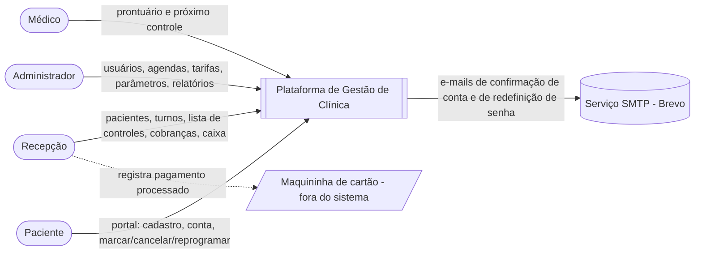
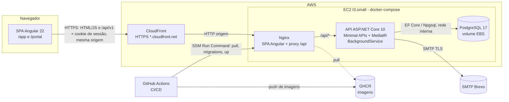
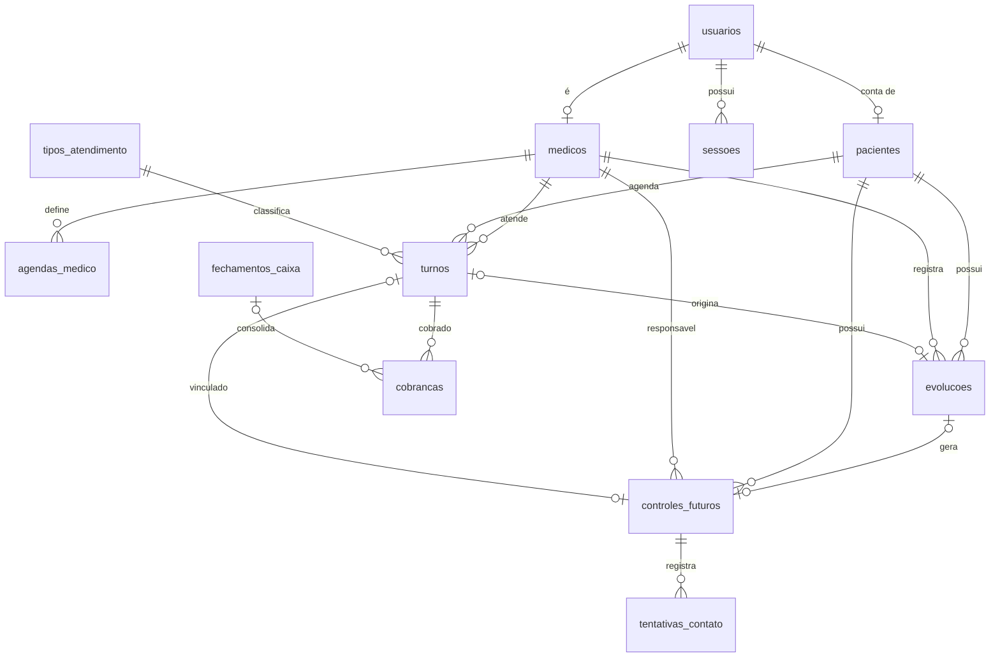
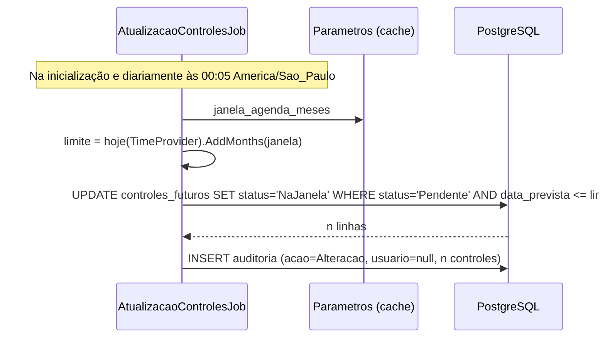
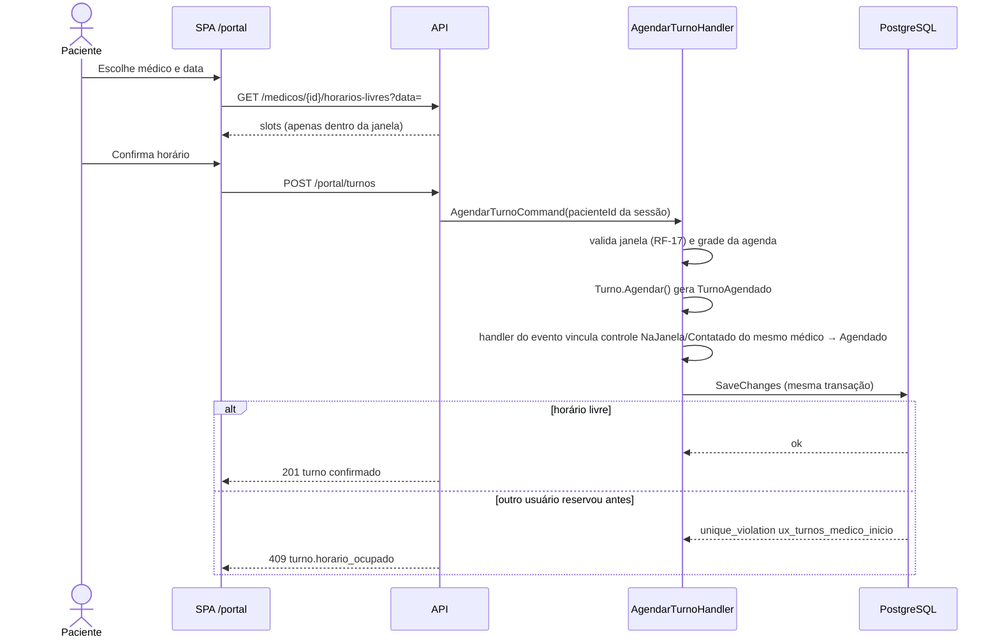
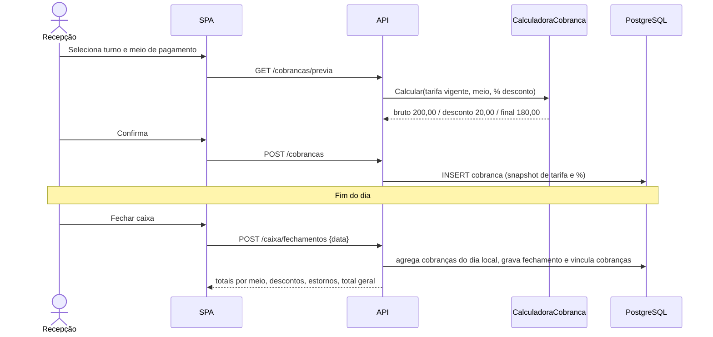
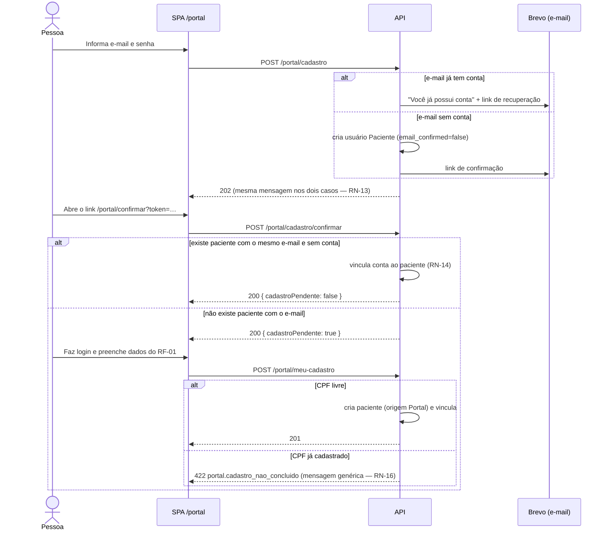
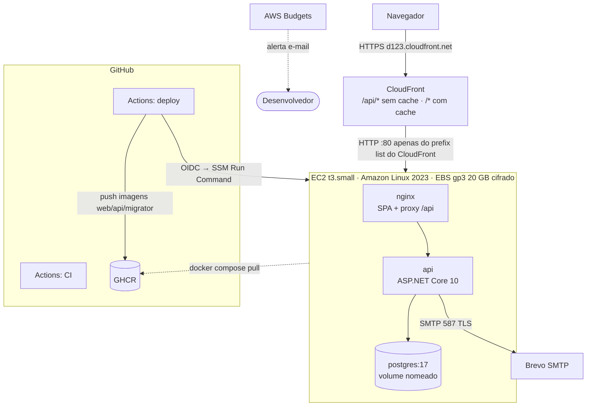
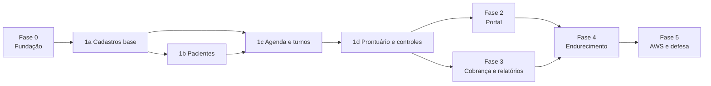

# TDD-001: Plataforma de Gestão de Clínica Médica

| Campo | Valor |
|---|---|
| **Estado** | Rascunho |
| **Versão** | 0.5 |
| **Data** | 2026-11-24 (revisado em 2026-11-25) |
| **Autor** | Leo Fzp (gerado com apoio da skill `generate-tdd`) |
| **PRD de origem** | `docs/prd/PRD-001-plataforma-gestao-clinica.md` (v1.2, aprovado) |
| **Escopo** | Fases v1.0, v1.1 e v1.2 do PRD (RF-01 a RF-37). A v2 (RF-38, RF-39) aparece apenas como ponto de extensão. |
| **Prompt de origem** | "a partir de las especificaiones presentes en @docs/prd/PRD-001-plataforma-gestao-clinica.md, cree un archivo de especificacion tecnica (tdd) centralizando las desiciones tecnicas para el desarrollo del producto. Como tecnologias principales me gustaria utilizar Angular 22 (standalone, zoneless, uso de singnals), NET 10 (patron .slnx, clean arquitecture, DDD, Test con MStest)." |
| **Fontes** | PRD-001; `README.md` (badges de tecnologias); `CLAUDE.md`; `docs/Entrevista.md` (contexto secundário); `openspec/config.yaml`; clarificações com o usuário em 2026-11-24 e 2026-11-25; limites do AWS Free plan e do Amazon SES consultados em 2026-11-25; versões verificadas no Context7 (Angular 22.x, Signal Forms estável, `@lucide/angular` 1.x, MediatR 14.x) |

---

## 1. Resumo técnico

A plataforma é uma aplicação web composta por uma API REST em **.NET 10** (DT-06), organizada como **monólito modular com Clean Architecture e DDD** (DT-01) e casos de uso em **CQRS com MediatR** (DT-02), e por uma **SPA Angular 22** standalone, zoneless e baseada em signals (DT-07), com área interna (Administrador, Médico, Recepção) e portal do paciente carregados sob demanda (DT-04). Os dados ficam em **PostgreSQL** (DT-11) acessado com **Entity Framework Core** (DT-12). Os drivers que mais pesaram foram: o acompanhamento de controles futuros com mudança automática de status (RF-10 → BackgroundService, DT-23), a não duplicidade de turnos entre portal e recepção (RF-19 → índice único parcial, DT-14), o acesso mínimo a dados de saúde (RNF-01/RNF-03 → Identity com cookie de sessão, auditoria por interceptor, DT-45/DT-19), o cadastro do portal sem revelar contas existentes (RN-13/RN-14 → confirmação por e-mail, DT-44) e a restrição de **1 desenvolvedor com orçamento gratuito para a defesa do TCC** (RT-01/RT-02 → uma instância EC2 com docker-compose atrás do CloudFront, no AWS Free plan, DT-41).

## 2. Escopo técnico

### 2.1 Requisitos cobertos
- **Funcionais:** RF-01 a RF-37 (inclui RF-02a).
- **Não funcionais:** RNF-01 a RNF-05 e RNF-09 (RNF-06, RNF-07 e RNF-08 foram removidos no PRD v1.2; os IDs não são reutilizados).
- **Regras de negócio:** RN-01 a RN-17.
- **Histórias de usuário:** HU-01 a HU-11.
- **Fases:** MVP v1.0 (RF-01 a RF-20, RF-36, RF-37), v1.1 (RF-21 a RF-24) e v1.2 (RF-25 a RF-35).

### 2.2 Fora do escopo técnico
- **RF-38 (avisos automáticos, v2):** apenas o ponto de extensão (evento de domínio `ControleEntrouNaJanela` e a porta `INotificadorPaciente`). O provedor depende do canal ainda `[POR DEFINIR]` no PRD (pergunta aberta nº 3 do PRD); será tratado num TDD ou revisão futura.
- **RF-39 (faturamento a convênios, v2):** a obra social continua como dado cadastral (RN-10). Sem desenho nesta versão.
- Migração de dados do sistema atual, pagamento on-line, múltiplas sedes, prescrição eletrônica e telemedicina (PRD §5.2).
- Visualização do prontuário ou dos controles pelo paciente no portal (PRD §5.2).
- Adequação à LGPD (consentimento, política de privacidade, direitos do titular, anonimização): fora do escopo do TCC (PRD §5.2).
- Metas de desempenho, disponibilidade e backup: deixaram de ser requisitos (RNF-06 a RNF-08 removidos). O ambiente em nuvem existe para a demonstração e a defesa do TCC (DT-41, DT-43).

### 2.3 Restrições
| ID | Restrição | Origem |
|---|---|---|
| RT-01 | Um único desenvolvedor; projeto acadêmico (TCC). Priorizar simplicidade e entregabilidade. | Equipe (clarificação 2026-11-24) |
| RT-02 | Orçamento de infraestrutura gratuito: conta AWS no **Free plan** (criada a partir de 15/07/2025), com até US$ 200 em créditos; a conta é encerrada após 6 meses ou ao esgotar os créditos. O ambiente serve à exposição e defesa do TCC. | Equipe (clarificações 2026-11-24 e 2026-11-25) |
| RT-03 | Stack principal definido pelo usuário: Angular 22 (standalone, zoneless, signals) e .NET 10 (.slnx, Clean Architecture, DDD, MSTest). | Prompt do usuário |
| RT-04 | Tecnologias declaradas no README: ASP.NET Core API REST, EF Core, PostgreSQL, Identity, Swagger, Angular, Node.js, TypeScript, Tailwind CSS, Lucide Icons, Docker. | `README.md` |
| RT-05 | A adequação à LGPD não é considerada neste projeto acadêmico; mantém-se o acesso mínimo por perfil (RNF-01) e a auditoria (RNF-03). | PRD §5.2 e RNF-01 (v1.2) |
| RT-06 | Interface em pt-BR, moeda R$ (RNF-09); documentos e código gerados por agentes em português (`CLAUDE.md`). | PRD / `CLAUDE.md` |
| RT-07 | Uma única unidade; o sistema começa sem dados. | PRD §16 |

## 3. Drivers arquitetônicos

| RNF / RN | Atributo de qualidade | Cenário mensurável | Tática / decisão |
|---|---|---|---|
| RNF-01 | Acesso mínimo | Usuário Recepção chama `GET /pacientes/{id}/evolucoes` → recebe 403 e nenhum conteúdo clínico | RBAC por perfil (DT-45) |
| RNF-02 | Segurança | 100 % do tráfego do navegador em TLS; senhas com hash forte | HTTPS no CloudFront + HSTS (DT-22, DT-41), hash PBKDF2 do Identity (DT-18) |
| RNF-03 | Auditoria | Toda leitura/alteração de prontuário, cobrança e controle gera linha em `auditoria` com usuário, ação e data/hora, retida ≥ 5 anos | Interceptor EF Core + behavior de leitura (DT-19) |
| RNF-04 | Usabilidade | Marcar turno em ≤ 3 telas; lista de controles a 1 clique da tela inicial | SPA com tela inicial da Recepção = lista de trabalho (DT-04, DT-46) |
| RNF-05 | Responsividade | Portal funcional em 360 px | Tailwind (mobile-first) + Angular CDK (DT-46); E2E com viewport 360 px (DT-31) |
| RNF-09 | Idioma/formatos | Datas DD/MM/AAAA, R$ 0.000,00 | `LOCALE_ID` pt-BR + `Intl` (DT-26) |
| RN-01, RN-02 | Correção temporal | Controle com data prevista 2027-05-18 entra na janela em 2027-03-18 | `TimeProvider` + job diário idempotente (DT-23, DT-26) |
| RN-09, RF-19 | Integridade | Dois agendamentos simultâneos no mesmo horário → um sucesso, um 409 | Índices únicos + concorrência otimista (DT-14) |
| RN-11 | Imutabilidade financeira | Nenhum `DELETE` em cobranças | Sem exclusão física; estorno (DT-15) |
| RN-13, RN-14 | Não enumeração de contas | `POST /portal/cadastro` e `POST /auth/esqueci-senha` respondem 202 com o mesmo corpo, exista ou não o e-mail | Confirmação por e-mail decide o vínculo fora da resposta HTTP (DT-44) |
| RN-15 | Validade do link | Link de redefinição usado após 1 h ou pela 2ª vez → rejeitado | `TokenLifespan` de 1 h + troca do security stamp (DT-44) |

## 4. Resumo das decisões técnicas

> Visão rápida do registro centralizado (seção 20). O detalhe, as alternativas e a justificativa estão apenas lá.

| ID | Categoria | Decisão | Estado |
|---|---|---|---|
| DT-01 | ARQ | Monólito modular com Clean Architecture + DDD (4 projetos, módulos por contexto) | Aceita |
| DT-02 | ARQ | CQRS com MediatR 14 (licença comercial) e pipeline behaviors | Aceita |
| DT-03 | ARQ | API REST com Minimal APIs agrupadas por módulo, versão na URL `/api/v1` | Aceita |
| DT-04 | ARQ | Uma SPA Angular com áreas lazy `/app` (interno) e `/portal` (paciente) | Aceita |
| DT-05 | ARQ | Monorepo com `backend/` e `frontend/` | Aceita |
| DT-06 | LNG/FRW | C# 14 / .NET 10 LTS / ASP.NET Core 10, solução `.slnx` | Aceita |
| DT-07 | FRW | Angular 22 (standalone, zoneless, signals) + TypeScript | Aceita |
| DT-09 | FRW | Estado com signals em serviços por feature | Aceita |
| DT-10 | FRW | `HttpClient` + `httpResource` + serviços tipados manuais | Aceita |
| DT-11 | DAT | PostgreSQL 17 | Aceita |
| DT-12 | DAT | EF Core 10 + Npgsql; EF Migrations (bundle) e seeds idempotentes | Aceita |
| DT-13 | DAT | Chaves primárias UUID v7 | Aceita |
| DT-14 | DAT | Índice único parcial + concorrência otimista (`xmin`) | Aceita |
| DT-15 | DAT | Sem exclusão física; estados/desativação | Aceita |
| DT-16 | DAT | Sem cache distribuído; `IMemoryCache` para parâmetros e tarifas | Aceita |
| DT-18 | SEG | Senha ≥ 8 caracteres com letra e número; bloqueio após 5 falhas por 15 min; e-mail confirmado obrigatório para o perfil Paciente | Aceita |
| DT-19 | SEG | Auditoria com interceptor do EF Core + behavior de leitura, tabela em PostgreSQL | Aceita |
| DT-20 | SEG | User Secrets (dev), variáveis de ambiente (prod), GitHub Secrets (CI) | Aceita |
| DT-22 | SEG | Proteções web: HTTPS/HSTS, mesma origem (sem CORS), rate limiting, cabeçalhos de segurança | Aceita |
| DT-23 | ASY | `BackgroundService` diário e idempotente (também na inicialização) | Aceita |
| DT-24 | INT | E-mail via SMTP com MailKit; Brevo (prod) e Mailpit (dev) | Aceita |
| DT-25 | LIB | FluentValidation + mapeamento manual | Aceita |
| DT-26 | LIB | Tipos nativos de data, UTC no banco, `TimeProvider`, fuso America/Sao_Paulo, locale pt-BR | Aceita |
| DT-27 | LIB | OpenAPI nativo (`Microsoft.AspNetCore.OpenApi`) + Swagger UI em dev | Aceita |
| DT-28 | OBS | Serilog JSON no console + Seq em dev; sem APM | Aceita |
| DT-29 | LIB | Exportação com ClosedXML (.xlsx) e CSV nativo | Aceita |
| DT-30 | QA | Backend: MSTest + NSubstitute + Shouldly + Testcontainers; unitários e integração | Aceita |
| DT-31 | QA | Frontend: Vitest para serviços/guards; poucos E2E com Playwright | Aceita |
| DT-32 | QA | Cobertura ≥ 80 % em Domain/Application; dotnet format + analyzers, ESLint + Prettier | Aceita |
| DT-34 | INF | Docker + docker-compose para ambiente local e para o ambiente de demonstração | Aceita |
| DT-36 | INF | Ambientes Local + Demonstração; CI/CD com GitHub Actions, imagens no GHCR e deploy por SSM | Aceita |
| DT-37 | CNV | Domínio em português, termos técnicos em inglês; snake_case no banco | Aceita |
| DT-38 | CNV | GitHub Flow + Conventional Commits + SemVer | Aceita |
| DT-39 | CNV | Erros em ProblemDetails (RFC 9457); paginação por offset | Aceita |
| DT-40 | INT | Mensageria (SMS/WhatsApp) e filas: não se aplica na v1 | Aceita |
| DT-41 | INF | AWS Free plan: uma EC2 t3.small com docker-compose (Nginx + API + PostgreSQL) atrás do CloudFront, mesma origem | Aceita |
| DT-42 | OBS | Health checks locais, logs do Docker com rotação e alertas de custo do AWS Budgets; sem monitoramento externo | Aceita |
| DT-43 | INF | Sem backup; ambiente de demonstração recriável por seed | Aceita |
| DT-44 | SEG | Cadastro do portal por confirmação de e-mail, vínculo por e-mail e respostas não enumeráveis | Aceita |
| DT-45 | SEG | ASP.NET Core Identity com cookie de autenticação, sessões no servidor (`ITicketStore` no PostgreSQL) e anti-CSRF; RBAC por perfil | Aceita |
| DT-46 | FRW | Angular CDK + componentes próprios em Tailwind CSS 4 + Lucide Icons (`@lucide/angular`); sem Angular Material e sem SCSS | Aceita |
| DT-47 | FRW | Formulários com Signal Forms (`@angular/forms/signals`) | Aceita |

## 5. Visão geral da arquitetura

### 5.1 Estilo arquitetônico
Monólito modular (DT-01) implantado como **um único processo** de API, com quatro projetos seguindo a Regra de Dependência da Clean Architecture: `Api → Application → Domain` e `Infrastructure → Application/Domain`. Dentro de cada projeto, o código é agrupado pelos contextos delimitados do PRD: **Pacientes**, **Prontuario**, **Agenda** (médicos, agendas e turnos), **Controles** (controles futuros e tentativas de contato), **Cobranca** (tipos de atendimento, cobranças, fechamento de caixa), **Relatorios**, **Acesso** (usuários e perfis) e **Configuracao** (parâmetros).

- **Domain:** agregados, value objects, eventos de domínio e interfaces de repositório. Sem dependências de framework.
- **Application:** commands/queries e handlers do MediatR (DT-02), validadores (DT-25), DTOs e mapeamentos manuais, portas (`IEmailSender`, `IUsuarioAtual`, `IUnitOfWork`).
- **Infrastructure:** EF Core/Npgsql (DT-12), Identity (DT-45), auditoria (DT-19), e-mail (DT-24), job (DT-23), exportação (DT-29).
- **Api:** Minimal APIs (DT-03), autenticação/autorização, ProblemDetails (DT-39), OpenAPI (DT-27).

A coordenação entre agregados (ex.: turno agendado → controle *Agendado*) usa **eventos de domínio** despachados como notificações do MediatR **dentro da mesma transação**, antes do `SaveChanges`.

### 5.2 Diagrama de contexto (C4 – nível 1)


### 5.3 Diagrama de contêineres (C4 – nível 2)


## 6. Stack tecnológico

| Camada | Tecnologia | Versão | Uso | DT |
|---|---|---|---|---|
| Backend | C# / .NET / ASP.NET Core (Minimal APIs) | C# 14 / .NET 10 LTS | API REST e job | DT-03, DT-06 |
| Backend | MediatR | 14.x (licença comercial) | CQRS, pipeline behaviors, eventos de domínio | DT-02 |
| Backend | FluentValidation | última estável | Validação de commands | DT-25 |
| Backend | ASP.NET Core Identity (cookie de autenticação) + Antiforgery | .NET 10 | Contas, perfis, sessões e anti-CSRF | DT-45 |
| Backend | Microsoft.AspNetCore.OpenApi + Swashbuckle.AspNetCore.SwaggerUI | .NET 10 | Documento OpenAPI 3.1 e UI | DT-27 |
| Backend | Serilog.AspNetCore | última estável | Logs estruturados | DT-28 |
| Backend | MailKit | última estável | Envio SMTP | DT-24 |
| Backend | ClosedXML | última estável | Exportação .xlsx | DT-29 |
| Frontend | Angular (standalone, zoneless, signals) + TypeScript | 22.x / versão suportada pelo Angular 22 | SPA | DT-07 |
| Frontend | Angular CDK | 22.x | Comportamento acessível sem estilo (Dialog, Overlay, A11y, Table, Stepper) | DT-46 |
| Frontend | Angular Signal Forms (`@angular/forms/signals`) | 22.x | Formulários | DT-47 |
| Frontend | Tailwind CSS | 4.x | Layout, tema (`@theme`) e responsividade | DT-46 |
| Frontend | Lucide Icons (`@lucide/angular`) | 1.x | Ícones SVG | DT-46 |
| Banco de dados | PostgreSQL | 17 | Persistência | DT-11 |
| Banco de dados | EF Core + Npgsql.EntityFrameworkCore.PostgreSQL | 10.x | ORM e migrations | DT-12 |
| Testes | MSTest, NSubstitute, Shouldly, Testcontainers.PostgreSql | MSTest 4.x; demais última estável | Unitários e integração | DT-30 |
| Testes | Vitest, Playwright | via Angular CLI 22 / última estável | Unitários de front e E2E | DT-31 |
| Qualidade | dotnet format + analyzers, ESLint (angular-eslint) + Prettier | — | Lint e formatação | DT-32 |
| Infraestrutura | Docker + docker-compose | — | Ambiente local e de demonstração | DT-34 |
| Infraestrutura | Nginx | estável (imagem oficial) | Servir a SPA e fazer proxy de `/api` | DT-41 |
| Infraestrutura | AWS EC2 (t3.small, Amazon Linux 2023), EBS gp3, CloudFront, SSM, Budgets | Free plan (créditos) | Hospedagem, HTTPS, deploy e alerta de custo | DT-41, DT-42, DT-36 |
| Infraestrutura | GitHub Actions + GitHub Container Registry (GHCR) | gratuito | CI/CD e registro de imagens | DT-36 |
| Dev | Mailpit, Seq | — | E-mail e logs locais | DT-24, DT-28 |

> As versões marcadas como "última estável" são fixadas em `Directory.Packages.props` e `package.json` no início da implementação.

## 7. Estrutura do projeto

### 7.1 Repositório
```text
TCC/
├── backend/
│   ├── Clinica.slnx
│   ├── Directory.Build.props          # TargetFramework net10.0, Nullable, TreatWarningsAsErrors
│   ├── Directory.Packages.props       # versões centralizadas dos pacotes NuGet
│   ├── src/
│   │   ├── Clinica.Domain/
│   │   ├── Clinica.Application/
│   │   ├── Clinica.Infrastructure/
│   │   └── Clinica.Api/
│   └── tests/
│       ├── Clinica.Domain.Tests/
│       ├── Clinica.Application.Tests/
│       └── Clinica.Api.IntegrationTests/
├── frontend/
│   ├── angular.json
│   ├── src/app/
│   │   ├── core/        # auth, interceptors, guards, layout, locale
│   │   ├── shared/      # ui/ (componentes Tailwind sobre o CDK), validacao/ (regras do Signal Forms), pipes (cpf, telefone)
│   │   └── features/    # pacientes, prontuario, controles, agenda, cobranca,
│   │                    # caixa, relatorios, admin, portal
│   └── e2e/             # Playwright
├── docs/  (prd/, tdd/, Entrevista.md)
├── openspec/
├── docker-compose.yml   # local: postgres, mailpit, seq, api, web
├── deploy/
│   ├── docker-compose.prod.yml  # demonstração: nginx (web), api, migrator, postgres
│   ├── nginx.conf               # SPA (try_files) + proxy /api + cabeçalhos
│   └── README.md                # passo a passo: EC2, CloudFront, SSM, Budgets
└── .github/workflows/   # ci.yml, deploy.yml
```

### 7.2 Organização interna
```text
Clinica.Domain/
  Shared/        AggregateRoot, Entity, IDomainEvent, DomainException, Dinheiro, Percentual
  Pacientes/     Paciente, Cpf, Email, Telefone, Endereco, Sexo, IPacienteRepository
  Prontuario/    Evolucao, IEvolucaoRepository
  Agenda/        Medico, AgendaSemanal, Turno, StatusTurno, OrigemTurno, ITurnoRepository
  Controles/     ControleFuturo, PrazoControle, StatusControle, TentativaContato, JanelaAgenda
  Cobranca/      TipoAtendimento, Cobranca, MeioPagamento, CalculadoraCobranca, FechamentoCaixa
  Configuracao/  ParametrosClinica
Clinica.Application/
  Common/        Behaviors (Validation, Logging, AuditoriaLeitura, Transaction), IUsuarioAtual, Paginacao
  <Modulo>/<CasoDeUso>/  Command|Query, Handler, Validator, Dto
Clinica.Infrastructure/
  Persistence/   ClinicaDbContext, Configurations/, Migrations/, Repositories/, Seed/
  Identity/      Usuario, SessaoTicketStore, ClinicaClaimsPrincipalFactory
  Auditoria/     AuditoriaInterceptor
  Jobs/          AtualizacaoControlesJob
  Email/         SmtpEmailSender
  Exportacao/    CsvExporter, XlsxExporter
Clinica.Api/
  Endpoints/     PacientesEndpoints, ControlesEndpoints, TurnosEndpoints, PortalEndpoints, ...
  Program.cs, ProblemDetails, Autorizacao (policies), ValidacaoAntiforgeryFilter
```

**Regras de dependência:** `Domain` não referencia nenhum outro projeto nem pacotes de infraestrutura; `Application` referencia apenas `Domain` (e MediatR/FluentValidation); `Infrastructure` implementa as portas de `Application`; `Api` é a raiz de composição. Os testes seguem o mesmo espelhamento.

## 8. Componentes e módulos

### 8.1 Acesso e usuários (`CMP-01`)
- **Responsabilidade:** autenticação, sessões (criação, renovação e revogação), perfis, CRUD de usuários internos, conta do paciente.
- **Requisitos atendidos:** RF-21, RF-24, RF-36, RF-37, RNF-02, RN-13 a RN-16, HU-11.
- **Interfaces expostas:** API-01 a API-10, API-47, API-48.
- **Dependências:** Identity (DT-45), CMP-02 (vínculo paciente ↔ conta), CMP-11 (e-mail).
- **Regras implementadas** (detalhes em DT-44):
  - Política de senha e bloqueio (DT-18); usuário desativado não autentica e tem todas as sessões revogadas; troca ou redefinição de senha também revoga as sessões abertas (DT-45).
  - Cadastro em duas etapas: `POST /portal/cadastro` recebe apenas e-mail e senha e responde sempre 202 com a mesma mensagem (RN-13). Se o e-mail já tem conta, envia um e-mail "você já possui conta" com link de recuperação; senão, cria o usuário (perfil Paciente, e-mail não confirmado) e envia o link de confirmação.
  - Ao confirmar o e-mail (API-47), se existir paciente com o mesmo e-mail e sem conta, a conta é vinculada (RN-14); senão, a conta fica com **cadastro pendente** e o portal exige o preenchimento dos dados do RF-01 (API-48, RN-16).
  - Em API-48, CPF já pertencente a outro paciente → 422 `portal.cadastro_nao_concluido` com mensagem genérica orientando procurar a recepção, sem revelar o cadastro existente (RN-16).
  - Login do perfil Paciente exige e-mail confirmado; credenciais inválidas → 401 genérico, sem indicar o campo errado (RN-13).
  - Redefinição de senha bem-sucedida também confirma o e-mail (o titular provou a posse da caixa de correio).

### 8.2 Pacientes (`CMP-02`)
- **Responsabilidade:** cadastro, edição, busca e ficha do paciente (dados pessoais + próximo controle, sem conteúdo clínico).
- **Requisitos atendidos:** RF-01, RF-02, RF-02a, RF-03, RN-09, RN-10, RN-12, RN-17.
- **Interfaces expostas:** API-11 a API-14.
- **Dependências:** CMP-05 (próximo controle na ficha).
- **Regras implementadas:** value object `Cpf` (11 dígitos, dígitos verificadores, armazenado sem máscara); `Email` normalizado em minúsculas; unicidade de CPF e e-mail validada no handler (mensagem indicando o campo duplicado e o paciente existente) e garantida por índice único (DT-14); telefone sem unicidade; `DataNascimento` não pode ser futura; idade calculada em `Paciente.IdadeEm(DateOnly hoje)` e não persistida.
- **Alteração de e-mail (RN-17):** só pela Recepção/Administrador (API-14); o portal não expõe edição de dados cadastrais. Na mesma transação: (a) se o paciente já tem conta, o e-mail/login da conta é atualizado, marcado como não confirmado e um novo link de confirmação é enviado; (b) se existe uma conta com **cadastro pendente** e e-mail confirmado igual ao novo e-mail, ela é vinculada ao paciente (cenário "CPF já cadastrado com outro e-mail" da HU-11); (c) se o novo e-mail pertence a uma conta já vinculada a outro paciente → 409 `paciente.email_duplicado`.

### 8.3 Prontuário (`CMP-03`)
- **Responsabilidade:** registrar e consultar evoluções clínicas; disparar a criação do controle futuro.
- **Requisitos atendidos:** RF-04, RF-05, RF-06, RF-07, RN-07.
- **Interfaces expostas:** API-15 a API-17.
- **Dependências:** CMP-05 (criação do controle), CMP-04 (turno atendido), CMP-12 (auditoria de leitura).
- **Regras implementadas:** apenas o perfil Médico lê ou grava (policy `ConteudoClinico`); evoluções listadas em ordem cronológica; ao registrar uma evolução vinculada a um turno, o turno passa a *Atendido* (evento `TurnoAtendido`); toda leitura gera registro de auditoria.

### 8.4 Agenda e turnos (`CMP-04`)
- **Responsabilidade:** cadastro de médicos, agenda semanal, cálculo de horários livres, marcação, cancelamento e reprogramação de turnos.
- **Requisitos atendidos:** RF-16, RF-17, RF-18, RF-19, RF-20, RF-22, RF-23, RN-01, RN-08.
- **Interfaces expostas:** API-23 a API-36.
- **Dependências:** CMP-08 (parâmetros), CMP-05 (eventos de turno).
- **Regras implementadas:**
  - Horários livres = slots gerados pela `AgendaSemanal` (dia da semana, início, fim, duração) entre hoje e `hoje + janela` (RN-01) menos turnos não cancelados.
  - `inicio` local > `hoje + janelaMeses` → erro `turno.fora_da_janela` (RF-17).
  - Slot deve coincidir com a grade da agenda do médico.
  - Unicidade `(medico_id, inicio)` para turnos não cancelados garantida por índice único parcial; violação → 409 `turno.horario_ocupado` (RF-19).
  - Paciente só cancela/reprograma se `inicio - agora ≥ antecedenciaMinimaHoras` (RN-08); caso contrário, erro `turno.antecedencia_insuficiente` com mensagem "entre em contato com a clínica".
  - Reprogramação altera `inicio` do mesmo turno (mantém o vínculo com o controle).
  - Eventos: `TurnoAgendado`, `TurnoCancelado`, `TurnoAtendido`.

### 8.5 Controles futuros (`CMP-05`)
- **Responsabilidade:** ciclo de vida do controle futuro, lista de trabalho, tentativas de contato, indicadores.
- **Requisitos atendidos:** RF-07 a RF-15, RF-35, RN-02, RN-03.
- **Interfaces expostas:** API-16 (criação via evolução), API-18 a API-22.
- **Dependências:** CMP-04 (eventos de turno), CMP-08 (janela), CMP-09 (job).
- **Regras implementadas (agregado `ControleFuturo`):**
  - `PrazoControle`: `{quantidade, unidade: Semanas|Meses}` ou `dataAproximada`. Data prevista = `dataAtendimento.AddMonths(n)` ou `AddDays(7·n)` (ex.: 2026-11-18 + 6 meses = 2027-05-18).
  - Status inicial: *NaJanela* se `dataPrevista ≤ hoje.AddMonths(janela)`, senão *Pendente*. Se na janela, a resposta inclui `sugestaoAgendamento` com horários livres próximos da data prevista (RF-08).
  - Máquina de estados conforme PRD §9.1: `Pendente→NaJanela` (job), `NaJanela→Contatado` (1ª tentativa de contato), `NaJanela|Contatado→Agendado` (evento `TurnoAgendado`), `Agendado→NaJanela` (`TurnoCancelado`), `Agendado→Realizado` (`TurnoAtendido`), `Pendente|NaJanela|Contatado→Cancelado` (ação manual com motivo). Transições inválidas lançam `DomainException`.
  - Vínculo automático: ao agendar um turno (recepção ou portal) sem `controleId` explícito, vincula-se o controle *NaJanela*/*Contatado* mais antigo do mesmo paciente com o mesmo médico (PRD §9.2).
  - Lista de trabalho: status ∈ {NaJanela, Contatado} e sem turno, ordenada por `data_prevista`, com telefone, e-mail e telefone do familiar; flag calculada `vencido = data_prevista < hoje` (RF-15).
  - Tentativas de contato só são aceitas para controles *NaJanela*/*Contatado*.

### 8.6 Tipos de atendimento e cobrança (`CMP-06`)
- **Responsabilidade:** tabela de tarifas, cálculo e registro de cobrança, estorno.
- **Requisitos atendidos:** RF-20, RF-25 a RF-29, RN-04, RN-05, RN-06, RN-10, RN-11.
- **Interfaces expostas:** API-37 a API-40.
- **Dependências:** CMP-04 (turno), CMP-08 (percentual de desconto).
- **Regras implementadas:** `CalculadoraCobranca` (serviço de domínio puro): `bruto = tarifa vigente` (snapshot no momento da cobrança, preserva valores antigos após mudança de tarifa — HU-10); `desconto = round(bruto × pct / 100, 2, AwayFromZero)` apenas para `Dinheiro`; `final = bruto − desconto`. Valores em `decimal`/`numeric(10,2)`. Uma cobrança ativa por turno; turno cancelado não pode ser cobrado; estorno exige justificativa, não apaga o registro e libera o turno para nova cobrança; cobrança incluída num fechamento de caixa não pode ser estornada sem reabrir o caixa (não previsto na v1 — estorno após fechamento é registrado no caixa do dia do estorno).

### 8.7 Caixa e relatórios (`CMP-07`)
- **Responsabilidade:** fechamento de caixa diário, relatórios de faturamento e atendimentos, exportação.
- **Requisitos atendidos:** RF-30 a RF-34.
- **Interfaces expostas:** API-41 a API-44.
- **Dependências:** CMP-06, CMP-10 (exportação).
- **Regras implementadas:** fechamento por data local (America/Sao_Paulo, DT-26) com totais por meio de pagamento, descontos, estornos e total geral; um fechamento por data; relatórios agregados em SQL (`date_trunc` sobre `registrada_em AT TIME ZONE 'America/Sao_Paulo'`), semana iniciando na segunda-feira; filtros por médico e tipo de atendimento; "pacientes atendidos" = turnos *Atendidos* distintos por paciente no dia.

### 8.8 Configuração (`CMP-08`)
- **Responsabilidade:** parâmetros da clínica com valores padrão.
- **Requisitos atendidos:** RF-17, RF-23, RF-27, RN-01, RN-05, RN-08.
- **Interfaces expostas:** API-45.
- **Regras implementadas:** `janela_agenda_meses` (padrão 2, 1–12), `desconto_dinheiro_percentual` (padrão 10, 0–100), `antecedencia_cancelamento_horas` (padrão 24, 0–168); lidos via `IMemoryCache` e invalidados na alteração (DT-16).

### 8.9 Job de atualização de controles (`CMP-09`)
- **Responsabilidade:** transição automática *Pendente → NaJanela* e limpeza de sessões expiradas ou revogadas.
- **Requisitos atendidos:** RF-10, RN-02.
- **Interfaces expostas:** nenhuma (JOB-01, JOB-02).
- **Dependências:** CMP-05, CMP-08, DT-23.

### 8.10 Exportação (`CMP-10`)
- **Responsabilidade:** gerar CSV (UTF-8 com BOM, separador `;`, decimais com vírgula) e .xlsx (ClosedXML) a partir do mesmo DTO exibido na tela.
- **Requisitos atendidos:** RF-34.
- **Dependências:** DT-29.

### 8.11 E-mail (`CMP-11`)
- **Responsabilidade:** envio dos e-mails de confirmação de conta, de "você já possui conta" e de redefinição de senha (links com tokens do Identity; redefinição válida por 1 h e de uso único — RN-15).
- **Requisitos atendidos:** RF-21, RF-24, RN-13, RN-15.
- **Dependências:** DT-24.

### 8.12 Auditoria (`CMP-12`)
- **Responsabilidade:** registrar leituras e alterações sensíveis.
- **Requisitos atendidos:** RNF-03, RNF-01.
- **Dependências:** DT-19.

### 8.13 SPA Angular (`CMP-13`)
- **Responsabilidade:** interface interna (`/app`) e portal do paciente (`/portal`).
- **Requisitos atendidos:** RNF-04, RNF-05, RNF-09 e as telas de todos os RF.
- **Dependências:** DT-04, DT-07, DT-09, DT-10, DT-46, DT-47.

## 9. Modelo de dados

### 9.1 Diagrama entidade-relacionamento


### 9.2 Tabelas

Convenções (DT-37): schema `clinica`; nomes em snake_case; `id uuid` (UUID v7, DT-13); instantes em `timestamptz` UTC; datas de calendário em `date` (DT-26); colunas de auditoria `criado_em`, `criado_por`, `atualizado_em`, `atualizado_por` em todas as tabelas de negócio (omitidas abaixo); `xmin` como token de concorrência nas tabelas marcadas com † (DT-14). Enums gravados como `varchar` com `CHECK`.

#### `usuarios` (schema `identidade`, tabelas do Identity renomeadas: `usuarios`, `perfis`, `usuarios_perfis`, `usuarios_claims`, `usuarios_logins`, `usuarios_tokens`, `perfis_claims`)
| Coluna | Tipo | Nulo | Chave / restrição | Descrição |
|---|---|---|---|---|
| id | uuid | Não | PK | |
| user_name | varchar(256) | Não | UNIQUE (normalizado) | Login (e-mail) |
| email | varchar(256) | Não | UNIQUE (normalizado) | |
| password_hash | text | Não | | PBKDF2 (DT-18) |
| email_confirmed | boolean | Não | default false | Obrigatório para login do perfil Paciente (DT-18, DT-44) |
| ativo | boolean | Não | default true | RF-37 |
| lockout_end, access_failed_count, security_stamp, concurrency_stamp | — | — | padrão do Identity | |

Perfis semeados: `Administrador`, `Medico`, `Recepcao`, `Paciente` (RF-36). Uma conta Paciente sem linha correspondente em `pacientes.usuario_id` está com **cadastro pendente** (DT-44).

#### `chaves_protecao_dados`
Tabela do `PersistKeysToDbContext` (ASP.NET Core Data Protection): guarda as chaves que protegem os tokens de confirmação e redefinição, o cookie de sessão e os tokens anti-CSRF, para que links e sessões continuem válidos após reinício do contêiner (DT-44, DT-45).

#### `sessoes` (schema `identidade`)
Sessões de autenticação gravadas pelo `SessaoTicketStore` (DT-45).

| Coluna | Tipo | Nulo | Chave / restrição | Descrição |
|---|---|---|---|---|
| id | uuid | Não | PK | Chave da sessão; único dado levado no cookie `__Host-clinica-sessao` |
| usuario_id | uuid | Não | FK → usuarios (cascade) | |
| ticket | bytea | Não | | `AuthenticationTicket` serializado e protegido pelo Data Protection |
| criada_em | timestamptz | Não | | |
| expira_em | timestamptz | Não | | Expiração deslizante de 30 min, renovada após metade do prazo |
| expira_absoluto_em | timestamptz | Não | | `criada_em` + 12 h |
| revogada_em | timestamptz | Sim | | Logout, desativação do usuário, troca ou redefinição de senha |

**Índices:** `(usuario_id)`, `(expira_em)`.

#### `pacientes` †
| Coluna | Tipo | Nulo | Chave / restrição | Descrição |
|---|---|---|---|---|
| id | uuid | Não | PK | |
| nome | varchar(100) | Não | | |
| sobrenome | varchar(100) | Não | | |
| sexo | varchar(10) | Não | CHECK in ('Homem','Mulher') | RF-01 |
| data_nascimento | date | Não | | Não futura (validação de domínio) |
| cpf | char(11) | Não | UNIQUE | Somente dígitos (RN-09) |
| email | varchar(254) | Não | UNIQUE | Minúsculas (RN-09); dado de vínculo com a conta (RN-14); alterado só pela Recepção (RN-17) |
| telefone | varchar(11) | Não | | DDD + número; pode repetir |
| telefone_familiar | varchar(11) | Sim | | |
| obra_social | varchar(100) | Sim | | RN-10 |
| bairro | varchar(100) | Não | | |
| logradouro | varchar(150) | Não | | |
| numero | varchar(10) | Não | | |
| complemento | varchar(60) | Sim | | casa/apartamento |
| usuario_id | uuid | Sim | FK → usuarios, UNIQUE | Conta do portal (RN-14) |
| origem_cadastro | varchar(10) | Não | CHECK in ('Recepcao','Portal') | RN-16; permite à Recepção revisar dados de autocadastro no 1º atendimento (risco do PRD) |

**Índices:** `ix_pacientes_nome` em `(lower(nome), lower(sobrenome))` com `varchar_pattern_ops` para busca por prefixo (RF-03).  
**Regras:** sem exclusão física (DT-15); idade não persistida (RN-12).

#### `medicos` †
| Coluna | Tipo | Nulo | Chave / restrição | Descrição |
|---|---|---|---|---|
| id | uuid | Não | PK | |
| usuario_id | uuid | Não | FK → usuarios, UNIQUE | |
| nome | varchar(150) | Não | | |
| especialidade | varchar(100) | Não | | |
| registro_profissional | varchar(20) | Não | UNIQUE | CRM/UF |
| ativo | boolean | Não | default true | |

#### `agendas_medico`
| Coluna | Tipo | Nulo | Chave / restrição | Descrição |
|---|---|---|---|---|
| id | uuid | Não | PK | |
| medico_id | uuid | Não | FK → medicos (cascade) | |
| dia_semana | smallint | Não | CHECK 0–6 | |
| hora_inicio | time | Não | | |
| hora_fim | time | Não | CHECK hora_fim > hora_inicio | |
| duracao_turno_min | smallint | Não | CHECK 5–240 | RF-16 |

**Índices:** `(medico_id, dia_semana)`. A agenda é substituída integralmente pelo administrador (API-27); faixas sobrepostas são rejeitadas no domínio.

#### `tipos_atendimento` †
| Coluna | Tipo | Nulo | Chave / restrição | Descrição |
|---|---|---|---|---|
| id | uuid | Não | PK | |
| nome | varchar(80) | Não | UNIQUE | Consulta, Controle… |
| tarifa_vigente | numeric(10,2) | Não | CHECK ≥ 0 | RF-25 |
| ativo | boolean | Não | default true | |

#### `turnos` †
| Coluna | Tipo | Nulo | Chave / restrição | Descrição |
|---|---|---|---|---|
| id | uuid | Não | PK | |
| paciente_id | uuid | Não | FK → pacientes (restrict) | |
| medico_id | uuid | Não | FK → medicos (restrict) | |
| tipo_atendimento_id | uuid | Não | FK → tipos_atendimento (restrict) | RF-20 |
| inicio | timestamptz | Não | | |
| fim | timestamptz | Não | | |
| status | varchar(15) | Não | CHECK in ('Agendado','Cancelado','Atendido') | |
| origem | varchar(10) | Não | CHECK in ('Recepcao','Portal') | |
| cancelado_em | timestamptz | Sim | | |
| motivo_cancelamento | varchar(250) | Sim | | |

**Índices:** `ux_turnos_medico_inicio` UNIQUE `(medico_id, inicio) WHERE status <> 'Cancelado'` (RF-19); `(paciente_id, inicio)`; `(inicio)`.

#### `evolucoes`
| Coluna | Tipo | Nulo | Chave / restrição | Descrição |
|---|---|---|---|---|
| id | uuid | Não | PK | |
| paciente_id | uuid | Não | FK → pacientes (restrict) | |
| medico_id | uuid | Não | FK → medicos (restrict) | |
| turno_id | uuid | Sim | FK → turnos, UNIQUE | |
| data_atendimento | timestamptz | Não | | |
| motivo | text | Não | | RF-04 |
| observacoes | text | Sim | | |
| medicamentos | text | Sim | | |
| indicacoes | text | Sim | | |

**Índices:** `(paciente_id, data_atendimento)` (RF-05).  
**Regras:** sem exclusão; toda alteração auditada com antes/depois (DT-19).

#### `controles_futuros` †
| Coluna | Tipo | Nulo | Chave / restrição | Descrição |
|---|---|---|---|---|
| id | uuid | Não | PK | |
| paciente_id | uuid | Não | FK → pacientes (restrict) | |
| medico_id | uuid | Não | FK → medicos (restrict) | |
| evolucao_origem_id | uuid | Sim | FK → evolucoes, UNIQUE | |
| prazo_quantidade | smallint | Sim | | "em N …" |
| prazo_unidade | varchar(10) | Sim | CHECK in ('Semanas','Meses') | |
| data_prevista | date | Não | | RF-07 |
| status | varchar(12) | Não | CHECK in ('Pendente','NaJanela','Contatado','Agendado','Realizado','Cancelado') | RF-09 |
| turno_id | uuid | Sim | FK → turnos, UNIQUE | RF-13 |
| motivo_cancelamento | varchar(250) | Sim | | |

**Índices:** `(status, data_prevista)` (lista de trabalho e job); `(medico_id, status)`; `(paciente_id)`.

#### `tentativas_contato`
| Coluna | Tipo | Nulo | Chave / restrição | Descrição |
|---|---|---|---|---|
| id | uuid | Não | PK | |
| controle_id | uuid | Não | FK → controles_futuros (restrict) | |
| funcionario_id | uuid | Não | FK → usuarios | |
| realizada_em | timestamptz | Não | | |
| canal | varchar(15) | Não | CHECK in ('Telefone','WhatsApp','Email','Presencial') | RF-12 |
| resultado | varchar(20) | Não | CHECK in ('Agendou','NaoAtendeu','RetornarDepois','NumeroInvalido','Recusou') | |
| observacao | varchar(500) | Sim | | |

**Índices:** `(controle_id, realizada_em)`.

#### `cobrancas` †
| Coluna | Tipo | Nulo | Chave / restrição | Descrição |
|---|---|---|---|---|
| id | uuid | Não | PK | |
| turno_id | uuid | Não | FK → turnos (restrict) | |
| paciente_id | uuid | Não | FK → pacientes | Desnormalizado para relatórios (RF-28) |
| medico_id | uuid | Não | FK → medicos | |
| tipo_atendimento_id | uuid | Não | FK → tipos_atendimento | |
| meio_pagamento | varchar(10) | Não | CHECK in ('Credito','Debito','Dinheiro') | |
| valor_bruto | numeric(10,2) | Não | CHECK ≥ 0 | Snapshot da tarifa |
| percentual_desconto | numeric(5,2) | Não | | Snapshot do parâmetro |
| desconto | numeric(10,2) | Não | | |
| valor_final | numeric(10,2) | Não | CHECK = valor_bruto − desconto | |
| registrada_em | timestamptz | Não | | |
| funcionario_id | uuid | Não | FK → usuarios | |
| estornada | boolean | Não | default false | RF-29 |
| estornada_em | timestamptz | Sim | | |
| estornada_por | uuid | Sim | FK → usuarios | |
| justificativa_estorno | varchar(500) | Sim | CHECK obrigatória se estornada | |
| fechamento_caixa_id | uuid | Sim | FK → fechamentos_caixa | |

**Índices:** `ux_cobrancas_turno_ativa` UNIQUE `(turno_id) WHERE estornada = false`; `(registrada_em)`; `(medico_id, registrada_em)`; `(tipo_atendimento_id, registrada_em)`.  
**Regras:** sem `DELETE` (RN-11, DT-15).

#### `fechamentos_caixa`
| Coluna | Tipo | Nulo | Chave / restrição | Descrição |
|---|---|---|---|---|
| id | uuid | Não | PK | |
| data | date | Não | UNIQUE | Data local |
| total_dinheiro, total_credito, total_debito | numeric(12,2) | Não | | |
| total_descontos | numeric(12,2) | Não | | |
| total_estornos | numeric(12,2) | Não | | |
| total_geral | numeric(12,2) | Não | | |
| quantidade_cobrancas | integer | Não | | |
| funcionario_id | uuid | Não | FK → usuarios | |
| fechado_em | timestamptz | Não | | |

#### `parametros`
| Coluna | Tipo | Nulo | Chave / restrição | Descrição |
|---|---|---|---|---|
| chave | varchar(60) | Não | PK | `janela_agenda_meses`, `desconto_dinheiro_percentual`, `antecedencia_cancelamento_horas` |
| valor | varchar(100) | Não | | |

#### `auditoria`
| Coluna | Tipo | Nulo | Chave / restrição | Descrição |
|---|---|---|---|---|
| id | uuid | Não | PK | |
| ocorrido_em | timestamptz | Não | | |
| usuario_id | uuid | Sim | | Nulo para o job |
| perfil | varchar(20) | Sim | | |
| acao | varchar(15) | Não | CHECK in ('Leitura','Criacao','Alteracao','Estorno','Login','LoginFalho') | |
| entidade | varchar(60) | Não | | |
| entidade_id | uuid | Sim | | |
| paciente_id | uuid | Sim | | Facilita consultar quem acessou os dados de um paciente |
| dados_antes | jsonb | Sim | | |
| dados_depois | jsonb | Sim | | |
| ip | inet | Sim | | |
| correlation_id | varchar(64) | Sim | | |

**Índices:** `(paciente_id, ocorrido_em)`, `(usuario_id, ocorrido_em)`, `(entidade, entidade_id)`.  
**Regras:** somente inserção (o usuário de banco da aplicação não tem `UPDATE`/`DELETE` nessa tabela); retenção ≥ 5 anos (RNF-03).

### 9.3 Estratégia de migrations e dados iniciais
- **Migrations:** EF Core Migrations no projeto `Clinica.Infrastructure` (DT-12), nomes `AAAAMMDDHHmm_DescricaoEmPascalCase`. No ambiente de demonstração, o pipeline publica uma imagem `migrator` com o **migrations bundle** (`dotnet ef migrations bundle`), executada na EC2 (`docker compose run --rm migrator`) antes de subir a nova versão da API (DT-36, DT-41). O PostgreSQL não é exposto fora da rede do docker-compose. A API não aplica migrations ao iniciar.
- **Seeds:** perfis e parâmetros padrão via `HasData`; usuário administrador inicial criado por um seeder idempotente na inicialização a partir de variáveis de ambiente (`ADMIN_EMAIL`, `ADMIN_SENHA_INICIAL`, DT-20), com troca de senha obrigatória no primeiro acesso.
- **Dados de demonstração:** seeder opcional e idempotente (`--seed-demo`) com médicos, pacientes fictícios e controles em todos os status, usado no ambiente local e no ambiente de demonstração da defesa. Como não há backup (DT-43), o seed é o mecanismo de recriação do ambiente.

## 10. Desenho da API

### 10.1 Convenções
- **Estilo e versionamento:** REST com Minimal APIs agrupadas por módulo (`MapGroup`), prefixo `/api/v1` (DT-03, DT-38). JSON camelCase.
- **Autenticação (DT-45):** cookie de autenticação do Identity `__Host-clinica-sessao` (HttpOnly, Secure, SameSite=Strict, `Path=/`, sem `Domain`), que leva apenas a chave da sessão gravada na tabela `sessoes`; expiração deslizante de 30 min de inatividade e limite absoluto de 12 h. A API responde 401/403 em vez de redirecionar. SPA e API compartilham a mesma origem `*.cloudfront.net` (DT-41), então o cookie é enviado normalmente e não há CORS.
- **Anti-CSRF (DT-45):** todo `POST`, `PUT`, `PATCH` e `DELETE` em `/api/v1`, inclusive o login, exige o cabeçalho `X-XSRF-TOKEN`, validado por `ValidacaoAntiforgeryFilter` com `IAntiforgery.ValidateRequestAsync`; requisição sem token válido → 400 `seguranca.antiforgery_invalido`. O token chega no cookie legível `__Host-XSRF-TOKEN`, emitido por API-02 e renovado em API-01 e API-03, pois o token é vinculado ao usuário.
- **Autorização:** policies por perfil (`Administrador`, `Medico`, `Recepcao`, `Paciente`, `Interno` = três primeiros, `ConteudoClinico` = Médico). Rotas `/portal/*` sempre filtram pelo paciente da sessão (nunca por id recebido).
- **Formato de erros:** ProblemDetails (RFC 9457) com `type`, `title`, `status`, `detail`, `traceId` e `code` de domínio (ex.: `paciente.cpf_duplicado`, `turno.horario_ocupado`, `turno.fora_da_janela`, `turno.antecedencia_insuficiente`, `controle.transicao_invalida`); erros de validação com `errors` por campo (DT-39). Status: 400 validação, 401, 403, 404, 409 conflito/concorrência, 422 regra de domínio, 429 rate limit.
- **Paginação, filtros e ordenação:** `?page=1&pageSize=20` (máx. 100); resposta `{ items, page, pageSize, totalItems }`; filtros como query string; ordenação padrão definida por endpoint (DT-39).
- **Formatos:** datas de calendário `YYYY-MM-DD`; instantes ISO 8601 em UTC (`2026-11-24T13:00:00Z`); valores monetários como número decimal com 2 casas (`200.00`); CPF e telefone apenas dígitos; IDs UUID v7. A formatação pt-BR é responsabilidade do frontend (DT-26).

### 10.2 Endpoints
Legenda de perfis: **Adm** Administrador, **Med** Médico, **Rec** Recepção, **Pac** Paciente, **Anon** anônimo.

| ID | Método | Rota (`/api/v1` …) | Descrição | Perfis autorizados | Requisitos |
|---|---|---|---|---|---|
| API-01 | POST | `/auth/login` | Login; cria a sessão, define o cookie de sessão e um novo token anti-CSRF; retorna os dados do usuário | Anon | RF-21, RF-36 |
| API-02 | GET | `/auth/sessao` | Retorna o usuário da sessão (id, nome, perfis, `pacienteId`/`medicoId`, `cadastroPendente`) ou 204 se não houver sessão; sempre emite o cookie `__Host-XSRF-TOKEN` | Anon | RF-36, RNF-02 |
| API-03 | POST | `/auth/logout` | Revoga a sessão atual, remove o cookie e emite novo token anti-CSRF | Autenticado | RNF-02 |
| API-04 | POST | `/auth/esqueci-senha` | Envia e-mail de redefinição (resposta sempre 202) | Anon | RF-24 |
| API-05 | POST | `/auth/redefinir-senha` | Redefine senha com token | Anon | RF-24 |
| API-06 | POST | `/portal/cadastro` | Recebe e-mail e senha; cria conta não confirmada e envia link de confirmação, ou envia aviso "você já possui conta" (resposta sempre 202) | Anon | RF-21, RN-13, RN-14 |
| API-07 | GET | `/usuarios` | Lista usuários internos | Adm | RF-37 |
| API-08 | POST | `/usuarios` | Cria usuário interno com perfil | Adm | RF-36, RF-37 |
| API-09 | PUT | `/usuarios/{id}` | Edita usuário/perfil | Adm | RF-37 |
| API-10 | POST | `/usuarios/{id}/desativar` | Desativa usuário e revoga suas sessões | Adm | RF-37 |
| API-11 | GET | `/pacientes?busca=` | Busca por nome, sobrenome ou CPF | Adm, Med, Rec | RF-03 |
| API-12 | POST | `/pacientes` | Cadastra paciente | Adm, Rec | RF-01, RF-02, RF-02a |
| API-13 | GET | `/pacientes/{id}` | Ficha (dados, idade, próximo controle) | Adm, Med, Rec | RF-01, RF-02a, HU-04 |
| API-14 | PUT | `/pacientes/{id}` | Edita paciente; alteração de e-mail sincroniza a conta do portal (CMP-02) | Adm, Rec | RF-01, RF-02, RN-17 |
| API-15 | GET | `/pacientes/{id}/evolucoes` | Prontuário em ordem cronológica | Med | RF-05, RF-06 |
| API-16 | POST | `/pacientes/{id}/evolucoes` | Registra evolução e, opcionalmente, próximo controle | Med | RF-04, RF-07, RF-08 |
| API-17 | PUT | `/evolucoes/{id}` | Corrige evolução (auditada) | Med | RF-04, RF-06 |
| API-18 | GET | `/controles/lista-trabalho` | Controles NaJanela/Contatado sem turno | Adm, Rec | RF-11, RF-15 |
| API-19 | GET | `/controles?medicoId=&status=&de=&ate=` | Consulta geral de controles | Adm, Med, Rec | RF-14 |
| API-20 | POST | `/controles/{id}/tentativas-contato` | Registra tentativa de contato | Adm, Rec | RF-12 |
| API-21 | POST | `/controles/{id}/cancelar` | Cancela controle com motivo | Adm, Med, Rec | RF-09 |
| API-22 | GET | `/controles/indicadores` | Contagens por status e vencidos | Adm, Rec | RF-35 |
| API-23 | GET | `/medicos` | Lista médicos ativos | Autenticado | RF-22 |
| API-24 | POST | `/medicos` | Cadastra médico (vinculado a usuário Médico) | Adm | RF-16, RF-37 |
| API-25 | PUT | `/medicos/{id}` | Edita médico | Adm | RF-16 |
| API-26 | GET | `/medicos/{id}/agenda` | Agenda semanal | Adm, Rec | RF-16 |
| API-27 | PUT | `/medicos/{id}/agenda` | Substitui agenda semanal | Adm | RF-16 |
| API-28 | GET | `/medicos/{id}/horarios-livres?data=` | Slots livres dentro da janela | Adm, Rec, Pac | RF-17, RF-22 |
| API-29 | GET | `/turnos?data=&medicoId=` | Turnos do dia/período | Adm, Med, Rec | RF-18 |
| API-30 | POST | `/turnos` | Marca turno (com `controleId` opcional) | Adm, Rec | RF-13, RF-17 a RF-20 |
| API-31 | PUT | `/turnos/{id}/reprogramar` | Reprograma turno | Adm, Rec | RF-18, RF-19 |
| API-32 | POST | `/turnos/{id}/cancelar` | Cancela turno | Adm, Rec | RF-18 |
| API-33 | GET | `/portal/turnos` | Turnos do paciente logado | Pac | RF-22, RF-23 |
| API-34 | POST | `/portal/turnos` | Marca turno pelo portal | Pac | RF-13, RF-17, RF-19, RF-22 |
| API-35 | PUT | `/portal/turnos/{id}/reprogramar` | Reprograma respeitando antecedência | Pac | RF-23, RN-08 |
| API-36 | POST | `/portal/turnos/{id}/cancelar` | Cancela respeitando antecedência | Pac | RF-23, RN-08 |
| API-37 | GET / POST / PUT | `/tipos-atendimento[/{id}]` | Lista (Interno) e mantém (Adm) tarifas | GET: Adm, Med, Rec · POST/PUT: Adm | RF-20, RF-25 |
| API-38 | GET | `/cobrancas/previa?turnoId=&meioPagamento=` | Calcula bruto, desconto e final sem gravar | Adm, Rec | RF-26, RF-27 |
| API-39 | POST | `/cobrancas` | Registra cobrança | Adm, Rec | RF-26 a RF-28 |
| API-40 | POST | `/cobrancas/{id}/estornar` | Estorna com justificativa | Adm, Rec | RF-29, RN-11 |
| API-41 | POST | `/caixa/fechamentos` | Gera fechamento do dia | Adm, Rec | RF-30 |
| API-42 | GET | `/caixa/fechamentos/{data}` | Consulta fechamento | Adm, Rec | RF-30 |
| API-43 | GET | `/relatorios/faturamento?de=&ate=&agrupamento=dia\|semana\|mes&medicoId=&tipoAtendimentoId=` | Faturamento e atendimentos | Adm | RF-31 a RF-33 |
| API-44 | GET | `/relatorios/faturamento/exportar?formato=csv\|xlsx&…` | Exporta os mesmos dados | Adm | RF-34 |
| API-45 | GET / PUT | `/parametros` | Consulta/altera parâmetros | GET: Interno · PUT: Adm | RF-17, RF-23, RF-27 |
| API-46 | GET | `/health` e `/health/ready` | Liveness e readiness (banco), usados pelo healthcheck do docker-compose e pelo smoke test do deploy | Anon | DT-42 |
| API-47 | POST | `/portal/cadastro/confirmar` | Confirma o e-mail com o token do link; vincula ao paciente com o mesmo e-mail ou devolve `cadastroPendente: true` | Anon (token) | RF-21, RN-14 |
| API-48 | POST | `/portal/meu-cadastro` | Completa o cadastro pendente com os dados do RF-01 (e-mail vem da conta) | Pac (cadastro pendente) | RF-21, RN-16 |

### 10.3 Contratos de exemplo

**API-16 — registrar evolução com próximo controle**
```http
POST /api/v1/pacientes/0193a8b2-.../evolucoes
Cookie: __Host-clinica-sessao=CfDJ8...; __Host-XSRF-TOKEN=CfDJ8...
X-XSRF-TOKEN: CfDJ8...
Content-Type: application/json

{
  "turnoId": "0193a8c0-...",
  "motivo": "Controle de hipertensão",
  "observacoes": "PA 130x85",
  "medicamentos": "Losartana 50 mg 1x/dia",
  "indicacoes": "Dieta hipossódica",
  "proximoControle": { "quantidade": 6, "unidade": "Meses" }
}
```
```http
201 Created
{
  "id": "0193a8d1-...",
  "controle": {
    "id": "0193a8d1-...",
    "dataPrevista": "2027-05-18",
    "status": "Pendente"
  },
  "sugestaoAgendamento": null
}
```

**API-34 — conflito de horário (RF-19)**
```http
409 Conflict
Content-Type: application/problem+json
{
  "type": "https://clinica/erros/turno.horario_ocupado",
  "title": "Horário indisponível",
  "status": 409,
  "detail": "O horário escolhido acabou de ser reservado. Escolha outro horário.",
  "code": "turno.horario_ocupado",
  "traceId": "00-4bf9..."
}
```

**API-39 — cobrança em dinheiro (HU-08)**
```json
// request
{ "turnoId": "0193a8c0-...", "meioPagamento": "Dinheiro" }
// 201 response
{ "id": "0193a9...", "valorBruto": 200.00, "percentualDesconto": 10.00,
  "desconto": 20.00, "valorFinal": 180.00, "registradaEm": "2026-11-24T14:05:00Z" }
```

## 11. Fluxos e sequências

### 11.1 Registrar consulta com próximo controle (HU-01)
```mermaid
sequenceDiagram
  actor M as Médico
  participant SPA
  participant API as API (Endpoint)
  participant H as RegistrarEvolucaoHandler
  participant D as Domínio
  participant DB as PostgreSQL
  M->>SPA: Preenche evolução + "6 meses"
  SPA->>API: POST /pacientes/{id}/evolucoes
  API->>H: Send(RegistrarEvolucaoCommand)
  H->>H: ValidationBehavior (FluentValidation)
  H->>D: Evolucao.Registrar(...); turno.MarcarAtendido()
  H->>D: ControleFuturo.Criar(prazo, hoje, janela)
  D-->>H: status = Pendente (2027-05-18 > hoje + 2 meses)
  H->>DB: SaveChanges (transação; interceptor grava auditoria)
  DB-->>H: ok
  H-->>API: EvolucaoCriadaDto
  API-->>SPA: 201 + controle
```

### 11.2 Entrada de controles na janela (RF-10, JOB-01)


### 11.3 Marcação pelo portal com vínculo ao controle (HU-06, RF-19)


### 11.4 Cobrança e fechamento de caixa (HU-08, HU-09)


### 11.5 Sessão por cookie e proteção anti-CSRF (DT-45)
```mermaid
sequenceDiagram
  participant SPA
  participant API
  participant DB as PostgreSQL
  SPA->>API: GET /auth/sessao (inicialização da SPA)
  API-->>SPA: 204 + Set-Cookie __Host-XSRF-TOKEN
  SPA->>API: POST /auth/login + X-XSRF-TOKEN
  API->>DB: valida credenciais e grava a sessão
  API-->>SPA: 200 usuário + Set-Cookie __Host-clinica-sessao + novo __Host-XSRF-TOKEN
  SPA->>API: POST recurso (cookie de sessão + X-XSRF-TOKEN)
  API->>DB: carrega a sessão pela chave (renova expira_em após metade do prazo)
  API-->>SPA: 2xx
  Note over SPA,API: Sessão expirada ou revogada → 401; o sessaoInterceptor limpa o AuthStore e leva ao login
```
Ao recarregar a página, a SPA chama `GET /auth/sessao` antes de ativar as rotas: com sessão válida recebe os dados do usuário; sem sessão recebe 204 e segue para o login.

### 11.6 Cadastro no portal com vínculo por e-mail (HU-11, DT-44)


## 12. Frontend

### 12.1 Aplicações e rotas
| Aplicação / área | Rota | Tela | Perfis | Requisitos |
|---|---|---|---|---|
| Pública | `/entrar` | Login interno | Anon | RF-36 |
| Pública | `/recuperar-senha`, `/redefinir-senha` | Recuperação de senha | Anon | RF-24 |
| Interna | `/app/inicio` | Início por perfil: Recepção → lista de trabalho; Médico → turnos do dia; Admin → indicadores | Adm, Med, Rec | RNF-04, RF-11, RF-35 |
| Interna | `/app/pacientes`, `/app/pacientes/novo`, `/app/pacientes/:id` | Busca, cadastro e ficha | Adm, Med, Rec | RF-01 a RF-03 |
| Interna | `/app/pacientes/:id/prontuario` | Prontuário e nova evolução com próximo controle | Med | RF-04 a RF-08 |
| Interna | `/app/controles` | Lista de trabalho + tentativas de contato | Adm, Rec | RF-11, RF-12, RF-15 |
| Interna | `/app/controles/todos` | Consulta com filtros | Adm, Med, Rec | RF-14 |
| Interna | `/app/agenda` | Agenda diária/semanal por médico; marcar, cancelar, reprogramar | Adm, Med (leitura), Rec | RF-16 a RF-20 |
| Interna | `/app/cobrancas`, `/app/caixa` | Cobrança, estorno e fechamento de caixa | Adm, Rec | RF-26 a RF-30 |
| Interna | `/app/relatorios` | Faturamento, atendimentos, exportação | Adm | RF-31 a RF-35 |
| Interna | `/app/admin/usuarios`, `/medicos`, `/tipos-atendimento`, `/parametros` | Configuração | Adm | RF-16, RF-17, RF-23, RF-25, RF-27, RF-37 |
| Portal | `/portal/entrar`, `/portal/cadastro`, `/portal/confirmar` | Login, criação de conta (e-mail e senha) e confirmação de e-mail | Anon | RF-21, RN-13, RN-14 |
| Portal | `/portal/completar-cadastro` | Formulário com os dados do RF-01 para conta com cadastro pendente; o guard redireciona para cá enquanto `cadastroPendente` da sessão (API-02) for verdadeiro | Pac | RF-21, RN-16 |
| Portal | `/portal/turnos` | Meus turnos (cancelar/reprogramar) | Pac | RF-23 |
| Portal | `/portal/turnos/novo` | Stepper: médico → data → horário (1 tela) | Pac | RF-22, RNF-04 |

As áreas `/app` e `/portal` são rotas carregadas sob demanda (`loadChildren`) com `canMatch` por perfil (DT-04). Componentes standalone com `ChangeDetectionStrategy.OnPush` e `provideZonelessChangeDetection()` (DT-07).

### 12.2 Gestão de estado, comunicação com a API e tratamento de erros
- **Estado (DT-09):** cada feature tem um serviço `@Injectable` com `signal()` privados e `computed()` públicos (ex.: `ListaTrabalhoStore` com filtros, itens e `vencidos`). Sessão em `AuthStore`, que guarda apenas os dados do usuário retornados por API-02; nenhum token fica acessível ao JavaScript. A SPA chama API-02 em `provideAppInitializer` para restaurar a sessão ao recarregar a página (DT-45).
- **API (DT-10):** serviços tipados por feature (`PacientesApi`, `TurnosApi`…) sobre `HttpClient`; leituras reativas com `httpResource()` ligadas a signals de filtro; escritas com métodos que retornam `Observable`/`Promise`. Interfaces TypeScript espelham os DTOs.
- **Interceptors:** `sessaoInterceptor` (resposta 401 → limpa o `AuthStore` e redireciona para `/entrar` ou `/portal/entrar` com `returnUrl`), cabeçalho anti-CSRF pelo suporte nativo do `HttpClient` (`withXsrfConfiguration({ cookieName: '__Host-XSRF-TOKEN', headerName: 'X-XSRF-TOKEN' })`, que exige URLs relativas para a API), `errorInterceptor` (converte ProblemDetails em mensagens pt-BR exibidas pelo serviço `Avisos`; erros de validação são devolvidos ao formulário para associação aos campos, DT-47), `correlationInterceptor` (`X-Correlation-Id`).
- **Formulários (DT-47):** Signal Forms — modelo tipado em `signal`, `form()` com schema de validação, diretiva `[formField]` e `submit()`; validadores próprios de CPF, telefone e data não futura em `shared/validacao`.

### 12.3 Design visual, acessibilidade e responsividade
- Componentes próprios em `shared/ui` (DT-46) sobre o Angular CDK: tabela (`CdkTable`), paginação, stepper (`CdkStepper`), diálogos (`Dialog`) e avisos (`LiveAnnouncer`); datas com `<input type="date">` nativo. Tailwind CSS 4 é a única ferramenta de estilo: tokens de tema em `@theme`, layout, espaçamento e breakpoints (mobile-first); sem SCSS.
- Ícones Lucide (`@lucide/angular`), importados um a um como componentes standalone; decorativos com `aria-hidden="true"`.
- Portal projetado a partir de 360 px (RNF-05); área interna otimizada para desktop, mas utilizável em tablet.
- Acessibilidade: comportamentos do CDK (`FocusTrap` nos diálogos, `LiveAnnouncer` nos avisos, navegação por teclado no stepper e na tabela), contraste AA, foco visível (`focus-visible` do Tailwind); vencidos destacados com ícone Lucide + texto (não só cor).

### 12.4 Internacionalização e formatos
- Locale único pt-BR (DT-26): `registerLocaleData(localePt)`, `LOCALE_ID = 'pt-BR'`, `DEFAULT_CURRENCY_CODE = 'BRL'`, `MAT_DATE_LOCALE = 'pt-BR'`; textos escritos diretamente em pt-BR (sem biblioteca de i18n).
- Pipes próprios: `cpf` (000.000.000-00), `telefone` ((11) 98765-4321), `idade`; `DatePipe` com `dd/MM/yyyy`; `CurrencyPipe` → R$ 0.000,00 (RNF-09).

## 13. Segurança e privacidade

### 13.1 Autenticação
ASP.NET Core Identity com usuário = e-mail e **cookie de autenticação com sessão no servidor** (DT-45). O login (`SignInManager.PasswordSignInAsync`) monta o principal com os claims `sub`, `role`, `pacienteId`/`medicoId` quando aplicável e `cadastroPendente` para contas Paciente sem paciente vinculado (`ClinicaClaimsPrincipalFactory`); o `SessaoTicketStore` grava o ticket na tabela `sessoes`, e o cookie `__Host-clinica-sessao` leva apenas a chave da sessão. Expiração deslizante de 30 min de inatividade e limite absoluto de 12 h. Logout revoga a sessão atual; desativação do usuário (RF-37) e troca ou redefinição de senha revogam todas as sessões do usuário, com efeito na requisição seguinte. Depois de API-48, a sessão é reemitida (`SignInManager.RefreshSignInAsync`) para refletir o `pacienteId`. Política de senha e bloqueio conforme DT-18; o perfil Paciente só autentica com e-mail confirmado. Confirmação de conta, vínculo por e-mail e redefinição de senha (link de 1 h, uso único) seguem a DT-44. Requisições que alteram estado exigem token anti-CSRF (10.1). Rate limiting nos endpoints de autenticação (DT-22). Usuário desativado é rejeitado no login.

### 13.2 Autorização (matriz perfil × recurso)
| Recurso / ação | Administrador | Médico | Recepção | Paciente |
|---|---|---|---|---|
| Usuários internos: criar/editar/desativar | ✅ | ❌ | ❌ | ❌ |
| Pacientes: buscar e ver ficha (sem conteúdo clínico) | ✅ | ✅ | ✅ | ❌ |
| Pacientes: cadastrar/editar | ✅ | ❌ | ✅ | Apenas o próprio autocadastro no portal (RN-16) |
| Pacientes: alterar e-mail | ✅ | ❌ | ✅ | ❌ (RN-17) |
| Prontuário: ler/registrar/corrigir evolução | ❌ | ✅ | ❌ | ❌ |
| Controles: consultar | ✅ | ✅ | ✅ | ❌ |
| Controles: lista de trabalho, tentativas, indicadores | ✅ | ❌ | ✅ | ❌ |
| Controles: cancelar | ✅ | ✅ | ✅ | ❌ |
| Médicos e agendas: configurar | ✅ | ❌ | ❌ | ❌ |
| Turnos: consultar | ✅ | ✅ | ✅ | Apenas os próprios |
| Turnos: marcar/cancelar/reprogramar | ✅ | ❌ | ✅ | Apenas os próprios, com antecedência (RN-08) |
| Tipos de atendimento/tarifas: manter | ✅ | ❌ | ❌ | ❌ |
| Cobranças: registrar/estornar | ✅ | ❌ | ✅ | ❌ |
| Fechamento de caixa | ✅ | ❌ | ✅ | ❌ |
| Relatórios e exportação | ✅ | ❌ | ❌ | ❌ |
| Parâmetros: alterar | ✅ | ❌ | ❌ | ❌ |

A matriz é implementada como policies no `Api` e repetida como guards no frontend (apenas para UX; a API é a autoridade). Testes de integração cobrem cada célula ❌ dos recursos clínicos (DT-30).

### 13.3 Proteção de dados
- **TLS** entre navegador e CloudFront (certificado padrão `*.cloudfront.net`, redirecionamento HTTP→HTTPS e HSTS) — RNF-02. O trecho CloudFront → EC2 usa HTTP na porta 80, aceito apenas do prefix list gerenciado do CloudFront (`com.amazonaws.global.cloudfront.origin-facing`) no security group; limitação conhecida e aceita para a demonstração (DT-41).
- **Criptografia em repouso:** volume EBS com criptografia padrão da conta habilitada (sem custo adicional).
- **Minimização:** DTOs da Recepção/Administrador nunca incluem campos clínicos (RNF-01, HU-04); logs não registram corpo de requisição nem dados pessoais (DT-28).
- **LGPD:** fora do escopo (PRD §5.2). O ambiente de demonstração usa somente dados fictícios gerados pelo seed (DT-43).

### 13.4 Auditoria
Implementada conforme DT-19: um `SaveChangesInterceptor` grava `Criacao`/`Alteracao`/`Estorno` com `dados_antes`/`dados_depois` (JSONB, apenas colunas alteradas) para `evolucoes`, `controles_futuros`, `tentativas_contato`, `cobrancas`, `fechamentos_caixa`, `turnos`, `pacientes` e `parametros`; um `AuditoriaLeituraBehavior` do MediatR grava `Leitura` para queries marcadas com `[AuditarLeitura]` (prontuário, ficha do paciente). Login e falhas de login também são registrados. A tabela é somente inserção e retida por ≥ 5 anos (RNF-03); no ambiente de demonstração a retenção fica limitada à vida da conta AWS (RT-02, pergunta aberta 1).

### 13.5 Gestão de segredos e proteções web
- **Segredos (DT-20):** connection string, senha do PostgreSQL, credenciais SMTP do Brevo, chave de licença do MediatR e senha inicial do admin em User Secrets (dev), arquivo `.env` na EC2 com permissão `600` gravado pelo deploy a partir de GitHub Secrets (demonstração) e GitHub Secrets (CI). Nenhum `.env` é versionado.
- **Acesso à instância:** sem porta 22 aberta; administração e deploy por **AWS Systems Manager** (Session Manager e Run Command). O GitHub Actions assume uma role IAM via **OIDC** com permissão apenas de `ssm:SendCommand` na instância (DT-36).
- **Proteções (DT-22):** HTTPS obrigatório + HSTS (response headers policy do CloudFront); **mesma origem** para SPA e API, então o CORS fica desabilitado; `ForwardedHeaders` configurado para confiar apenas no Nginx, que repassa `X-Forwarded-For` e `CloudFront-Forwarded-Proto` (necessário para rate limiting por IP e cookies `Secure`); rate limiting nativo (`AddRateLimiter`) em `/auth/*` (ex.: 10 req/min por IP), `/portal/cadastro` e `/portal/cadastro/confirmar`; cabeçalhos `Content-Security-Policy`, `X-Content-Type-Options`, `Referrer-Policy`, `X-Frame-Options: DENY` servidos pelo Nginx; cookie de sessão SameSite=Strict combinado com token anti-CSRF em toda requisição que altera estado (DT-45); validação de entrada com FluentValidation (DT-25); EF Core parametriza consultas.

## 14. Integrações externas

| Integração | Provedor | Propósito | Protocolo | Tratamento de falhas | DT |
|---|---|---|---|---|---|
| E-mail transacional | Brevo (demonstração) / Mailpit (dev) | Confirmação de conta e aviso de conta existente (RF-21), redefinição de senha (RF-24) | SMTP + STARTTLS via MailKit (porta 587; a porta 25 é bloqueada na EC2) | Timeout de 10 s; falha é registrada em log e os endpoints mantêm resposta 202 (RN-13); usuário pode solicitar de novo | DT-24 |
| Maquininha de cartão | — | Fora do sistema (RN-06) | — | — | Não se aplica |
| Mensageria SMS/WhatsApp | — | Avisos automáticos (RF-38, v2) | — | Ponto de extensão `INotificadorPaciente` | DT-40 |

## 15. Processos em segundo plano e tarefas programadas

| ID | Tarefa | Disparador / frequência | Descrição | Idempotência / tentativas | Requisitos |
|---|---|---|---|---|---|
| JOB-01 | `AtualizacaoControlesJob` | `BackgroundService`: na inicialização da API e diariamente às 00:05 America/Sao_Paulo | `Pendente → NaJanela` quando `data_prevista ≤ hoje + janela`; registra auditoria agregada | `UPDATE` condicional por status é idempotente; falha é registrada e reexecutada na próxima hora até sucesso | RF-10, RN-02 |
| JOB-02 | Limpeza de sessões | Mesmo `BackgroundService`, diário | Remove da tabela `sessoes` as linhas expiradas ou revogadas há > 30 dias | Idempotente | RNF-02 |

Observação: o contêiner da API roda com `restart: unless-stopped` e não hiberna (DT-41); o JOB-01 executa também na inicialização para cobrir reinícios e deploys. Os antigos JOB-03 e JOB-04 (backup e teste de restauração) foram removidos junto com o RNF-08 (DT-43); os IDs não são reutilizados.

## 16. Observabilidade

- **Logs (DT-28, DT-42):** Serilog com saída JSON no console; na EC2, driver `json-file` do Docker com rotação (`max-size: 10m`, `max-file: 5`) para não encher o disco; consulta por `docker compose logs` via Session Manager. Enriquecimento com `CorrelationId`, `UserId`, `Perfil`, `RequestPath`, `Elapsed`; sem dados pessoais. Em desenvolvimento, sink adicional para Seq (docker-compose). CloudWatch Logs não é usado (custo).
- **Métricas:** tempo de resposta por requisição registrado em log (`UseSerilogRequestLogging`), apenas para diagnóstico; sem APM (DT-28). Métricas básicas da EC2 (CPU, créditos de CPU) no painel padrão do EC2, sem custo.
- **Trazas:** não se aplica — processo único sem chamadas distribuídas; o `CorrelationId` propagado do frontend cobre a rastreabilidade.
- **Erros e alertas:** exceções não tratadas geram ProblemDetails 500 com `traceId` e log `Error`; falhas do JOB-01 em log `Error`. Alertas de **custo** pelo AWS Budgets (DT-42); não há monitoramento externo de disponibilidade (RNF-07 removido).
- **Health checks (DT-42):** `/health` (liveness, sem dependências) e `/health/ready` (verifica conexão com o PostgreSQL), via `AddHealthChecks`; usados no `healthcheck` do docker-compose (reinício automático) e no smoke test do deploy.

## 17. Estratégia de testes

| Nível | Ferramentas | O que cobre | Critério / cobertura | DT |
|---|---|---|---|---|
| Unitários backend | MSTest, NSubstitute, Shouldly | `Domain` (value objects CPF/e-mail, máquina de estados do controle, cálculo de data prevista, `CalculadoraCobranca`, regras de janela e antecedência com `FakeTimeProvider`) e `Application` (handlers e validadores com repositórios substituídos) | ≥ 80 % de linhas em `Clinica.Domain` e `Clinica.Application` (gate no CI) | DT-30, DT-32 |
| Integração backend | MSTest, `WebApplicationFactory`, Testcontainers (PostgreSQL 17), Shouldly | Endpoints ponta a ponta com banco real: índices únicos (CPF, e-mail, RF-19 com requisições concorrentes), `xmin`, migrations, policies por perfil (matriz 13.2), sessão (revogação imediata após logout e desativação, expiração deslizante com `FakeTimeProvider`, rejeição de escrita sem `X-XSRF-TOKEN`), auditoria, JOB-01, cadastro do portal com `IEmailSender` falso (respostas idênticas para e-mail existente/inexistente, vínculo por e-mail, CPF duplicado genérico, token de redefinição vencido após 1 h com `FakeTimeProvider` e reutilizado) | Todos os cenários Gherkin de HU-01 a HU-11 que não dependem de UI | DT-30 |
| Unitários frontend | Vitest (Angular CLI) | Stores de signals, guards, interceptors (401/erros), pipes e validadores | Sem gate de cobertura | DT-31 |
| E2E | Playwright (Chromium; viewport 1280 px e 360 px) | Poucos fluxos críticos: (1) médico registra controle → aparece na lista após avançar o relógio; (2) paciente cria conta, confirma o e-mail (link lido da API do Mailpit), completa o cadastro e marca turno no portal em 360 px; (3) recepção registra cobrança em dinheiro e fecha caixa | Executa no CI a cada merge na `main` contra docker-compose | DT-31 |

**Verificação dos critérios de aceitação:** cada cenário Gherkin do PRD vira um teste nomeado `HU0X_Cenario_...` no nível mais baixo que o cobre (domínio, integração ou E2E), referenciado na matriz da seção 21. Datas do PRD (ex.: 2026-11-18 → 2027-05-18) são reproduzidas com `FakeTimeProvider`, inclusive no ambiente E2E (endpoint de relógio habilitado apenas em `Development`).  
**Dados de teste:** builders/fábricas por agregado; CPFs válidos gerados; cada teste de integração usa transação revertida ou banco recriado por classe.  
**Execução no CI:** unitários e integração em todo PR; E2E em merge na `main` (DT-36).

## 18. Infraestrutura, implantação e CI/CD

### 18.1 Ambientes
| Ambiente | Propósito | Hospedagem | Dados |
|---|---|---|---|
| Local | Desenvolvimento e E2E | docker-compose: `postgres:17`, `mailpit`, `seq`, `api`, `web` (ou `dotnet run` + `ng serve`) | Seed de demonstração fictício |
| Demonstração | Exposição e defesa do TCC | AWS Free plan, região `us-east-1`: 1 EC2 t3.small com `deploy/docker-compose.prod.yml` (`web` Nginx, `api`, `migrator`, `postgres:17`) atrás de 1 distribuição CloudFront (DT-41) | Fictícios, gerados por `--seed-demo` (DT-43) |

### 18.2 Diagrama de implantação


**Configuração do CloudFront:** origem = DNS público da EC2, protocolo HTTP; comportamento `/api/*` com `CachingDisabled`, política de origem `AllViewerExceptHostHeader` (repassa os cookies de sessão e anti-CSRF e o cabeçalho `X-XSRF-TOKEN`) e todos os métodos HTTP; comportamento padrão (`/*`) com `CachingOptimized` para os arquivos com hash do build Angular; `index.html` servido pelo Nginx com `Cache-Control: no-cache`; redirecionamento HTTP→HTTPS; response headers policy com HSTS. O fallback de rotas da SPA é feito pelo Nginx (`try_files $uri /index.html`).

**Configuração da EC2:** Amazon Linux 2023 com Docker e o plugin Compose; **Elastic IP** associado (cobrado dos créditos), para que o DNS público usado como origem do CloudFront não mude quando a instância for parada e religada; swap de 2 GB; agente SSM (pré-instalado) com instance profile `AmazonSSMManagedInstanceCore`; security group sem porta 22 e com a porta 80 aberta somente para o prefix list do CloudFront; PostgreSQL acessível apenas pela rede interna do compose; limites de memória por contêiner (`api` 768 MB, `postgres` 512 MB com `shared_buffers=128MB`, `web` 64 MB).

### 18.3 Pipeline de CI/CD
- **`ci.yml` (pull request e push):** `dotnet restore/build` com warnings como erro → `dotnet format --verify-no-changes` → testes unitários + integração (Testcontainers no runner Ubuntu) com cobertura e gate de 80 % em Domain/Application → `npm ci` → `ng lint` (ESLint + Prettier) → `ng test` (Vitest) → `ng build`.
- **`deploy.yml` (push na `main`, após CI verde, ou `workflow_dispatch`):** sobe docker-compose e executa E2E Playwright → constrói as imagens `web` (Nginx + build Angular), `api` e `migrator` (efbundle) e publica no GHCR com a tag do commit → assume a role IAM por OIDC → `aws ssm send-command` na instância: grava o `.env` a partir dos GitHub Secrets, `docker compose pull`, `docker compose run --rm migrator`, `docker compose up -d` → smoke test em `https://<distribuição>/api/v1/health/ready`. Tag SemVer (`v1.0.0`, `v1.1.0`, `v1.2.0`) ao concluir cada fase (DT-38).
- **Imagens multi-arquitetura não são necessárias:** a t3.small é x86_64, igual ao runner do GitHub.
- **Gates:** proteção da `main` exige CI verde e PR; nenhuma migration destrutiva sem revisão manual.
- **Infraestrutura:** criada manualmente pelo console seguindo `deploy/README.md` (EC2, security group, instance profile, role OIDC, CloudFront, Budgets); IaC (CloudFormation/Terraform) não se aplica pelo tamanho do ambiente (RT-01).

### 18.4 Backup e recuperação
Não há backup automático (DT-43): o RNF-08 foi removido do PRD e o ambiente contém apenas dados fictícios. Em caso de perda do volume ou da instância, o ambiente é recriado seguindo `deploy/README.md`, executando o deploy e o seed de demonstração (`--seed-demo`). Recomenda-se ensaiar essa recriação uma vez antes da defesa.

## 19. Desempenho e limites do ambiente

- **Volumes esperados na demonstração:** poucos usuários simultâneos (banca e desenvolvedor) e dados fictícios do seed. Para uso real (uma sede): dezenas de usuários internos, poucos milhares de pacientes, centenas de turnos por semana.
- **Boas práticas mantidas** (sem meta numérica, pois o RNF-06 foi removido): índices dedicados às consultas críticas (seção 9.2); leituras com `AsNoTracking` e projeção direta para DTO; paginação obrigatória em listas (DT-39); agregações de relatórios em SQL; parâmetros e tarifas em `IMemoryCache` (DT-16).
- **Sem hibernação:** a EC2 fica ligada continuamente; não há cold start nem ping externo.
- **Limites do AWS Free plan (RT-02) e custo estimado** (preços on-demand de `us-east-1`, consultados em 2026-11-25; confirmar no console de Billing antes de criar os recursos):

| Recurso | Custo mensal estimado | Observação |
|---|---|---|
| EC2 t3.small 24×7 | ≈ US$ 15,20 | Tipo elegível no Free plan; consome créditos |
| Elastic IP (IPv4 público) | ≈ US$ 3,65 | Cobrado por hora desde 2024, inclusive com a instância parada |
| EBS gp3 20 GB | ≈ US$ 1,60 | |
| CloudFront | US$ 0 | Dentro da cota sempre gratuita (1 TB e 10 milhões de requisições/mês) |
| SSM, Budgets (2 orçamentos), GHCR, Brevo (300 e-mails/dia) | US$ 0 | |
| **Total** | **≈ US$ 20,50/mês** | US$ 100 de crédito inicial ≈ 4,8 meses; US$ 200 ≈ 6 meses (limite do Free plan) |

- **Implicações:** a conta do Free plan é encerrada após 6 meses ou ao esgotar os créditos; o ambiente deve ser criado **perto da defesa** e a instância pode ser **parada** fora dos períodos de uso (com a instância parada, cobram-se apenas o EBS e o Elastic IP, ≈ US$ 5,25/mês; o JOB-01 recupera as transições pendentes ao religar). Se for necessário estender, a conta pode ser convertida para o plano pago sem mudança de arquitetura. Se a memória da t3.small se mostrar suficiente com folga, a t3.micro reduz o custo da instância pela metade.

## 20. Registro de decisões técnicas

> Fonte única da verdade das decisões técnicas do projeto. As demais seções apenas referenciam estes IDs.

### DT-01: Monólito modular com Clean Architecture e DDD
| Campo | Valor |
|---|---|
| **Categoria** | ARQ |
| **Estado** | Aceita |
| **Data** | 2026-11-24 |
| **Requisitos relacionados** | Todos os RF; RT-01, RT-03 |
| **Fonte** | Prompt do usuário (Clean Architecture, DDD) + Clarificação com usuário (2026-11-24) |

**Contexto:** o usuário definiu Clean Architecture e DDD; é preciso decidir a granularidade. Um desenvolvedor, uma clínica, sem RNF de escala.

**Opções consideradas:**
1. **Monólito modular com 4 projetos (Domain/Application/Infrastructure/Api) e módulos por contexto em pastas** — simples, uma implantação; isolamento entre módulos por convenção.
2. **Monólito com projetos por módulo (~15 projetos)** — isolamento forte; muita cerimônia para 1 dev.

**Decisão:** opção 1.

**Justificativa:** entrega o desenho de Clean Architecture + DDD exigido com o menor custo de manutenção (RT-01) e uma única implantação no free tier (RT-02).

**Consequências:** (+) uma solução simples, refatorações fáceis; (−) fronteiras entre módulos dependem de disciplina e revisão; coordenação entre agregados via eventos de domínio na mesma transação.

### DT-02: CQRS com MediatR
| Campo | Valor |
|---|---|
| **Categoria** | ARQ |
| **Estado** | Aceita |
| **Data** | 2026-11-24 |
| **Requisitos relacionados** | RNF-03, todos os RF |
| **Fonte** | Clarificação com usuário (2026-11-24) |

**Contexto:** organizar os casos de uso da camada Application com pontos transversais (validação, auditoria de leitura, transação, log).

**Opções consideradas:**
1. **Dispatcher próprio** — sem dependência; menos recursos.
2. **Mediator (martinothamar, MIT, source generator)** — API semelhante, gratuita.
3. **Serviços de aplicação** — direto, menos separação leitura/escrita.
4. **MediatR 14 (Lucky Penny Software, licença comercial)** — o mais conhecido, pipeline behaviors e notificações maduros.

**Decisão:** MediatR 14.x.

**Justificativa:** escolha do usuário pela familiaridade e documentação; pipeline behaviors atendem validação (DT-25), auditoria de leitura (DT-19) e transação; notificações implementam eventos de domínio.

**Consequências:** (+) padrão amplamente documentado; (−) exige chave de licença configurada (a licença Community é gratuita para indivíduos/organizações abaixo do limite de receita definido pelo fornecedor — verificar elegibilidade e registrar a chave como segredo, DT-20); dependência de fornecedor comercial.

### DT-03: API REST com Minimal APIs e versão na URL
| Campo | Valor |
|---|---|
| **Categoria** | ARQ |
| **Estado** | Aceita |
| **Data** | 2026-11-24 |
| **Requisitos relacionados** | Todos os RF |
| **Fonte** | Decisão preexistente (`README.md`: API REST) + Clarificação com usuário (2026-11-24) |

**Contexto:** estilo de API declarado como REST; falta definir o estilo dos endpoints no ASP.NET Core 10.

**Opções consideradas:**
1. **Minimal APIs agrupadas por módulo (`MapGroup`)** — pouco boilerplate, suporte nativo a OpenAPI.
2. **Controllers** — mais familiar, mais código.

**Decisão:** Minimal APIs, prefixo `/api/v1`.

**Justificativa:** com MediatR, os endpoints ficam finos (recebem, enviam o command, mapeiam o resultado); integra-se diretamente ao OpenAPI nativo (DT-27).

**Consequências:** (+) menos código; (−) organização dos endpoints exige convenção (uma classe estática `XxxEndpoints` por módulo).

### DT-04: Uma SPA com áreas lazy para uso interno e portal
| Campo | Valor |
|---|---|
| **Categoria** | ARQ |
| **Estado** | Aceita |
| **Data** | 2026-11-24 |
| **Requisitos relacionados** | RF-21 a RF-24, RF-36, RNF-04, RNF-05 |
| **Fonte** | Clarificação com usuário (2026-11-24) |

**Contexto:** quatro perfis, sendo o Paciente um público externo com interface própria.

**Opções consideradas:**
1. **Uma SPA com `/app` e `/portal` lazy e guards por perfil** — um build e uma implantação.
2. **Duas aplicações no mesmo workspace** — isolamento total, build e deploy duplicados.

**Decisão:** opção 1.

**Justificativa:** menor esforço para 1 dev (RT-01) e um único build servido pelo Nginx (DT-41); o lazy loading evita que o paciente baixe o código interno.

**Consequências:** (+) compartilhamento direto de componentes e autenticação; (−) segurança depende da API (guards são apenas UX), o que já é premissa (seção 13.2).

### DT-05: Monorepo backend/ + frontend/
| Campo | Valor |
|---|---|
| **Categoria** | ARQ |
| **Estado** | Aceita |
| **Data** | 2026-11-24 |
| **Requisitos relacionados** | — |
| **Fonte** | Clarificação com usuário (2026-11-24) |

**Contexto:** o repositório atual contém apenas `docs/` e `openspec/`.

**Opções consideradas:** 1. **Monorepo com `backend/` e `frontend/`**; 2. Monorepo com solução na raiz e Angular em `src/Clinica.Web`; 3. Dois repositórios.

**Decisão:** opção 1.

**Justificativa:** um PR por funcionalidade cobre API, SPA, testes e documentação; um só CI.

**Consequências:** (+) rastreabilidade com PRD/TDD/OpenSpec no mesmo repo; (−) workflows de CI precisam de filtros por caminho para não rodar tudo sempre.

### DT-06: C# 14 / .NET 10 LTS / ASP.NET Core 10 com solução .slnx
| Campo | Valor |
|---|---|
| **Categoria** | LNG / FRW |
| **Estado** | Aceita |
| **Data** | 2026-11-24 |
| **Requisitos relacionados** | Todos os RF |
| **Fonte** | Decisão preexistente (`README.md`: .NET, C#) + Prompt do usuário (.NET 10, .slnx) |

**Contexto:** plataforma do backend.

**Opções consideradas:** .NET 10 LTS (escolhido pelo usuário); não foram avaliadas alternativas por ser decisão preexistente.

**Decisão:** .NET 10 LTS, C# 14, ASP.NET Core 10, solução no formato XML `.slnx`; `Directory.Build.props` (nullable, warnings como erro) e `Directory.Packages.props` (gestão central de pacotes).

**Justificativa:** versão LTS com suporte de 3 anos, cobrindo o ciclo do TCC e da operação inicial.

**Consequências:** (+) suporte de longo prazo, `Guid.CreateVersion7`, `TimeProvider`, OpenAPI nativo; (−) ferramentas precisam suportar `.slnx` (SDK .NET 9.0.200+ / IDEs atuais).

### DT-07: Angular 22 standalone, zoneless e signals
| Campo | Valor |
|---|---|
| **Categoria** | FRW |
| **Estado** | Aceita |
| **Data** | 2026-11-24 |
| **Requisitos relacionados** | RNF-04, RNF-05, telas de todos os RF |
| **Fonte** | Decisão preexistente (`README.md`: Angular, TypeScript, Node.js) + Prompt do usuário |

**Contexto:** framework do frontend.

**Opções consideradas:** Angular 22 (escolhido pelo usuário; versão 22.x confirmada no Context7).

**Decisão:** Angular 22 com componentes standalone, `provideZonelessChangeDetection()`, signals, `OnPush` e novo controle de fluxo (`@if`, `@for`); TypeScript na versão suportada pelo Angular 22; Node.js LTS apenas para build.

**Justificativa:** padrão atual do framework; zoneless + signals reduz re-renderizações e simplifica o estado (DT-09).

**Consequências:** (+) código moderno e menor bundle; (−) bibliotecas de terceiros precisam ser compatíveis com zoneless (Angular CDK e `@lucide/angular` funcionam sem zone.js, DT-46).

### DT-09: Estado com signals em serviços por feature
| Campo | Valor |
|---|---|
| **Categoria** | FRW |
| **Estado** | Aceita |
| **Data** | 2026-11-24 |
| **Requisitos relacionados** | RF-11, RF-22 |
| **Fonte** | Clarificação com usuário (2026-11-24) |

**Opções consideradas:** 1. **Signals em serviços**; 2. NgRx SignalStore.

**Decisão:** stores simples com `signal`/`computed` em serviços injetáveis.

**Justificativa:** escopo de estado pequeno; sem dependência extra.

**Consequências:** (+) simplicidade; (−) convenção própria precisa ser seguida (estado privado, leitura pública por `computed`).

### DT-10: Comunicação com a API via HttpClient, httpResource e serviços manuais
| Campo | Valor |
|---|---|
| **Categoria** | FRW |
| **Estado** | Aceita |
| **Data** | 2026-11-24 |
| **Requisitos relacionados** | Todos os RF com tela |
| **Fonte** | Clarificação com usuário (2026-11-24) |

**Opções consideradas:** 1. **`HttpClient` + `httpResource` + serviços tipados manuais**; 2. Cliente gerado a partir do OpenAPI (orval/openapi-generator).

**Decisão:** opção 1, com interceptors de autenticação, erros e correlação.

**Justificativa:** integração nativa com signals; sem etapa de geração no build.

**Consequências:** (+) controle total dos tipos; (−) DTOs TypeScript mantidos à mão — divergências detectadas pelos testes E2E e pela revisão do OpenAPI.

### DT-11: PostgreSQL 17
| Campo | Valor |
|---|---|
| **Categoria** | DAT |
| **Estado** | Aceita |
| **Data** | 2026-11-24 |
| **Requisitos relacionados** | RF-19, RN-09, RNF-03 |
| **Fonte** | Decisão preexistente (`README.md`: PostgreSQL) |

**Decisão:** PostgreSQL 17 (mesma imagem `postgres:17` no docker-compose local, no ambiente de demonstração na EC2 — DT-41 — e no Testcontainers).

**Justificativa:** declarado no README; índices parciais, `jsonb`, `xmin` e `timestamptz` atendem RF-19 e auditoria.

**Consequências:** (+) recursos usados diretamente no desenho; (−) testes de integração exigem Docker no runner.

### DT-12: EF Core 10 + Npgsql, EF Migrations e seeds idempotentes
| Campo | Valor |
|---|---|
| **Categoria** | DAT |
| **Estado** | Aceita |
| **Data** | 2026-11-24 |
| **Requisitos relacionados** | Todos os RF; RNF-03 |
| **Fonte** | Decisão preexistente (`README.md`: Entity Framework) + Clarificação com usuário (2026-11-24, derivadas) |

**Opções consideradas (migrations):** EF Migrations (derivada do ORM) vs. Flyway/scripts; escolhida a derivada.

**Decisão:** EF Core 10 com `Npgsql.EntityFrameworkCore.PostgreSQL`; configuração por `IEntityTypeConfiguration`; migrations aplicadas por bundle no pipeline; seeds via `HasData` + seeder idempotente do admin.

**Justificativa:** coerência com o ORM; bundle permite aplicar migrations sem SDK em produção.

**Consequências:** (+) um só modelo; (−) mapeamento de value objects (owned types/conversions) exige cuidado com DDD (construtores privados, setters privados).

### DT-13: Chaves UUID v7
| Campo | Valor |
|---|---|
| **Categoria** | DAT |
| **Estado** | Aceita |
| **Data** | 2026-11-24 |
| **Requisitos relacionados** | RF-22 (portal), RNF-01 |
| **Fonte** | Clarificação com usuário (2026-11-24) |

**Opções consideradas:** 1. **UUID v7**; 2. bigint identity; 3. UUID v4.

**Decisão:** UUID v7 gerado no domínio com `Guid.CreateVersion7()`.

**Justificativa:** ordenável no tempo (bom para índices B-tree), não expõe contagens nas URLs do portal, entidades nascem com identidade (DDD).

**Consequências:** (+) IDs gerados sem ida ao banco; (−) 16 bytes por chave; IDs longos em logs/URLs.

### DT-14: Índice único parcial + concorrência otimista
| Campo | Valor |
|---|---|
| **Categoria** | DAT |
| **Estado** | Aceita |
| **Data** | 2026-11-24 |
| **Requisitos relacionados** | RF-02, RF-19, RN-09, risco "marcações simultâneas" do PRD |
| **Fonte** | Clarificação com usuário (2026-11-24) |

**Opções consideradas:** 1. **Índice único parcial + `xmin` otimista**; 2. Apenas índice único; 3. Bloqueio pessimista (`SELECT FOR UPDATE`).

**Decisão:** `UNIQUE (medico_id, inicio) WHERE status <> 'Cancelado'` em `turnos`; UNIQUE em `pacientes.cpf`, `pacientes.email`, `cobrancas(turno_id) WHERE estornada = false`; `xmin` como token de concorrência nos agregados editáveis (tabelas †).

**Justificativa:** o banco garante a regra mesmo sob corrida entre portal e recepção; `xmin` evita atualizações perdidas sem coluna extra.

**Consequências:** (+) correção garantida; (−) handlers traduzem `unique_violation` (23505) e `DbUpdateConcurrencyException` em 409.

### DT-15: Sem exclusão física; estados e desativação
| Campo | Valor |
|---|---|
| **Categoria** | DAT |
| **Estado** | Aceita |
| **Data** | 2026-11-24 |
| **Requisitos relacionados** | RN-11, RF-29, RF-37, RNF-03 |
| **Fonte** | Clarificação com usuário (2026-11-24) |

**Opções consideradas:** 1. **Estados/desativação, sem DELETE**; 2. Soft delete genérico com filtro global; 3. Exclusão física salvo cobranças.

**Decisão:** opção 1; a API não expõe `DELETE` para dados clínicos, financeiros ou cadastrais; exclusões dão lugar a `ativo=false`, `Cancelado` ou `estornada`.

**Justificativa:** preserva histórico e auditoria; explícito no domínio.

**Consequências:** (+) rastreabilidade; (−) consultas precisam filtrar explicitamente por estado.

### DT-16: Cache em memória apenas para parâmetros e tarifas
| Campo | Valor |
|---|---|
| **Categoria** | DAT |
| **Estado** | Aceita |
| **Data** | 2026-11-24 |
| **Requisitos relacionados** | RF-17, RF-23, RF-27 |
| **Fonte** | Clarificação com usuário (2026-11-24) |

**Opções consideradas:** 1. **`IMemoryCache` para parâmetros**; 2. Sem cache; 3. Redis.

**Decisão:** opção 1, invalidado ao alterar parâmetros/tarifas.

**Justificativa:** leituras muito frequentes (janela, desconto) com custo zero; uma instância de API.

**Consequências:** (+) simples; (−) se houver mais de uma instância no futuro, será preciso cache distribuído ou TTL curto.

### DT-18: Política de senhas e bloqueio
| Campo | Valor |
|---|---|
| **Categoria** | SEG |
| **Estado** | Aceita |
| **Data** | 2026-11-24 |
| **Requisitos relacionados** | RNF-02, RF-21 |
| **Fonte** | Clarificação com usuário (2026-11-24) |

**Opções consideradas:** 1. **≥ 8 caracteres com letra e número; bloqueio 5 falhas/15 min**; 2. ≥ 12 caracteres sem complexidade; 3. Padrões do Identity.

**Decisão:** opção 1, com hash padrão do Identity (PBKDF2-HMAC-SHA512, 100 000 iterações). E-mail confirmado é obrigatório para o login do perfil Paciente, pois o e-mail é o dado de vínculo com o cadastro (RN-14, DT-44). Usuários internos são criados pelo administrador já com e-mail confirmado.

**Justificativa:** equilíbrio entre usabilidade para pacientes e proteção contra força bruta.

**Consequências:** (+) configuração nativa; (−) senhas de 8 caracteres são o mínimo aceitável; revisar se houver incidente.

### DT-19: Auditoria por interceptor do EF Core e behavior de leitura
| Campo | Valor |
|---|---|
| **Categoria** | SEG |
| **Estado** | Aceita |
| **Data** | 2026-11-24 |
| **Requisitos relacionados** | RNF-03, RNF-01 |
| **Fonte** | Clarificação com usuário (2026-11-24) |

**Opções consideradas:** 1. **`SaveChangesInterceptor` + `AuditoriaLeituraBehavior` em tabela PostgreSQL**; 2. Registro manual em cada caso de uso; 3. Apenas logs estruturados.

**Decisão:** opção 1 (detalhes em 13.4).

**Justificativa:** cobre alterações automaticamente; leituras de prontuário auditadas de forma declarativa; consulta e retenção de 5 anos no próprio banco.

**Consequências:** (+) difícil esquecer um caso; (−) crescimento da tabela (ver riscos); `UPDATE` em massa do JOB-01 não passa pelo interceptor e é auditado manualmente.

### DT-20: Gestão de segredos
| Campo | Valor |
|---|---|
| **Categoria** | SEG |
| **Estado** | Aceita |
| **Data** | 2026-11-24 |
| **Requisitos relacionados** | RNF-01, RNF-02 |
| **Fonte** | Clarificação com usuário (2026-11-24) |

**Opções consideradas:** 1. **User Secrets + variáveis de ambiente + GitHub Secrets**; 2. Azure Key Vault/Vault.

**Decisão:** opção 1 (lista de segredos em 13.5).

**Justificativa:** custo zero e suficiente para 1 dev.

**Consequências:** (+) nenhum segredo no repositório; (−) rotação manual.

### DT-22: Proteções web
| Campo | Valor |
|---|---|
| **Categoria** | SEG |
| **Estado** | Aceita |
| **Data** | 2026-11-24 |
| **Requisitos relacionados** | RNF-02, RF-21, RF-24 |
| **Fonte** | Clarificação com usuário (2026-11-24, derivadas) |

**Decisão:** HTTPS obrigatório + HSTS; SPA e API na mesma origem, sem CORS (DT-41); rate limiting nativo em autenticação e cadastro; cabeçalhos de segurança; anti-CSRF (DT-45); validação de entrada (detalhes em 13.5).

**Justificativa:** recursos nativos do ASP.NET Core, sem custo.

**Consequências:** (+) proteção contra força bruta e clickjacking; (−) CSP precisa ser ajustada para os estilos de componentes que o Angular injeta em tempo de execução.

### DT-23: BackgroundService diário e idempotente
| Campo | Valor |
|---|---|
| **Categoria** | ASY |
| **Estado** | Aceita |
| **Data** | 2026-11-24 |
| **Requisitos relacionados** | RF-10, RN-02 |
| **Fonte** | Clarificação com usuário (2026-11-24) |

**Opções consideradas:** 1. **`BackgroundService` nativo, diário e na inicialização**; 2. Hangfire com storage PostgreSQL; 3. Status calculado na consulta.

**Decisão:** opção 1 (JOB-01, JOB-02).

**Justificativa:** sem dependências; a execução na inicialização compensa reinícios do contêiner, deploys e períodos com a instância parada (DT-41).

**Consequências:** (+) simples; (−) sem painel de jobs nem agendamento persistente; para os avisos da v2 (RF-38) reavaliar Hangfire.

### DT-24: E-mail por SMTP com MailKit (Brevo/Mailpit)
| Campo | Valor |
|---|---|
| **Categoria** | INT |
| **Estado** | Aceita |
| **Data** | 2026-11-24 |
| **Requisitos relacionados** | RF-21, RF-24, RN-13, RN-15 |
| **Fonte** | Clarificações com usuário (2026-11-24 e 2026-11-25) |

**Opções consideradas:** 1. **SMTP genérico (MailKit) com Brevo free e Mailpit em dev**; 2. API HTTP Resend/SendGrid; 3. Gmail SMTP; 4. Amazon SES (avaliado em 2026-11-25 com a migração para AWS).

**Decisão:** opção 1, atrás da porta `IEmailSender`, mantida na AWS.

**Justificativa:** gratuito (300 e-mails/dia) e envia para qualquer destinatário; troca de provedor apenas por configuração. O Amazon SES foi descartado: o free tier próprio do SES terminou para contas novas em 21/07/2026 e contas novas começam em sandbox, enviando apenas para endereços verificados, o que impede o autocadastro de pacientes com e-mails arbitrários (RN-16).

**Consequências:** (+) sem acoplamento ao provedor; (−) requer domínio/remetente verificado no Brevo para boa entregabilidade.

### DT-25: FluentValidation e mapeamento manual
| Campo | Valor |
|---|---|
| **Categoria** | LIB |
| **Estado** | Aceita |
| **Data** | 2026-11-24 |
| **Requisitos relacionados** | RF-01, RF-02, RF-02a, RF-07 |
| **Fonte** | Clarificação com usuário (2026-11-24) |

**Opções consideradas:** 1. **FluentValidation + mapeamento manual**; 2. FluentValidation + Mapperly; 3. DataAnnotations + manual.

**Decisão:** opção 1; validadores executados por `ValidationBehavior` do MediatR; mapeamento por métodos de extensão `ToDto()`.

**Justificativa:** regras ricas (CPF, datas) e mapeamento explícito, sem bibliotecas comerciais.

**Consequências:** (+) testável e previsível; (−) mais código de mapeamento.

### DT-26: Datas, fuso horário e formatos
| Campo | Valor |
|---|---|
| **Categoria** | LIB |
| **Estado** | Aceita |
| **Data** | 2026-11-24 |
| **Requisitos relacionados** | RN-01, RN-08, RN-12, RF-07, RF-10, RF-30, RNF-09 |
| **Fonte** | Clarificação com usuário (2026-11-24) |

**Opções consideradas:** 1. **Tipos nativos + UTC no banco + `TimeProvider`**; 2. NodaTime.

**Decisão:** `DateOnly` para datas de calendário (`date`), `DateTimeOffset` UTC para instantes (`timestamptz`); fuso de negócio `America/Sao_Paulo` configurável; `TimeProvider` injetado (e `FakeTimeProvider` nos testes); no Angular, `LOCALE_ID` pt-BR, `Intl`/pipes nativos e sem biblioteca de i18n.

**Justificativa:** suficiente para as regras do PRD e testável; nenhuma dependência extra.

**Consequências:** (+) regras de janela e antecedência testáveis com datas do PRD; (−) conversões de fuso devem ficar centralizadas num serviço `RelogioClinica`.

### DT-27: OpenAPI nativo + Swagger UI
| Campo | Valor |
|---|---|
| **Categoria** | LIB |
| **Estado** | Aceita |
| **Data** | 2026-11-24 |
| **Requisitos relacionados** | — (suporte ao desenvolvimento) |
| **Fonte** | Decisão preexistente (`README.md`: Swagger) + Clarificação com usuário (2026-11-24) |

**Opções consideradas:** 1. **`Microsoft.AspNetCore.OpenApi` + Swagger UI**; 2. OpenAPI nativo + Scalar; 3. Swashbuckle completo.

**Decisão:** opção 1; UI disponível apenas em `Development`.

**Justificativa:** respeita o Swagger do README sem duplicar a geração.

**Consequências:** (+) documento OpenAPI 3.1 sempre atualizado; (−) Swagger UI depende do pacote `Swashbuckle.AspNetCore.SwaggerUI`.

### DT-28: Serilog em JSON e Seq em desenvolvimento; sem APM
| Campo | Valor |
|---|---|
| **Categoria** | OBS |
| **Estado** | Aceita |
| **Data** | 2026-11-24 |
| **Requisitos relacionados** | RNF-03 |
| **Fonte** | Clarificação com usuário (2026-11-24) |

**Opções consideradas:** 1. **Serilog JSON no console + Seq em dev**; 2. Serilog + Sentry; 3. `Microsoft.Extensions.Logging` puro.

**Decisão:** opção 1. APM e tracing distribuído: não se aplica (processo único, orçamento gratuito).

**Justificativa:** logs estruturados gratuitos e suficientes para diagnosticar e medir tempos de resposta.

**Consequências:** (+) custo zero; (−) sem alerta proativo de exceções; logs guardados apenas na EC2 com rotação (DT-42).

### DT-29: Exportação com ClosedXML e CSV nativo
| Campo | Valor |
|---|---|
| **Categoria** | LIB |
| **Estado** | Aceita |
| **Data** | 2026-11-24 |
| **Requisitos relacionados** | RF-34 |
| **Fonte** | Clarificação com usuário (2026-11-24) |

**Opções consideradas:** 1. **ClosedXML + CSV nativo no backend**; 2. Apenas CSV; 3. Exportação no frontend (SheetJS).

**Decisão:** opção 1; CSV UTF-8 com BOM e separador `;`.

**Justificativa:** Excel pt-BR abre corretamente; exportação usa a mesma query do relatório (HU-09).

**Consequências:** (+) arquivo idêntico ao exibido; (−) geração em memória — aceitável aos volumes esperados.

### DT-30: Testes de backend com MSTest, NSubstitute, Shouldly e Testcontainers
| Campo | Valor |
|---|---|
| **Categoria** | QA |
| **Estado** | Aceita |
| **Data** | 2026-11-24 |
| **Requisitos relacionados** | Todos os RF; HU-01 a HU-11 |
| **Fonte** | Prompt do usuário (MSTest) + Clarificação com usuário (2026-11-24) |

**Opções consideradas:** 1. **NSubstitute + Shouldly + Testcontainers**; 2. Moq + Assert nativo + Testcontainers; 3. NSubstitute + Shouldly + SQLite em memória.

**Decisão:** níveis adotados: unitários (Domain e Application) e integração (API + banco). MSTest como framework, NSubstitute, Shouldly e Testcontainers (PostgreSQL 17) com `WebApplicationFactory`.

**Justificativa:** bibliotecas com licenças livres; banco real valida índices parciais e `xmin`.

**Consequências:** (+) alta confiança nas regras críticas; (−) testes de integração mais lentos e dependentes de Docker.

### DT-31: Testes de frontend com Vitest e poucos E2E com Playwright
| Campo | Valor |
|---|---|
| **Categoria** | QA |
| **Estado** | Aceita |
| **Data** | 2026-11-24 |
| **Requisitos relacionados** | RNF-04, RNF-05, HU-01, HU-06, HU-08, HU-09, HU-11 |
| **Fonte** | Clarificação com usuário (2026-11-24) |

**Opções consideradas:** unitários de front: 1. **apenas serviços/guards com Vitest**; 2. sem unitários; 3. serviços e componentes. E2E: Playwright (escolhido pelo usuário).

**Decisão:** Vitest (runner padrão do Angular CLI) para stores, guards, interceptors, pipes e validadores; 3 fluxos E2E com Playwright (seção 17).

**Justificativa:** foca o esforço onde há lógica; telas cobertas pelos E2E críticos.

**Consequências:** (+) suíte enxuta; (−) regressões visuais de telas menos críticas dependem de teste manual.

### DT-32: Cobertura mínima e análise estática
| Campo | Valor |
|---|---|
| **Categoria** | QA |
| **Estado** | Aceita |
| **Data** | 2026-11-24 |
| **Requisitos relacionados** | — (qualidade) |
| **Fonte** | Clarificação com usuário (2026-11-24) |

**Opções consideradas:** 1. **80 % em Domain/Application**; 2. 60 % global; 3. Sem limite.

**Decisão:** gate de 80 % de linhas em `Clinica.Domain` e `Clinica.Application`; `dotnet format` + analyzers do SDK com warnings como erro; ESLint (angular-eslint) + Prettier.

**Justificativa:** concentra exigência nas regras de negócio.

**Consequências:** (+) qualidade nas camadas críticas; (−) Infrastructure/Api dependem dos testes de integração sem gate numérico.

### DT-34: Docker e docker-compose
| Campo | Valor |
|---|---|
| **Categoria** | INF |
| **Estado** | Aceita |
| **Data** | 2026-11-24 |
| **Requisitos relacionados** | — |
| **Fonte** | Decisão preexistente (`README.md`: Docker) |

**Decisão:** `Dockerfile` multi-stage da API (SDK → runtime ASP.NET 10, usuário não root), da imagem `web` (build Angular → Nginx) e da imagem `migrator` (efbundle); `docker-compose.yml` para ambiente local e E2E (postgres, mailpit, seq, api, web); `deploy/docker-compose.prod.yml` para o ambiente de demonstração na EC2 (DT-41). Kubernetes e IaC adicional: não se aplica.

**Justificativa:** as imagens são o artefato implantado; o mesmo modelo de compose roda localmente e na EC2.

**Consequências:** (+) paridade local/produção; (−) Docker obrigatório para desenvolvimento e testes de integração.

### DT-36: Ambientes Local + Produção e CI/CD com GitHub Actions
| Campo | Valor |
|---|---|
| **Categoria** | INF |
| **Estado** | Aceita |
| **Data** | 2026-11-24 |
| **Requisitos relacionados** | RT-01, RT-02 |
| **Fonte** | Clarificações com usuário (2026-11-24 e 2026-11-25) |

**Opções consideradas:** 1. **Local + Produção**; 2. Local + Homologação + Produção. Deploy: a. **imagens no GHCR + SSM Run Command via OIDC**; b. SSH a partir do GitHub Actions; c. build na própria EC2.

**Decisão:** opção 1, com o segundo ambiente chamado **Demonstração** (DT-41), e deploy pela opção a; pipelines descritos em 18.3.

**Justificativa:** menor esforço para 1 dev; E2E contra docker-compose substitui a homologação. O SSM dispensa abrir a porta 22 e guardar chave SSH; o GHCR é gratuito e evita o limite de armazenamento do ECR; compilar .NET e Angular numa t3.small seria lento.

**Consequências:** (+) simples e sem portas administrativas abertas; (−) mudanças vão direto para o ambiente de demonstração após CI/E2E — usar migrations aditivas; exige configurar uma role IAM com OIDC uma única vez.

### DT-37: Idioma dos identificadores e convenções de nomes
| Campo | Valor |
|---|---|
| **Categoria** | CNV |
| **Estado** | Aceita |
| **Data** | 2026-11-24 |
| **Requisitos relacionados** | RT-06 |
| **Fonte** | Clarificação com usuário (2026-11-24); `CLAUDE.md` |

**Opções consideradas:** 1. **Domínio em português, termos técnicos em inglês**; 2. Tudo em português; 3. Tudo em inglês.

**Decisão:** linguagem ubíqua em português sem acentos (`Paciente`, `ControleFuturo`, `MarcarNaJanela`), sufixos/padrões técnicos em inglês (`Command`, `Handler`, `Repository`, `Dto`, `Endpoints`). C#: PascalCase/camelCase padrão; TypeScript: camelCase, arquivos kebab-case; banco: snake_case em português; organização por funcionalidade (feature folders) dentro de cada camada.

**Justificativa:** alinha código ao PRD e ao `CLAUDE.md` sem lutar contra as APIs dos frameworks.

**Consequências:** (+) rastreabilidade PRD ↔ código; (−) mistura de idiomas exige guia de estilo.

### DT-38: GitHub Flow, Conventional Commits e SemVer
| Campo | Valor |
|---|---|
| **Categoria** | CNV |
| **Estado** | Aceita |
| **Data** | 2026-11-24 |
| **Requisitos relacionados** | PRD §14 (fases) |
| **Fonte** | Clarificação com usuário (2026-11-24) |

**Opções consideradas:** 1. **GitHub Flow + Conventional Commits + SemVer**; 2. Git Flow; 3. Trunk-based.

**Decisão:** `main` protegida; ramas `feat/`, `fix/`, `docs/`, `chore/`; commits `tipo(escopo): descrição`; tags `v1.0.0`, `v1.1.0`, `v1.2.0` por fase; API versionada na URL (`/api/v1`).

**Justificativa:** fluxo leve para 1 dev com histórico legível.

**Consequências:** (+) changelog automatizável; (−) disciplina nos commits.

### DT-39: ProblemDetails e paginação por offset
| Campo | Valor |
|---|---|
| **Categoria** | CNV |
| **Estado** | Aceita |
| **Data** | 2026-11-24 |
| **Requisitos relacionados** | RF-02, RF-19, RF-23 |
| **Fonte** | Clarificação com usuário (2026-11-24, derivadas) |

**Decisão:** erros em ProblemDetails (RFC 9457) com `code` de domínio; paginação `page/pageSize` (máx. 100) (detalhes em 10.1).

**Justificativa:** padrão nativo do ASP.NET Core; offset é suficiente aos volumes previstos.

**Consequências:** (+) tratamento uniforme no `errorInterceptor`; (−) offset degrada em páginas muito altas (irrelevante neste volume).

### DT-40: Mensageria e filas não se aplicam na v1
| Campo | Valor |
|---|---|
| **Categoria** | INT / ASY |
| **Estado** | Aceita |
| **Data** | 2026-11-24 |
| **Requisitos relacionados** | RN-03, RF-38 |
| **Fonte** | PRD (RN-03, §5.2) |

**Decisão:** sem provedor de SMS/WhatsApp e sem filas na v1; o evento `ControleEntrouNaJanela` e a porta `INotificadorPaciente` ficam definidos como ponto de extensão para a v2. Armazenamento de arquivos: não se aplica (o PRD não prevê anexos).

**Justificativa:** RN-03 define contato manual na v1; o canal da v2 está `[POR DEFINIR]` no PRD.

**Consequências:** (+) escopo enxuto; (−) a v2 exigirá novas DT (canal, provedor, possivelmente Hangfire).

### DT-41: AWS Free plan — EC2 única com docker-compose atrás do CloudFront
| Campo | Valor |
|---|---|
| **Categoria** | INF |
| **Estado** | Aceita |
| **Data** | 2026-11-25 |
| **Requisitos relacionados** | RNF-02, RNF-05, RT-01, RT-02, DT-45 |
| **Fonte** | Clarificação com usuário (2026-11-25): hospedagem na AWS gratuita, com o objetivo de expor e defender o TCC evitando o cookie entre subdomínios e a hibernação do plano anterior |

**Contexto:** o plano anterior (Render + Neon) quebrava o cookie de autenticação SameSite=Strict, porque SPA e API ficavam em subdomínios diferentes de `onrender.com`, um sufixo público, e dependia de ping para evitar hibernação. A conta AWS é nova (Free plan: até US$ 200 em créditos, encerrada após 6 meses ou ao esgotar os créditos). Tipos de EC2 elegíveis: t3.micro, t3.small, t4g.micro, t4g.small, c7i-flex.large e m7i-flex.large.

**Opções consideradas:**
1. **Uma EC2 t3.small com docker-compose (Nginx serve a SPA e faz proxy de `/api`; API; PostgreSQL) atrás de uma distribuição CloudFront** — uma só origem HTTPS, poucos serviços, custo ≈ US$ 20,50/mês pago com créditos.
2. **S3 + CloudFront para a SPA, EC2 para a API e RDS PostgreSQL** — mais "cloud-native", mas com mais serviços, mais configuração e mais consumo de créditos.
3. **Lambda + API Gateway** — o `BackgroundService` (DT-23) não roda em Lambda, e o cold start do .NET piora a demonstração.

**Decisão:** opção 1, na região `us-east-1` (menor preço; o CloudFront entrega pelos pontos de presença no Brasil). Instância t3.small (2 vCPU, 2 GB) com Amazon Linux 2023, EBS gp3 de 20 GB cifrado, Elastic IP, swap de 2 GB e limites de memória por contêiner. CloudFront com o domínio padrão `*.cloudfront.net` (sem domínio próprio), `/api/*` sem cache e o restante com cache. Security group aceitando a porta 80 somente do prefix list do CloudFront; sem porta 22 (administração por SSM). Detalhes em 18.1 a 18.3 e 19.

**Justificativa:** SPA e API na mesma origem resolvem o problema do cookie sem domínio próprio nem proxy de terceiros; o certificado TLS do CloudFront é gratuito; a instância não hiberna; a topologia é igual ao docker-compose local, fácil de explicar na banca; o custo cabe nos créditos durante o período da defesa.

**Consequências:** (+) resolve o cookie entre subdomínios e a hibernação; paridade local/demonstração; um único ponto de deploy. (−) Ponto único de falha, sem alta disponibilidade (aceito: RNF-07 removido). Trecho CloudFront → EC2 em HTTP, mitigado pelo security group restrito ao CloudFront. 2 GB de RAM exigem limites de memória e swap. Administração do SO (atualizações) fica com o desenvolvedor, e a conta do Free plan tem prazo (ver 19 e riscos). Os valores de custo devem ser reconferidos no console antes da criação dos recursos.

### DT-42: Health checks locais, logs com rotação e alertas de custo
| Campo | Valor |
|---|---|
| **Categoria** | OBS |
| **Estado** | Aceita |
| **Data** | 2026-11-25 |
| **Requisitos relacionados** | RF-10, RT-02 |
| **Fonte** | Clarificação com usuário (2026-11-25), derivada de DT-41 e da remoção do RNF-07 |

**Contexto:** sem meta de disponibilidade e sem hibernação, o risco operacional relevante para a defesa é **esgotar os créditos** ou encher o disco com logs.

**Opções consideradas:** 1. **Health checks no docker-compose + rotação de logs do Docker + AWS Budgets**; 2. Além disso, CloudWatch Logs/Alarms (custo por ingestão e métricas personalizadas); 3. Manter um ping externo (UptimeRobot).

**Decisão:** opção 1. `/health` e `/health/ready` no `healthcheck` do compose com `restart: unless-stopped`; driver `json-file` com `max-size: 10m` e `max-file: 5`; dois orçamentos no AWS Budgets (gratuitos), com alertas por e-mail em 50 % e 80 % dos créditos e de custo previsto acima de US$ 25/mês; acompanhamento do saldo na página **Credits** do Billing.

**Justificativa:** custo zero e foco nos riscos reais do ambiente de demonstração.

**Consequências:** (+) nenhum serviço externo adicional; (−) sem alerta de indisponibilidade: o desenvolvedor verifica o ambiente antes da defesa (smoke test do deploy).

### DT-43: Sem backup; ambiente recriável por seed
| Campo | Valor |
|---|---|
| **Categoria** | INF |
| **Estado** | Aceita |
| **Data** | 2026-11-25 |
| **Requisitos relacionados** | RT-01, RT-02 (RNF-08 removido do PRD) |
| **Fonte** | Clarificação com usuário (2026-11-25): "sem backup" |

**Opções consideradas:** 1. **Sem backup; recriação por seed**; 2. Snapshot manual do EBS antes da defesa; 3. Manter `pg_dump` diário por GitHub Actions.

**Decisão:** opção 1. Os workflows `backup.yml` e `restore-test.yml`, o JOB-03, o JOB-04 e a chave de cifra de backup foram removidos.

**Justificativa:** o RNF-08 deixou de existir; o ambiente contém apenas dados fictícios gerados pelo seed (`--seed-demo`), então a perda do volume é resolvida recriando o ambiente.

**Consequências:** (+) menos peças e nenhum segredo de backup; (−) dados inseridos manualmente durante testes são perdidos se o volume for perdido. Recomenda-se ensaiar a recriação completa (18.4) antes da defesa. Se o sistema vier a ter uso real, reabrir esta decisão.

### DT-44: Cadastro do portal por confirmação de e-mail e vínculo por e-mail
| Campo | Valor |
|---|---|
| **Categoria** | SEG |
| **Estado** | Aceita |
| **Data** | 2026-11-25 |
| **Requisitos relacionados** | RF-02, RF-21, RF-24, RN-13 a RN-17, HU-11 |
| **Fonte** | PRD v1.2 (clarificações com o usuário em 2026-11-25) |

**Contexto:** o PRD exige que login, criação de conta e recuperação de senha não revelem se um e-mail está cadastrado (RN-13); que o e-mail vincule a conta ao cadastro (RN-14); que pessoas sem cadastro possam se cadastrar pelo portal (RN-16); e que o link de redefinição valha 1 h e seja de uso único (RN-15). Pedir os dados do RF-01 só quando o e-mail não está cadastrado revelaria, na própria tela, se o e-mail existe.

**Opções consideradas:**
1. **Duas etapas com confirmação por e-mail:** o formulário inicial pede só e-mail e senha e sempre responde 202; o que acontece depois (vínculo, pedido de dados do RF-01 ou aviso de conta existente) só é revelado a quem abre o link enviado ao e-mail.
2. **Formulário único com todos os dados do RF-01** — o paciente já cadastrado pela clínica teria de redigitar tudo, e a divergência entre os dados digitados e os do cadastro exigiria regras extras.
3. **Vínculo sem confirmação de e-mail** — qualquer pessoa que digitasse o e-mail de um paciente ficaria vinculada ao cadastro dele.

**Decisão:** opção 1, com:
- Tokens do Identity: confirmação de e-mail com validade de 24 h (provedor dedicado) e redefinição de senha com `DataProtectionTokenProviderOptions.TokenLifespan` de 1 h. A redefinição atualiza o security stamp, o que torna o link de uso único (RN-15).
- Chaves do Data Protection persistidas no PostgreSQL (`PersistKeysToDbContext`), para que os links continuem válidos após reinício do contêiner.
- Vínculo por e-mail apenas após a confirmação (RN-14); conta sem paciente fica com `cadastroPendente` até API-48 (RN-16).
- CPF duplicado no autocadastro → mensagem genérica orientando procurar a recepção (RF-02, RN-16).
- Alteração de e-mail apenas pela Recepção, sincronizando a conta (RN-17, CMP-02).
- Rate limiting nos endpoints de cadastro e confirmação (DT-22).

**Justificativa:** cumpre RN-13 a RN-17 sem regras de comparação de dados pessoais e usa apenas recursos nativos do Identity.

**Consequências:** (+) não há enumeração de contas pela interface; o paciente já cadastrado pela clínica não redigita dados. (−) O cadastro depende da entrega do e-mail (Brevo, DT-24); o paciente precisa de uma etapa extra para confirmar o e-mail. Contas que nunca confirmam o e-mail ficam no banco (volume irrelevante na demonstração).

### DT-45: Identity com cookie de autenticação, sessões no servidor e anti-CSRF
| Campo | Valor |
|---|---|
| **Categoria** | SEG |
| **Estado** | Aceita |
| **Data** | 2026-11-25 |
| **Requisitos relacionados** | RF-06, RF-21, RF-36, RF-37, RNF-01, RNF-02, DT-41 |
| **Fonte** | Clarificação com usuário (2026-11-25): revisão do TDD antes da aprovação |

**Contexto:** o modelo anterior usava access JWT de 15 min em memória e refresh rotativo em cookie HttpOnly, com três problemas: o usuário desativado continuava com acesso por até 15 min; duas abas renovando a sessão ao mesmo tempo disparavam a detecção de reuso do refresh e derrubavam a sessão; e a rotação exigia tabela própria, interceptor com fila e uma chamada extra ao recarregar a página. Como a SPA e a API passaram a ser servidas pela mesma origem (DT-41) e o PRD não prevê clientes móveis nem integrações de terceiros, o JWT deixou de trazer vantagem.

**Opções consideradas:**
1. **Cookie de autenticação do Identity com sessões no servidor (`ITicketStore` no PostgreSQL) e anti-CSRF** — revogação imediata; nenhum token acessível ao JavaScript.
2. **Cookie de autenticação do Identity com o ticket inteiro no cookie e `SecurityStampValidator`** — sem tabela, mas a revogação depende do intervalo de validação do security stamp (30 min por padrão).
3. **Manter JWT com refresh e coordenar as abas** (Web Locks ou `BroadcastChannel`) — mantém toda a complexidade e a janela de 15 min.

**Decisão:** opção 1, com:
- Cookie `__Host-clinica-sessao`: HttpOnly, Secure, SameSite=Strict, `Path=/`, sem `Domain`; contém apenas a chave da sessão, protegida pelo Data Protection.
- `ITicketStore` próprio (`SessaoTicketStore`) que grava o `AuthenticationTicket` protegido na tabela `sessoes`; expiração deslizante de 30 min de inatividade (`SlidingExpiration`) e limite absoluto de 12 h.
- Revogação da sessão atual no logout e de todas as sessões do usuário na desativação (RF-37) e na troca ou redefinição de senha.
- Eventos `OnRedirectToLogin` → 401 e `OnRedirectToAccessDenied` → 403, sem redirecionamento HTML.
- Anti-CSRF com `AddAntiforgery` (cabeçalho `X-XSRF-TOKEN`; token entregue no cookie legível `__Host-XSRF-TOKEN`), validado por um filtro de endpoint em todo `POST`, `PUT`, `PATCH` e `DELETE` de `/api/v1`, inclusive o login. O `HttpClient` do Angular envia o cabeçalho nativamente.
- Perfis (roles) `Administrador`, `Medico`, `Recepcao`, `Paciente` e policies por perfil.
- Chaves do Data Protection já persistidas no PostgreSQL (DT-44), então sessões e tokens anti-CSRF sobrevivem ao reinício do contêiner.

**Justificativa:** usa apenas recursos nativos do ASP.NET Core; a desativação de usuário passa a ter efeito imediato, o que é adequado a dados de saúde; elimina a rotação do refresh, a fila no interceptor e o problema das várias abas; o RBAC continua derivando de RF-36.

**Consequências:** (+) frontend mais simples: nenhum token em memória, e recarregar a página restaura a sessão por API-02; (+) revogação imediata. (−) Uma consulta à tabela `sessoes` por requisição autenticada (por chave primária, irrelevante no volume da clínica). (−) Volta a exigir token anti-CSRF. (−) A API fica restrita a clientes na mesma origem; uma futura app móvel ou integração de terceiros exigiria um esquema adicional por token.

### DT-46: Angular CDK, Tailwind CSS e Lucide Icons, sem Angular Material e sem SCSS
| Campo | Valor |
|---|---|
| **Categoria** | FRW |
| **Estado** | Aceita |
| **Data** | 2026-11-25 |
| **Requisitos relacionados** | RNF-04, RNF-05, RNF-09 |
| **Fonte** | Clarificação com usuário (2026-11-25): apresentação com Angular nativo, Tailwind CSS e Lucide Icons; SCSS descartado |

**Contexto:** o usuário definiu que a apresentação deve usar recursos nativos do Angular, Tailwind CSS e Lucide Icons. Sem Material, era preciso escolher a base dos componentes interativos (tabela, paginação, stepper, diálogos, avisos e seleção de data).

**Opções consideradas:**
1. **Angular CDK + Tailwind CSS** — comportamentos acessíveis oficiais do Angular, sem estilo imposto; a aparência fica toda no Tailwind.
2. **Apenas HTML nativo + Tailwind CSS** — uma dependência a menos, mas foco, teclado e ARIA de cada componente teriam de ser implementados e testados à mão.

**Decisão:** opção 1, com:
- **Angular CDK 22:** `Dialog` (diálogos e confirmações), `Overlay` (menus e popovers), `A11y` (`FocusTrap`, `LiveAnnouncer`, `FocusMonitor`), `CdkTable` (listas tabulares) e `CdkStepper` (marcação de turno no portal).
- **Componentes próprios estilizados com Tailwind** em `shared/ui`: `Botao`, `Campo`, `Tabela` (sobre `CdkTable`), `Paginacao`, `Stepper` (sobre `CdkStepper`), `Dialogo` e `Avisos` (fila de avisos em signals, anunciada por `LiveAnnouncer`, substituindo o snackbar).
- **Datas:** `<input type="date">` nativo, com o modelo em `YYYY-MM-DD` (DT-26).
- **Tailwind CSS 4.x** como única ferramenta de estilo: tokens de cor, tipografia e espaçamento em `@theme` no `styles.css` global; CSS plano apenas para o que as utilidades não cobrem. **SCSS não é usado.**
- **Lucide Icons** pelo pacote `@lucide/angular` (1.x): um componente standalone por ícone (ex.: `<svg lucideCalendar></svg>`), sem zone.js e com tree-shaking; padrões globais (tamanho, espessura) por `provideLucideConfig()`. Ícones decorativos com `aria-hidden="true"`; ícones que carregam significado sempre acompanhados de texto.

**Justificativa:** o CDK é mantido pela equipe do Angular, segue as versões do framework e funciona sem zone.js (DT-07); entrega acessibilidade testada sem impor aparência, o que deixa o visual inteiramente no Tailwind. O Lucide é leve, consistente e tem pacote Angular moderno baseado em signals.

**Consequências:** (+) visual próprio, sem estilos de outra biblioteca competindo com o preflight do Tailwind; uma única linguagem de estilo. (+) Comportamentos de acessibilidade do CDK prontos. (−) Tabela, paginação, stepper e diálogos precisam de componentes próprios em `shared/ui`, o que aumenta a Fase 0. (−) O `<input type="date">` exibe a data no formato do idioma do navegador; em navegador em pt-BR aparece DD/MM/AAAA (RNF-09), mas em outro idioma não. Se isso for um problema na validação, a alternativa é um campo de texto com máscara DD/MM/AAAA como controle customizado do Signal Forms (DT-47).

### DT-47: Formulários com Signal Forms
| Campo | Valor |
|---|---|
| **Categoria** | FRW |
| **Estado** | Aceita |
| **Data** | 2026-11-25 |
| **Requisitos relacionados** | RF-01, RF-07, RF-16, RF-21, RF-24, RF-26 |
| **Fonte** | Clarificação com usuário (2026-11-25); estado estável do Signal Forms confirmado no Context7 (roadmap do Angular) |

**Contexto:** com o estado da SPA todo em signals (DT-09), o usuário pediu formulários nativos baseados em signals.

**Opções consideradas:** 1. **Signal Forms (`@angular/forms/signals`)**; 2. Reactive Forms tipados.

**Decisão:** opção 1. Cada formulário é um `signal` de modelo tipado (espelhando o DTO de entrada) passado a `form()`, com regras declaradas no schema (`required`, `email`, `minLength`, `pattern` e validadores próprios de CPF, telefone e data não futura em `shared/validacao`); campos ligados pela diretiva `[formField]`; envio por `submit()`, que só executa a ação quando o formulário é válido. Erros de validação da API (`errors` do ProblemDetails, DT-39) são associados aos campos correspondentes; erros sem campo vão para `Avisos` (DT-46). Componentes de campo próprios (`Campo`) implementam a interface de controle do Signal Forms para exibir rótulo, dica e mensagens de erro de forma acessível (`aria-invalid`, `aria-describedby`).

**Justificativa:** API estável no Angular 22, coerente com zoneless e signals (DT-07, DT-09); validação declarada uma única vez por modelo e estado do formulário lido como signals no template.

**Consequências:** (+) menos código de ligação e nenhum `Observable` nos formulários; (+) validadores puros e testáveis com Vitest. (−) API mais recente que Reactive Forms, com menos exemplos de terceiros; (−) validadores de CPF/telefone/data precisam ser escritos no formato de regra do Signal Forms.

## 21. Matriz de rastreabilidade

| Requisito | Componente(s) | Endpoint(s) / tela(s) | Tabela(s) | Teste(s) |
|---|---|---|---|---|
| RF-01 | CMP-02 | API-12, API-14 · `/app/pacientes/novo` | pacientes | Unit `Cpf`/`Email`; Integração HU-05 |
| RF-02 | CMP-02 | API-12, API-14 | pacientes (UNIQUE) | Integração HU-05 CPF/e-mail duplicado; telefone compartilhado |
| RF-02a | CMP-02 | API-13 · ficha | pacientes | Unit `Paciente.IdadeEm` (1990-05-10 → 36 em 2026-11-24) |
| RF-03 | CMP-02 | API-11 · `/app/pacientes` | pacientes | Integração busca por nome/CPF |
| RF-04 | CMP-03 | API-16, API-17 · prontuário | evolucoes | Integração HU-01 |
| RF-05 | CMP-03 | API-15 | evolucoes | Integração HU-04 ordem cronológica |
| RF-06 | CMP-03, CMP-01 | API-15 a API-17 (policy) | — | Integração HU-04 Recepção 403 |
| RF-07 | CMP-05 | API-16 | controles_futuros | Unit `PrazoControle` (6 meses → 2027-05-18) |
| RF-08 | CMP-05, CMP-04 | API-16 (`sugestaoAgendamento`) | controles_futuros, turnos | Integração HU-01 cenário 2 |
| RF-09 | CMP-05 | API-19, API-21 | controles_futuros | Unit máquina de estados |
| RF-10 | CMP-09 | JOB-01 | controles_futuros | Integração JOB-01 com `FakeTimeProvider` (2027-03-18); E2E fluxo 1 |
| RF-11 | CMP-05 | API-18 · `/app/controles` | controles_futuros, pacientes | Integração HU-02 |
| RF-12 | CMP-05 | API-20 | tentativas_contato | Integração HU-02 tentativa |
| RF-13 | CMP-04, CMP-05 | API-30, API-34, API-16 | turnos, controles_futuros | Integração HU-03, HU-06 vínculo |
| RF-14 | CMP-05 | API-19 · `/app/controles/todos` | controles_futuros | Integração filtros |
| RF-15 | CMP-05 | API-18 (`vencido`) | controles_futuros | Integração HU-02 vencido |
| RF-16 | CMP-04 | API-24 a API-27 · admin/médicos | medicos, agendas_medico | Unit `AgendaSemanal`; Integração |
| RF-17 | CMP-04, CMP-08 | API-28, API-30, API-34 | parametros, turnos | Unit janela; Integração HU-06 fora da janela |
| RF-18 | CMP-04 | API-30 a API-32 · `/app/agenda` | turnos | Integração |
| RF-19 | CMP-04 | API-30, API-31, API-34 | turnos (UNIQUE parcial) | Integração concorrente (2 requisições paralelas) |
| RF-20 | CMP-04, CMP-06 | API-30, API-37 | turnos, tipos_atendimento | Integração |
| RF-21 | CMP-01, CMP-11 | API-01, API-06, API-47, API-48 · `/portal/cadastro`, `/portal/confirmar`, `/portal/completar-cadastro` | usuarios, pacientes | Integração HU-11 (vínculo, sem cadastro prévio, CPF duplicado, conta existente); E2E fluxo 2 |
| RF-22 | CMP-04 | API-28, API-34 · `/portal/turnos/novo` | turnos | Integração HU-06; E2E fluxo 2 (360 px) |
| RF-23 | CMP-04, CMP-08 | API-35, API-36 | turnos, parametros | Unit antecedência; Integração HU-07 |
| RF-24 | CMP-01, CMP-11 | API-04, API-05 | usuarios, chaves_protecao_dados | Integração HU-11 (recuperar senha, link vencido após 1 h, reuso do link, e-mail não cadastrado) com fake `IEmailSender` |
| RF-25 | CMP-06 | API-37 | tipos_atendimento | Integração HU-10 |
| RF-26 | CMP-06 | API-38, API-39 | cobrancas | Unit `CalculadoraCobranca` |
| RF-27 | CMP-06, CMP-08 | API-38, API-39, API-45 | cobrancas, parametros | Unit HU-08 (200 → 180) |
| RF-28 | CMP-06 | API-39 | cobrancas | Integração HU-08 |
| RF-29 | CMP-06 | API-40 | cobrancas | Integração estorno sem exclusão |
| RF-30 | CMP-07 | API-41, API-42 · `/app/caixa` | fechamentos_caixa, cobrancas | Integração HU-09; E2E fluxo 3 |
| RF-31 | CMP-07 | API-43 · `/app/relatorios` | cobrancas, turnos | Integração agregação diária |
| RF-32 | CMP-07 | API-43 | cobrancas, turnos | Integração semana/mês |
| RF-33 | CMP-07 | API-43 | cobrancas | Integração filtros |
| RF-34 | CMP-07, CMP-10 | API-44 | — | Unit CSV/XLSX; Integração HU-09 exportação |
| RF-35 | CMP-05 | API-22 · `/app/inicio` | controles_futuros | Integração indicadores |
| RF-36 | CMP-01 | Policies; guards | usuarios, perfis | Integração matriz 13.2 |
| RF-37 | CMP-01 | API-07 a API-10 · admin/usuários | usuarios, sessoes | Integração usuário desativado não autentica e perde as sessões abertas |
| RN-13 a RN-15 | CMP-01, CMP-11 | API-04 a API-06, API-47 | usuarios | Integração: respostas idênticas para e-mail existente/inexistente; validade e uso único do link |
| RN-16, RN-17 | CMP-01, CMP-02 | API-14, API-48 | pacientes, usuarios | Integração: autocadastro, CPF duplicado genérico, alteração de e-mail pela Recepção com vínculo |
| RNF-01 a RNF-05, RNF-09 | Ver seção 3 | — | auditoria (RNF-03) | Integração matriz 13.2 e auditoria; E2E 360 px |

## 22. Roadmap de implementação

> Ordem de construção derivada do plano de entregas do PRD (§14) e das dependências técnicas entre componentes. As fases não têm datas: o prazo depende do calendário do TCC. A única restrição temporal é a **Fase 5**, que deve começar perto da defesa por causa da validade dos créditos do AWS Free plan (RT-02, DT-41). Cada incremento pode virar um change do OpenSpec (`/opsx:propose <nome>`).

### 22.1 Visão geral

| Fase | Nome | Fase do PRD | Requisitos | Tag (DT-38) | Change OpenSpec sugerido |
|---|---|---|---|---|---|
| 0 | Fundação técnica | — | RF-36 (parcial), RNF-02, RNF-03 (base), RNF-09 | `v0.1.0` | `fundacao-plataforma` |
| 1 | MVP — Cadastros, agenda, prontuário e controles | MVP v1.0 | RF-01 a RF-20, RF-36, RF-37, HU-01 a HU-05 | `v1.0.0` | `cadastros-base`, `pacientes`, `agenda-turnos`, `prontuario-controles` |
| 2 | Portal do paciente | v1.1 | RF-21 a RF-24, RN-13 a RN-17, HU-06, HU-07, HU-11 | `v1.1.0` | `portal-paciente` |
| 3 | Cobrança, caixa e relatórios | v1.2 | RF-25 a RF-35, HU-08 a HU-10 | `v1.2.0` | `cobranca-caixa-relatorios` |
| 4 | Endurecimento e preparação do deploy | — | RNF-01 a RNF-05 (verificação final) | `v1.2.x` | `preparacao-deploy` |
| 5 | Implantação na AWS e defesa | — | RT-02 | — | `implantacao-aws` |
| — | Fora do roadmap (v2) | v2 | RF-38, RF-39 | — | — |



As fases 2 e 3 dependem apenas da Fase 1 e podem ser feitas em qualquer ordem. A ordem 2 → 3 segue o PRD.

### 22.2 Fase 0 — Fundação técnica (`v0.1.0`)
- **Objetivo:** esqueleto executável de ponta a ponta, com qualidade automatizada desde o primeiro commit.
- **Entregáveis:**
  - Monorepo `backend/` + `frontend/` (DT-05); `Clinica.slnx` com os 4 projetos e os 3 de teste, `Directory.Build.props` e `Directory.Packages.props` (DT-01, DT-06).
  - Pipeline MediatR com `ValidationBehavior`, `LoggingBehavior` e `TransactionBehavior` (DT-02, DT-25); ProblemDetails com `code` (DT-39); Serilog (DT-28); OpenAPI + Swagger UI em dev (DT-27); `/health` e `/health/ready` (API-46, DT-42).
  - `ClinicaDbContext`, primeira migration (schemas `clinica` e `identidade`, `parametros`, `auditoria`, `sessoes`), seeds de perfis, parâmetros e admin inicial (DT-11 a DT-13, 9.3).
  - Identity com cookie de sessão, `SessaoTicketStore` e anti-CSRF: API-01 a API-03; JOB-02 (DT-45, DT-18, DT-23); `AuditoriaInterceptor` e `AuditoriaLeituraBehavior` (DT-19); `RelogioClinica` com `TimeProvider` (DT-26).
  - Angular 22 zoneless com CDK, Tailwind CSS 4 (tokens em `@theme`), Lucide, componentes base de `shared/ui` e validadores de Signal Forms (DT-46, DT-47), locale pt-BR, `AuthStore` restaurado por API-02, `sessaoInterceptor` e XSRF do `HttpClient`, layout `/app` e tela `/entrar` (DT-07 a DT-10, DT-26).
  - `docker-compose.yml` local (postgres, mailpit, seq, api, web) e `ci.yml` com build, lint, testes e gate de cobertura (DT-30 a DT-32, DT-34, DT-36).
- **Critério de conclusão:** o admin semeado faz login na SPA, a sessão sobrevive ao recarregar a página, escritas sem `X-XSRF-TOKEN` são rejeitadas, o CI fica verde e o login aparece na auditoria.

### 22.3 Fase 1 — MVP v1.0 (`v1.0.0`)
Dividida em quatro incrementos, cada um com seus testes:

| Incremento | Escopo | Componentes / endpoints / tabelas | Testes que fecham o incremento |
|---|---|---|---|
| **1a Cadastros base** | Usuários internos e perfis (RF-36, RF-37); médicos e agendas (RF-16); parâmetros (RF-17); tipos de atendimento com tarifa (RF-20; antecipa a parte cadastral do RF-25, necessária para o turno ter tipo) | CMP-01, CMP-04 (médicos), CMP-08 · API-07 a API-10, API-23 a API-27, API-37, API-45 · `medicos`, `agendas_medico`, `tipos_atendimento` · telas `/app/admin/*` | Integração da matriz 13.2 para os recursos do incremento; usuário desativado não autentica; faixas de agenda sobrepostas rejeitadas |
| **1b Pacientes** | Cadastro, edição, busca, ficha e idade (RF-01 a RF-03, RF-02a, RN-09, RN-12) | CMP-02 · API-11 a API-14 · `pacientes` (com `origem_cadastro`) · `/app/pacientes*` | Cenários Gherkin da HU-05 (CPF e e-mail duplicados, telefone compartilhado, idade 36) |
| **1c Agenda e turnos** | Horários livres, marcação, cancelamento e reprogramação pela recepção (RF-17 a RF-20) | CMP-04 · API-28 a API-32 · `turnos` com índice único parcial (DT-14) · `/app/agenda` | Janela de 2 meses; corrida concorrente → 1 sucesso e 1 × 409 (RF-19) |
| **1d Prontuário e controles** | Evoluções com próximo controle, máquina de estados, JOB-01, lista de trabalho, tentativas, consulta geral e vencidos (RF-04 a RF-15) | CMP-03, CMP-05, CMP-09 · API-15 a API-21 · `evolucoes`, `controles_futuros`, `tentativas_contato` · `/app/pacientes/:id/prontuario`, `/app/controles*`, `/app/inicio` (Recepção e Médico) | Cenários Gherkin de HU-01 a HU-04; JOB-01 com `FakeTimeProvider` (2027-03-18); **E2E fluxo 1** |

- **Observações:** os indicadores de controles (API-22, RF-35) e a tela inicial do Administrador ficam para a Fase 3, como no PRD. Na Fase 1, a alteração de e-mail do paciente (API-14) ainda não sincroniza contas do portal, porque elas só passam a existir na Fase 2.
- **Critério de conclusão:** todos os cenários Gherkin de HU-01 a HU-05 automatizados e verdes; o fluxo do PRD §9.1 (controle *Pendente* → *Na janela* → *Contatado* → *Agendado* → *Realizado*) funciona de ponta a ponta na SPA.

### 22.4 Fase 2 — Portal do paciente (`v1.1.0`)
- **Escopo:** RF-21 a RF-24, RN-13 a RN-17, HU-06, HU-07 e HU-11.
- **Entregáveis:**
  - Cadastro em duas etapas, confirmação de e-mail, cadastro pendente e vínculo por e-mail (DT-44): API-04 a API-06, API-47, API-48.
  - Tabela `chaves_protecao_dados`; `SmtpEmailSender` com Mailpit em dev e Brevo configurável (CMP-11, DT-24).
  - Sincronização da conta ao alterar e-mail em API-14 (RN-17, CMP-02); `/portal/turnos*` com antecedência mínima (API-33 a API-36, RN-08).
  - Rate limiting de autenticação e cadastro (DT-22); área `/portal` responsiva a partir de 360 px (RNF-05).
- **Critério de conclusão:** os cenários Gherkin de HU-06, HU-07 e HU-11 passam, incluindo respostas idênticas para e-mail existente e inexistente e o link vencido após 1 h; **E2E fluxo 2** em 360 px.

### 22.5 Fase 3 — Cobrança, caixa e relatórios (`v1.2.0`)
- **Escopo:** RF-25 a RF-35, HU-08, HU-09 e HU-10.
- **Entregáveis:** `CalculadoraCobranca`, prévia, registro e estorno (API-38 a API-40); fechamento de caixa (API-41, API-42); relatórios e exportação CSV/XLSX (API-43, API-44, CMP-10, DT-29); indicadores de controles (API-22) e tela inicial do Administrador; alteração de tarifa preservando cobranças antigas (HU-10). Tabelas `cobrancas` e `fechamentos_caixa`.
- **Critério de conclusão:** cenários Gherkin de HU-08 a HU-10 (200 → 180 em dinheiro; tarifa alterada não muda cobranças registradas); **E2E fluxo 3**.

### 22.6 Fase 4 — Endurecimento e preparação do deploy (`v1.2.x`)
- **Objetivo:** fechar lacunas transversais e deixar o deploy pronto antes de gastar créditos da AWS.
- **Entregáveis:**
  - Revisão da matriz de autorização completa (13.2) e da auditoria (RNF-01, RNF-03); cabeçalhos de segurança e CSP ajustada aos estilos de componentes do Angular (DT-22).
  - Checagem de acessibilidade básica e de RNF-04 (marcar turno em ≤ 3 telas).
  - Seed `--seed-demo` com dados fictícios cobrindo todos os status e um roteiro da demonstração.
  - Imagens `web` (Nginx), `api` e `migrator`; `deploy/docker-compose.prod.yml`, `deploy/nginx.conf`, `deploy/README.md` e `deploy.yml` (DT-34, DT-36, DT-41).
  - Ensaio local do compose de produção com limites de memória iguais aos da t3.small (`docker stats`).
- **Critério de conclusão:** o compose de produção sobe localmente a partir das imagens do GHCR, executa as migrations e o seed e passa no smoke test de login, recarga da página com sessão ativa e escrita com anti-CSRF por trás do Nginx.

### 22.7 Fase 5 — Implantação na AWS e defesa
- **Quando:** perto da data da defesa, para que os créditos e o prazo de 6 meses do Free plan cubram a apresentação (19, riscos).
- **Passos:**
  1. Conferir saldo e preços no Billing; criar os orçamentos do AWS Budgets (DT-42).
  2. Criar EC2 t3.small, Elastic IP, security group, instance profile do SSM e role OIDC do GitHub (18.2, DT-36, DT-41).
  3. Criar a distribuição CloudFront com os comportamentos `/api/*` e `/*` (18.2).
  4. Configurar os GitHub Secrets e executar o `deploy.yml`; rodar o seed de demonstração (DT-43).
  5. Smoke test pela URL `*.cloudfront.net`: login interno, recarga da página com sessão ativa, cadastro no portal com e-mail real (Brevo) e marcação de turno.
  6. Ensaiar a recriação completa do ambiente (18.4) e parar a instância fora dos períodos de uso.
- **Critério de conclusão:** o roteiro da demonstração roda inteiro no ambiente AWS; alertas de custo ativos; procedimento de recriação ensaiado.

### 22.8 Regras do roadmap
- Cada incremento só termina com os testes do seu escopo verdes no CI e com a matriz de rastreabilidade (seção 21) atualizada.
- Migrations sempre aditivas (DT-36); nenhuma fase altera decisões do registro (seção 20) sem uma nova DT.
- Itens v2 (RF-38, RF-39) não entram no roadmap; seus pontos de extensão (DT-40) não exigem implementação.

## 23. Riscos técnicos e dívida técnica

| Risco / dívida | Probabilidade | Impacto | Mitigação / plano |
|---|---|---|---|
| Créditos do Free plan se esgotam ou a conta é encerrada (6 meses) antes da defesa | Média | Alto | Criar o ambiente perto da defesa; parar a instância fora dos períodos de uso; alertas do AWS Budgets (DT-42); se necessário, converter para o plano pago (≈ US$ 20,50/mês) |
| Memória da t3.small (2 GB) insuficiente para API + PostgreSQL + Nginx | Baixa | Médio | Limites por contêiner, `shared_buffers` reduzido e swap de 2 GB (18.2); acompanhar com `docker stats` antes da defesa |
| Perda do volume ou da instância sem backup (DT-43) | Baixa | Médio | Recriação documentada em `deploy/README.md` + seed de demonstração; ensaio antes da defesa |
| E-mails do Brevo caem no spam ou atrasam, travando o cadastro na demonstração | Média | Médio | Remetente verificado no Brevo; usuários de demonstração já confirmados no seed; testar com os e-mails da banca antes da apresentação |
| Licença comercial do MediatR (elegibilidade ou mudança de termos) | Baixa | Médio | Handlers isolados atrás das interfaces do MediatR; migração para `Mediator` (MIT) é mecânica |
| Configuração incorreta do CloudFront (cache em `/api/*`, cookies ou cabeçalhos não repassados) quebra login/sessão | Média | Alto | Política `CachingDisabled` + `AllViewerExceptHostHeader` em `/api/*` (18.2); smoke test de login, sessão e anti-CSRF após o deploy |
| Crescimento da tabela `auditoria` (leituras de prontuário) | Média | Médio | Gravar apenas colunas alteradas; índices; avaliar particionamento por ano se necessário |
| Fuso/data incorretos nas regras de janela e caixa | Média | Alto | `RelogioClinica` centralizado; testes com datas do PRD e virada de dia |
| `<input type="date">` exibe a data no formato do idioma do navegador, fora de DD/MM/AAAA (RNF-09) | Baixa | Baixo | Navegadores da clínica em pt-BR; se necessário, trocar por campo de texto com máscara como controle customizado do Signal Forms (DT-46, DT-47) |
| DTOs do frontend divergem da API (cliente manual, DT-10) | Média | Baixo | Revisão do OpenAPI no PR; E2E nos fluxos críticos |
| Dívida: sem homologação nem APM | — | Médio | Reavaliar após a v1.2 ou se houver uso real contínuo |

## 24. Suposições

- [SUPOSTO] O fuso horário de negócio é `America/Sao_Paulo` (configurável) — aceito pelo usuário na decisão DT-26.
- [SUPOSTO] As versões marcadas como "última estável" (FluentValidation, Serilog, MailKit, ClosedXML, NSubstitute, Shouldly, Testcontainers, Playwright, Tailwind 4.x, `@lucide/angular` 1.x) são fixadas no início da implementação — consequência aceita das decisões DT-25 a DT-32.

## 25. Perguntas em aberto

| # | Pergunta | DT afetada | Responsável | Estado |
|---|---|---|---|---|
| 1 | Validar os valores restantes dos RNF com a clínica (retenção de auditoria de 5 anos, número de telas, 360 px) — herdada do PRD (pergunta 2). No ambiente de demonstração, a retenção fica limitada à vida da conta AWS. | DT-19, DT-41 | Direção da clínica | Aberta |
| 2 | Canal e provedor dos avisos automáticos da v2 (RF-38) — herdada do PRD (pergunta 3). | DT-40 | Direção da clínica | Aberta (v2) |

## 26. Glossário técnico

| Termo | Definição |
|---|---|
| Agregado (DDD) | Conjunto de entidades tratado como unidade de consistência (ex.: `ControleFuturo` com suas `TentativaContato`). |
| Evento de domínio | Fato ocorrido no domínio (`TurnoAgendado`) que outros agregados tratam na mesma transação. |
| CQRS | Separação entre commands (escrita) e queries (leitura) na camada Application. |
| Pipeline behavior | Etapa do MediatR executada antes/depois de cada handler (validação, auditoria, transação). |
| Zoneless | Modo do Angular sem Zone.js; a detecção de mudanças é disparada por signals e eventos. |
| `httpResource` | API do Angular que expõe uma requisição HTTP como recurso reativo baseado em signals. |
| UUID v7 | Identificador único com prefixo de tempo, ordenável. |
| `xmin` | Coluna de sistema do PostgreSQL usada como token de concorrência otimista. |
| Índice único parcial | Índice `UNIQUE` aplicado apenas às linhas que atendem a um `WHERE`. |
| ProblemDetails | Formato padrão de erro HTTP (RFC 9457). |
| `ITicketStore` | Interface do ASP.NET Core que guarda o ticket de autenticação no servidor; o cookie leva só a chave da sessão. |
| Anti-CSRF | Token enviado em cabeçalho (`X-XSRF-TOKEN`) que impede outro site de usar o cookie de sessão para alterar dados. |
| Migrations bundle | Executável gerado pelo EF Core que aplica as migrations sem o SDK. |
| Testcontainers | Biblioteca que sobe contêineres Docker descartáveis durante os testes. |
| Free plan (AWS) | Plano de contas AWS criadas a partir de 15/07/2025: créditos de até US$ 200, conta encerrada após 6 meses ou ao esgotar os créditos. |
| CloudFront | CDN da AWS; aqui fornece HTTPS e uma origem única para SPA e API. |
| SSM (Systems Manager) | Serviço da AWS para acessar e executar comandos na EC2 sem SSH. |
| OIDC (GitHub → AWS) | Federação que permite ao GitHub Actions assumir uma role IAM sem chaves de acesso fixas. |
| Cadastro pendente | Conta Paciente com e-mail confirmado, mas ainda sem paciente vinculado (DT-44). |
